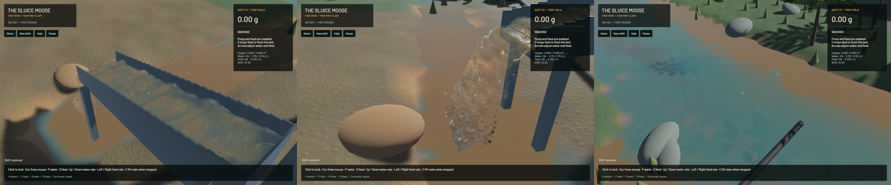

The conservative phase-response foundation passes independent CPU equations and actual GPU transfer/pressure/gather controls. **It is not active in the playable `GpuFlip3D` or worker.** Ordinary phase-budget errors remain. The [model and runtime prerequisites](../physics/phase-response.md) explain what is implemented and what must happen before activation. The complete operation, physical coupling, packing and calibration issues stay open.

Thirteen zero-gravity GPU controls isolate three problems in the current solver. With pure FLIP and pressure disabled, transfer residual is approximately 7e-9 of initial momentum. Pure PIC transfer has a 7.57e-4 residual. Water pressure contributes 1.62e-2. Mixed grain drag without pressure adds 7.9148 relative-mass m/s with effectively no water reaction. The explicit 0.97 FLIP/PIC full mixed case has a 10.57% residual at 120 Hz and 7.01% at 240 Hz. These are measured failures, not accepted physical tolerances. Earlier historical percentages may use a different blend.

The new local equations use full-gravity predictors and pressure-derived buoyancy, equal/opposite drag and a matching variable-mobility pressure operator. The f64 reference is checked against an independently assembled dense solve, backward-Euler energy identity, pressure impulse, subdivision, stiff coupling, freefall and hydrostatic settling. This is our algebraic elimination, not a claim that published validation results apply to this APIC implementation.

The GPU harness executes the new moments, phase response, optional real pressure solve and matching production G2P. Its eight valid cases cover drag, exact/reserved capacity, reversed input, stiff drag, pressure, freefall and affine rotation. Full grid/auxiliary/coefficient/particle-velocity/affine output is exactly equal across capacity and particle order. At relative mass 115.8, maximum linear-momentum residual is about 5.13e-7 and angular residual 3.20e-7. Drag reduces generalized APIC energy; rotation retains it within float rounding. Three invalid-input controls report a status and leave every particle velocity and affine row untouched. This is not yet joined worker refusal or guarded advection.

All three production pressure dispatch variants pass open/closed manufactured variable-coefficient solutions, including a GPU-ready-header switch within one submission. The 800-sweep verification uses bounded 80-sweep submissions in the separate-pass reference path. Three early diagnostic runs timed out because too many unsubmitted Metal command buffers exhausted its pool; a stack sample identified that wait. Production remains at its existing sweeps. No crash report appeared.

**63 distinct CPU/unit/integration checks and seven explicitly executed GPU tests pass.** GPU coverage also includes the original excavation/pump/720-step/live-restore pipeline, storage growth/large live continuation and constant-flow APIC transfer. Other ignored suites remain unrun. Strict focused all-target Clippy and formatting pass. Game-library Clippy completes with 100 existing diagnostics and no primary span in changed code. Workspace Format/Test game debt remains separate; this is not a full-workspace CI pass. All thirteen ordinary-solver JSON budget receipts match the pre-change baseline exactly after shader specialization.

The signed final native app retains the crest/mud and branched-tree changes. Nine selected frozen-state fields, including 128 authoritative tracks and 128 render samples, match the preceding build exactly. The [native motion clip](2026-10-23-phase-response.mp4) retains every 45/44/45/45 source frame for sluice/outlet/river/bank, encoded as 976 frames at 60 FPS wall timing. Source capture is 12 Hz. Every recorded presentation interval advances, with zero underruns. Review covers six temporal samples per view and full sluice/river frames, rather than the complete clip or an operator replay.

Raised/pillowy water over some riffles, grain stippling, shoreline geometry and placeholder scene/equipment art remain visible. The numerical foundation does not itself improve those visuals or establish realistic riffle washout.

| Isolated 20-second native measurement | Prior build | Final build |
|---|---:|---:|
| Mean render FPS | 55.60 | 55.66 |
| p95 frame duration | 26.85 ms | 26.44 ms |
| Simulation / wall time | 0.2966× | 0.2965× |
| Real-time target | Failed | Failed |

These short runs show no claimed throughput gain. Final whole-water error is -7.796 mL, sluice water error zero, bulk-material error 0.3071 mL, dry-mass error 0.0005529 kg and gold error 7.28e-12 g. Material gates pass; the real-time benchmark deliberately returns failure because simulation is below 1×.

One initial benchmark accidentally overlapped packaging for about 18 seconds and its timing is discarded. Both jobs had exited before an owned-only stop could act; no process was killed. Accepted measurements, captures, tests, compilation and encoding were serialized. Scoped cleanup leaves zero owned game/browser/test or heavy processes. It leaves 18 shared Playwright MCP and 72 Node processes untouched. Installed Beads rejects `bd sync`; only the two touched records are exported into the tracked issue file. The original dirty checkout and user stash remain preserved. The new runtime, soil/machine contact, construction, shaker, complete circuit, calibration, real-time and full operator stages remain open.

[Machine-readable numerical/native receipts](2026-10-23-phase-response.json) retain the failed baseline alongside the new harness, exact-state controls and capture coverage.
