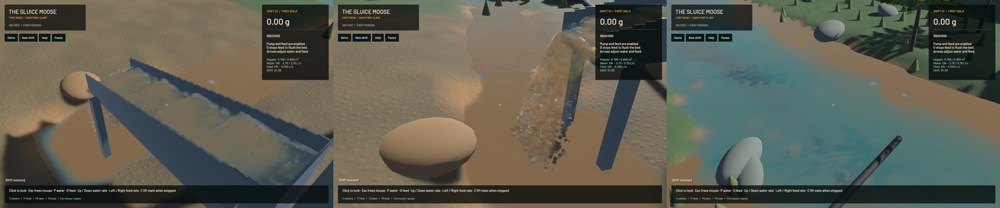

The conservative phase response now runs through the actual FLIP step and hydraulic worker in explicit validation mode. It replaces the former standalone-only integration with represented-volume repair, fresh particle transfer after repair, consistent phase pressure, guarded advection and joined refusal readback. **Ordinary gameplay still uses the existing model.** Volume-constraint angular accuracy, velocity clipping and dense-bed calibration remain open, so this is not default activation or completion of the wash-plant stage.

Run the signed build with `--conservative-phases`; use that flag consistently for validation-save continuation. The flag selects the actual worker, not only diagnostic equations. The terrain-flow solver, DEM contacts, riffle geometry, physical grids, timesteps and pressure sweep counts remain. The new path skips redundant legacy P2G and avoids adding old one-way grain/porosity forces to the explicit phase response. The old hard bed-occupancy threshold is not used in validation mode; permeability/contact convergence still requires independent checks.

Thirteen actual runtime zero-gravity cases repeat the earlier failed budget. Maximum relative linear-momentum residual is `2.536e-7` across the new cases. The 120 Hz full mixed case changes from `0.10568` in the ordinary model to approximately `1.52e-8` in validation mode. Drag transfers equal/opposite impulse within float rounding. These controls disable external forcing and remain below numerical safety limits; they do not establish conservation in every operating flow. All thirteen ordinary-model JSON receipts remain exactly equal to the preceding checkpoint.

Actual represented water plus solid volume is scattered with the quadratic cell kernel; raw home-cell water markers remain separate. Pressure unknowns use occupied water cells so carrier support exists on their faces. The density kernel includes integrated voxel solid support, edges/corners and closed boundaries. Fields are recomputed after position repair. Independent quadrature, surface no-suction, constant-flow transfer and open/closed variable-pressure controls pass.

Failure stays sticky across substeps that intentionally have no readback. The ordinary five-plane range copy carries a 16-byte refusal tail, inspected before CPU outputs are touched. Guarded repair/advection and post-G2P finite validation prevent invalid transient output from reaching DEM or the Session. An injected NaN exposed a faulty output check; integer IEEE exponent inspection fixes it. Actual-worker refusal now pauses once, retains water/soil/gold, keeps the shift reloadable and suppresses further ticks. The fault fixture uses an admissible finite affine field; an earlier deliberately oversized velocity correctly failed existing save admission and was replaced in the test, without weakening admission rules.

**63 distinct CPU/unit/integration checks and 17 explicitly executed real-GPU tests pass.** Coverage includes actual 120/240 Hz full-step budgets, freefall across densities/drag stiffness, represented volume, finite-output refusal, real worker custody, both complete excavation/pump/720-step/restore pipelines, both-model allocation/warm-pressure controls, exact large live-save continuation, contact projection, pressure variants and signed accumulators. Only unordered contact-map export arrays are sorted in full-state comparisons. The affected transport/worker/storage tests were repeated after grouping readback arguments. Other ignored GPU suites remain unrun. Strict focused all-target Clippy, maintained/changed-region formatting and signed packaging pass; game-library lint has 98 existing diagnostics and no primary span on changed code. Repository-wide Format/Test game debt remains separate.

The runtime probe also exposes a failed angular gate: position-only volume repair gives APIC angular residual about `6.57e-6`, versus about `2e-7` without repair. Halving timestep does not reduce the repair residual. `sluice-volume-constraint` tracks a consistent remedy; a global angular subtraction is not used.

| Same starting shift, 20-second native window | Ordinary model | Coupled validation |
|---|---:|---:|
| Mean render FPS | 55.77 | 53.81 |
| p95 frame time | 26.71 ms | 27.91 ms |
| Simulation / wall time | 0.2997× | 0.2566× |
| Ending water particles | 116,963 | 131,524 |
| Ending grain parcels | 4,642 | 5,261 |
| Real-time target | Failed | Failed |

Both runs remain active and fault-free and pass the material budgets. Different physical trajectories change the workloads, so this is not an isolated algorithm-speed comparison or a throughput improvement claim. The coupled run's whole-water error is about -7.796 mL and its sluice-water error is zero. The [JSON receipts](2026-10-23-phase-runtime.json) retain all material errors, clocks, inputs, source/binary fingerprints and failed real-time results.

Endpoint speed diagnostics find 153 coupled particles within 0.1% of the 1.08 m/s CFL limit, versus 232 in the ordinary model. These are endpoint counts, not actual clipping-event counters or removed impulse measurements. `sluice-fluid-cfl` requires that measurement and a consistent remedy before treating the complete operating flow as conservative. Settled-bed pressure/contact hydrostatics, voidage-dependent drag, partial wetting, packing, mesh/parcel/time convergence and independent recovery remain required.

[Native motion](2026-10-23-phase-runtime.mp4) starts from the warmed coupled benchmark save and retains every 43/45/45/44 sluice/outlet/river/bank source frame. It encodes 974 frames at 60 FPS wall timing; source capture is 12 Hz, not a 60 Hz physics claim. Every recorded presentation interval advances, with zero recording underruns and first-display delay below 16.11 ms. Review covers six temporal samples per view and full sluice/outlet/river frames, rather than the entire clip or a manual operator replay. Broad raised sheets, grain stippling, coarse outlet grains, shoreline and placeholder art remain visible. Numerical integration is not a claim that the rendering now looks realistic.

All heavy jobs were serialized for this checkpoint. No personal browser was used. Final scoped cleanup and push are recorded with the handoff; the dirty original checkout and user stash remain preserved. The full soil/machine, constructed pad/pond, wash-plant, water-circuit, graphics, calibration and real-time objective stays open.
