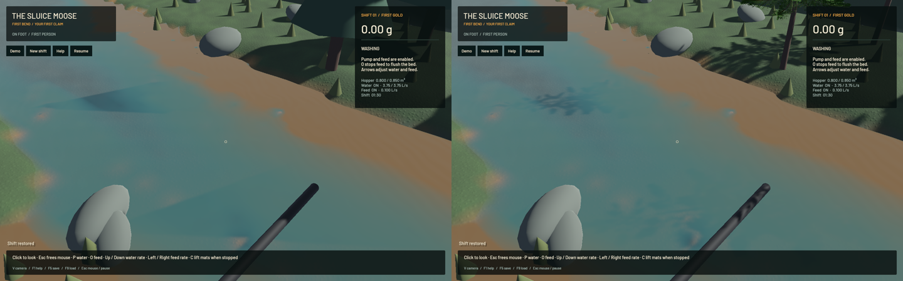
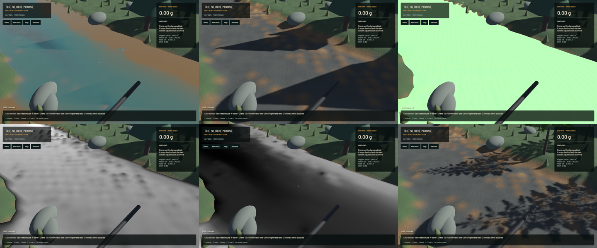
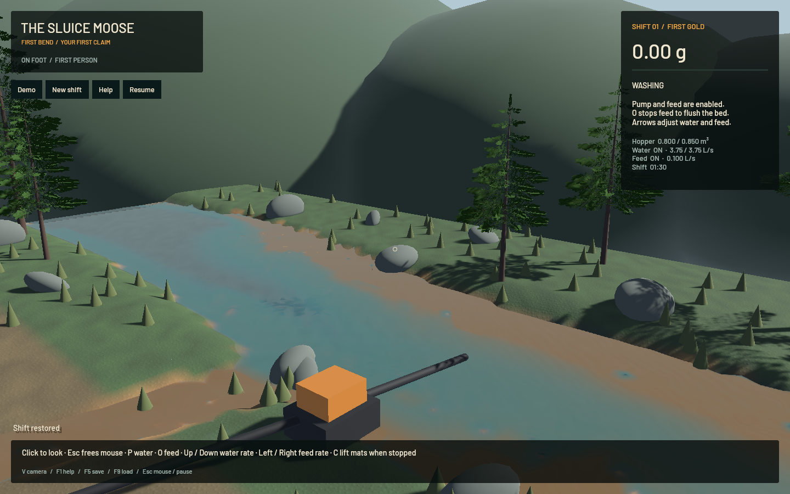
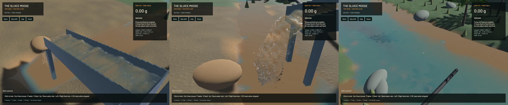

The large triangular river patches came from the opaque shadows of the placeholder cone trees. Matched frozen diagnostic views identify that source; branched conifer foliage now produces broken shadows over the bank and riverbed. The water solver, shading parameters and shadow light settings retain their existing behavior.

The diagnostic build uses `7fd28a5` plus capture instrumentation. Reading the montage left to right, top to bottom: original final colour, opaque scene before water, water normals, visible optical column, sediment extinction, and the updated opaque scene. The triangles are present in the original opaque scene and absent from the normal/column/extinction fields. The updated scene retains cast shadows with a branched silhouette. All five diagnostic channels match selected simulation clocks, steps, particle tracks, render kernels, flow, machine, excavation and deliveries exactly. The same selected fields also match across the old and new canopy builds.

Capture-only `--capture-water-debug scene|normal|column|sediment` selects the corresponding view when used with `--capture-motion`. Column white represents a 0.5 m path; sediment white represents extinction 1200 per metre. Normals are displayed as `normal*0.5+0.5`. These are diagnostic colours, not water-material changes. Frozen evidence omits the obstructing pause overlay while retaining the actual paused simulation. Ordinary pause UI is unchanged. A `bank` camera shows full canopy silhouettes.

The conifers use eight deterministic shared branch meshes, a shared 512×256 cutout texture and eight coverage-preserving mips. Each canopy has fewer than 1024 triangles; the existing placement loop admits at most 75 canopy instances. Texture data totals 699,040 bytes, not a total GPU-memory bound. The material uses the same alpha mask for scene/depth/shadow rendering. Two-sided lighting, clamped texture edges, curved crossed branch cards and tapered trunks replace the solid tiered cones. Shadows remain enabled. These are static environment assets; no tree-root, collision, wind or soil-mechanics claim is made.

**43 app CPU checks and seven explicitly executed real-GPU optics checks pass**, plus strict focused all-target Clippy, maintained-package formatting, whitespace, signed packaging and native Metal rendering. New controls bound canopy extent/cost and retain masked coverage through all texture mips. Existing thin-sheet, spray, optical-volume, opaque clipping and input checks still pass. One CPU profiling test remains ignored. All 185 checked simulation/physics source files match the base head. This is not a full-workspace or unrelated GPU-suite pass; legacy formatting/game-test debt remains open.

| Same accumulated-bed input; separate 20-second native windows after warm-up | Before | Final |
|---|---:|---:|
| Mean render FPS | 55.69 | 55.66 |
| p95 frame time | 27.36 ms | 26.58 ms |
| Simulation / wall speed | 0.295× | 0.302× |

These evolving short windows establish no speed gain. The combined real-time gate still fails. Numerical gates pass: zero sluice-water residual, -7.79 mL whole-water residual, 0.309 mL reference-bulk residual, 0.000557 kg dry-mass residual and -9.1e-13 g gold residual.

[Native motion](2026-10-23-river-shadows.mp4) retains every 45/44/44/45 source capture for sluice/outlet/river/bank in 60 FPS wall timing. The source capture request is 12 Hz; this encoding is not a 60 Hz physics claim. Every recorded presentation interval advances, with zero recording underruns and first-display delay below 16.27 ms. Review covers six temporal samples per view plus full frozen diagnostic and updated river/bank frames, rather than the entire video or an operator replay. Coastline cells, coarse grass/rock/backdrop art, grain stippling, simplified water illumination and real-time physics remain open.

The broader staged objective remains active. The next physical prerequisite is the closed water/grain momentum budget in `sluice-phase-coupling`, followed by porosity/packing and recovery calibration; this asset correction does not validate those models or complete the full operating loop. Heavy verification is serialized. Scoped cleanup, crash diagnostics and preservation of the original checkout/stash are recorded in the [receipt](2026-10-23-river-shadows.json) before landing.

Scoped cleanup leaves zero owned game/test/browser or heavy jobs. Twenty shared Playwright MCP and 80 Node processes remain untouched. No new panic-full or WindowServer report appeared. The original dirty checkout and user stash remain preserved. Installed Beads rejects `bd sync`; only the three touched project issues are exported into the tracked issue file.
