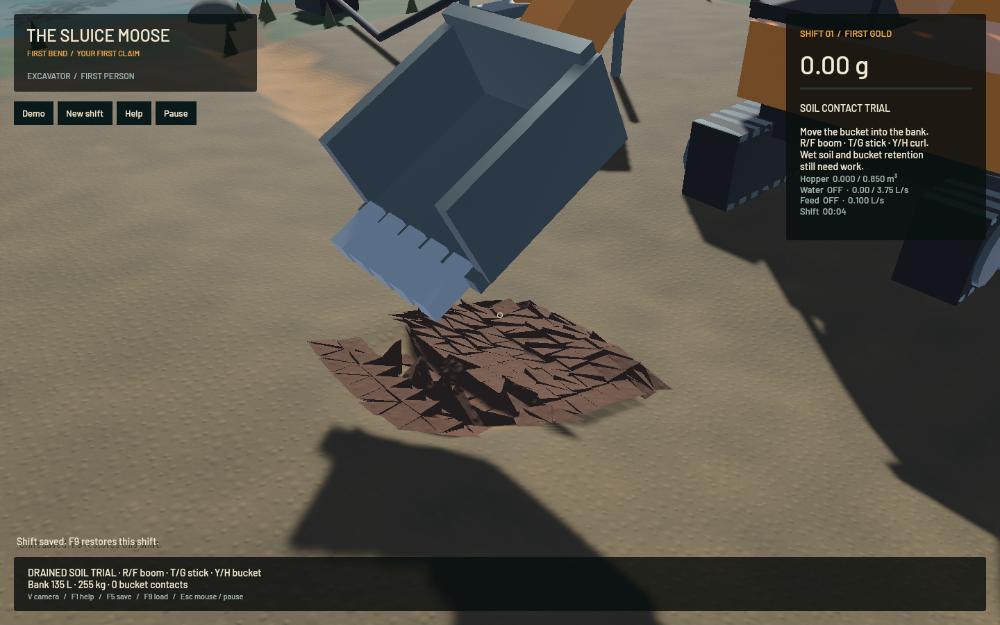
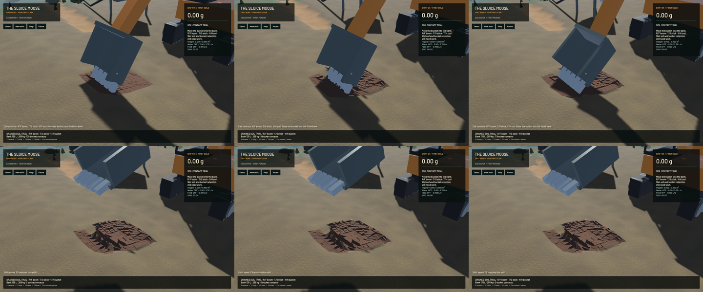

The five-second, 304-clod digging replay now needs **19.0% less CPU time**, with byte-identical complete saved snapshots. Exact shortcuts skip the Coulomb root solve for zero-radius SIMD batches and mixed frictionless/sticking batches. A positive-radius sliding lane retains the original 24 bisections and feasible-side result. The caller still applies the full impulse delta, so an old friction impulse is removed when its allowance reaches zero.

| Fixed five simulated seconds, three serial runs per epoch | Median CPU wall time |
|---|---:|
| Preserved baseline, before | 18.413 s |
| Candidate | 14.912 s |
| Same baseline executable, repeated after | 18.414 s |

The before/candidate/after ordering checks timing drift. Six baseline runs and three candidate runs use the identical actuator sequence. Ten complete saves, sampled every 30 of 300 domain steps, match across the baseline, candidate and repeated baseline: **19,402,407 bytes**, including all 304 clods. This verifies those ten complete boundaries, not every unsampled tick. Twenty-four ordinary and articulated-without-soil snapshots also remain byte-identical to the preserved pre-soil reference. The fingerprinted baseline executable is retained independently of Cargo libraries that later builds overwrite. The replay source and raw evidence are retained in the [receipt's artifact directory](2026-10-23-soil-friction.json).

The default-false ordinary friction path is unchanged. Mechanical cadence remains 240 Hz with four TGS stages and sixteen PGS iterations; no body, contact, water/riffle/terrain resolution or accuracy limit is reduced. No contact history, new hidden state, dependency or save format is added. Version 9 still represents active soil. All **719 other tracked source files** match `7260c68`; only the contact helper/tests and upstream provenance metadata differ among tracked sources. The published original-file hashes remain intact.

**208 maintained CPU/application checks, 85 contact-engine library checks and five explicitly executed real-GPU pipeline checks pass.** The new production-width SIMD control covers 512 batches of frictionless, sticking and sliding lanes, including nonzero old impulses. Nonzero outputs retain their bit patterns against the previous implementation; zero results compare exactly numerically. Independent energy, slip direction, inclined-block, impact/momentum and physical-step refinement checks remain in place. Actual-GPU checks exercise the original FLIP/APIC, DEM, terrain pipeline and live restoration, including moving soil on dry ground. Maintained strict all-target Clippy, maintained formatting, authored-fragment formatting, whitespace and signed packaging pass. Of 93 ordinarily ignored checks, five ran explicitly and 88 did not; full workspace CI is not claimed.

| Separate native 20-second windows | Render FPS | p95 frame | Simulation / wall | Real-time gate |
|---|---:|---:|---:|---|
| Prepared bank, baseline | 55.69 | 20.63 ms | 0.1900× | Failed |
| Prepared bank, candidate | 55.84 | 20.87 ms | 0.2348× | Failed |
| Candidate, ordinary loaded water | 55.80 | 26.69 ms | 0.3197× | Failed |

The bank windows evolve to different physical endpoints because their rates differ; the fixed-work replay is the stronger timing control. The moving-bank capture has a different contact workload and advances 0.3268×; that difference is not attributed to screenshot overhead. Both native material gates pass. Final prepared-bank whole-water residual is 0.1176 mL, sluice-water residual is zero and gold residual is -8.19e-12 g. Full budgets remain in the receipt. Matched frozen bank and ordinary-water images are each byte-identical across all 1440×900 RGB pixels, preserving the previous crest repair.

[Native soil motion](2026-10-23-soil-friction.mp4) retains all 218 captures in 1206 encoded frames at 60 FPS wall timing. The source target is 12 Hz; repeated display frames are not additional physics. All 304 rendered bodies remain present and their finite material is constant, with up to 111 sampled tool contacts. A native F5 save restores all 304 clods: each of eight frozen frames checks 9,504 f32 bit patterns and 5,503 other canonical values. These are eight frames after one restore, not eight independent restores. Eighteen native synthetic keyboard/mouse/toolbar checks pass. Review covers six temporal samples, one full-resolution midpoint and matched frozen images; the full encoded video and manual OS input were not reviewed.

The images still show coarse triangular chips and an empty bucket after lifting. Actual shell/sidewall/tooth colliders and retention/spill remain the next digging-mechanics phase; the rendered bucket is still backed by its floor-only contact proxy. World rebuilding, smoother worker-packet presentation, continuous activation, cohesive/wet mud, calibration, pads, shaker decks and constructed settling remain open under the full operation plan. The runtime objective remains in progress.

All heavy jobs ran sequentially with one compiler/encoder job. Required scoped cleanup leaves no owned native/encoder/browser/test process; 14 shared Playwright MCP and 56 Node processes remain untouched. No new panic-full or WindowServer report appeared. The original dirty checkout and user stash are preserved. Installed Beads rejects `bd sync`; only the three changed project records are merged from explicit export. The [numeric receipt](2026-10-23-soil-friction.json) includes source, binary, replay, native-budget and media fingerprints.
