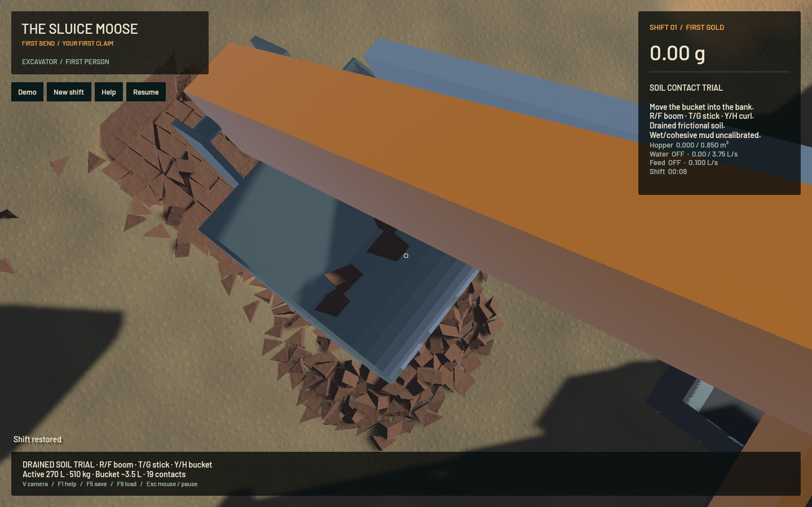
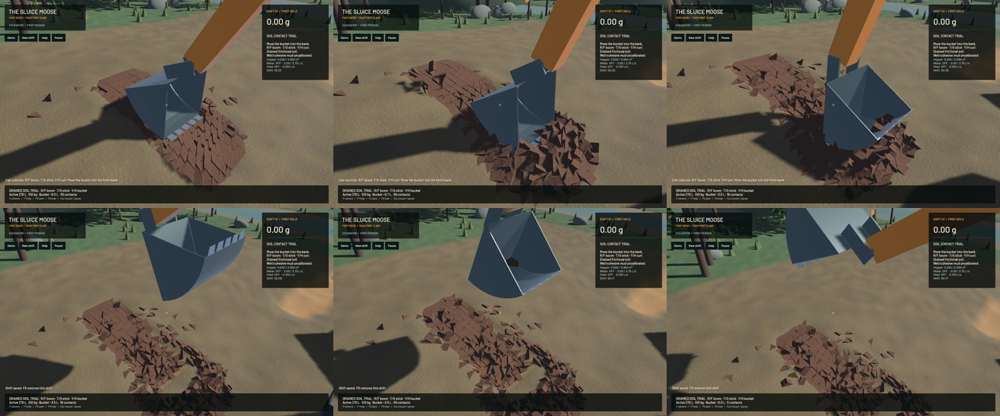

Small-clod free rotation now uses a coupled exponential midpoint update between contact impulses. The reproduced 200 rad/s principal-spin lag drops from **20.589 degrees to 0.000286 degrees** over 0.5 seconds, without the old speed clamp or loss of checked principal-spin energy. Asymmetric-body phase, energy and angular-momentum vector controls now refine against an independent f64 reference. The [rotation model](../physics/soil-rotation.md) records equations, numerical work limits and the measured range.

This is a rotational-accuracy checkpoint. **The matched bulk-yield gate still fails**, and the realistic operation remains incomplete.

A quaternion exponential alone corrected principal phase but left the old first-order gyroscopic drift. The final method takes actual post-contact momentum, solves a midpoint orientation in temporary double precision, and reconstructs endpoint angular velocity consistently. Internal angular accuracy scales with the mechanical timestep; a fixed angular cap had masked physical-step refinement by reducing the inner stage count. Zero spin preserves exact input poses. Canonical engine state remains f32, with no additional saved dynamic history.

The independent reference uses quaternion RK4 at constant world angular momentum and the full geometry tensor. It is separately refined. Ordinary 31.016 rad/s and fast 186.097 rad/s asymmetric controls retain their predeclared absolute phase/invariant gates. At 240/480/960 Hz, fast-case phase errors are 0.001424/0.000357/0.000106 rad. Default-rate relative energy and angular-momentum-vector errors are below 6.2e-7. The 120 Hz ordinary case also remains checked. This is measured accuracy, not an unconditional-stability or universal energy-exactness claim.

Only the opted-in fast, unlocked clod path changes. The old first-order gyro increment is skipped there so it is not applied twice. Contact impulses remain in the actual velocity before free rotation. Ordinary capped bodies retain their established arithmetic. All **738 other tracked Rust/shader/config build sources** match `e821b07`. Water, riffles, terrain flow, contact iterations, bank geometry, material stock and joystick policy are unchanged.

**231 maintained CPU checks and five explicitly executed real-GPU pipeline checks pass**, plus strict scoped all-target Clippy, maintained/vendor formatting and signed packaging. Checks include free impacts, mouth entry, retention/discharge, whole-cycle ground escape, delayed inputs, warm/cold restore, zero-spin exact pose and the independent rotation references. Genuine versions 7/8/9/10 produce byte-identical complete saved snapshots against the preserved old executable over 120 controlled steps. Other ignored suites and full-workspace CI are not claimed.

| Same 270 L bank, 560 clods, 60 Hz feedback controller | 240 Hz mechanics | 480 Hz mechanics |
|---|---:|---:|
| Approximate minimum held at 9–10 s | 3.398438 L | 2.109375 L |
| Contents at 18 s | 0 L | 0 L |
| Highest-vertex minimum above actual triangle substrate | 31.257 mm | 35.058 mm |
| Maximum sampled |omega| times mechanical timestep | 0.3836 rad | 0.1264 rad |
| CPU wall time | 86.91 s | 159.31 s |

All source constituents and all 560 bodies remain exact; initial/final whole-system material/water/gold budgets agree in both runs. Neither sampled step-angle proxy exceeds 90 degrees, but sampling is only at logical endpoints and does not prove within-step CCD convergence. Both profiles scoop and empty; their held estimates differ by **46.81%**, failing the predeclared 10% comparison gate. Contents classify centroids, so partly protruding clods and coarse parcel size also limit this measurement. Soil-resolution refinement, geometry-clipped contents, calibration and broader contact-time controls remain required.

The coupled tool trajectory also changes: final boom differs by about 8.22 degrees and curl by 25.99 degrees; final actuator references differ correspondingly. An identical feedback policy is not an identical command tape. This result does not isolate a soil-only cause. An initial-geometry probe finds no bucket/clod contacts before time zero and a 15.138 mm physical-triangle clearance versus 15.000 mm from the bilinear sampler, so a large initial shell penetration is not reproduced. Next work should separate recorded-input/tool-path convergence from contact/soil refinement before tuning soil parameters to the held-volume number.

The [wall-timed native replay](2026-10-23-soil-rotation.mp4) reaches 18.0167 simulated seconds in 80.317 wall seconds including capture overhead, with 308 source frames. It holds about 3.515625 L at 9–10 seconds and fully empties. All 560 clods/material remain accounted, scalar bucket custody stays empty, and no body wholly escapes below the actual triangular substrate by 25 mm. This escape check does not bound every contact penetration. Native bulk/dry-mass residuals are +0.05159 mL/+0.09286 g; water residual is +0.06823 mL and gold residual is +6.82e-12 g. The differing asynchronous input history is not a matched comparison with the CPU fixture.

Frozen restore checks all 560 clods, 17,440 f32 values and 10,112 other canonical values per frame across 8 frames. Eighteen synthetic native Bevy input/save checks pass; they do not exercise OS focus or prove a manual playthrough. An intentionally incomplete endpoint capture fails as required. The ordinary sluice frozen image is pixel-identical to the committed renderer. The [receipt](2026-10-23-soil-rotation.json) contains the full source, input/evidence and binary hashes. Review covers six temporal samples, full held/discharge images and the restored close-up; whole-video viewing is not claimed.

| Separate 20-second native windows | Water demo | Dry-bank idle |
|---|---:|---:|
| Render FPS | 55.63 | 55.88 |
| p95 frame | 25.94 ms | 19.79 ms |
| Simulation / wall | 0.3066x | 0.1533x |
| Physical real-time gate | Failed | Failed |

Material-budget gates pass. These windows establish no speedup, and neither view runs physics in real time. Work ran sequentially with one compiler/native/encoder job at a time. Required cleanup leaves zero owned jobs; 14 pre-existing Playwright MCP and 56 Node processes remain untouched; no new panic-full or WindowServer report appeared. The original dirty checkout and user stash remain intact. Installed Beads rejects `bd sync`; only touched project rows are merged from its export before the scoped commit/push.

Bulk convergence, wet/cohesive soil, continuous activation, compaction, calibrated hydraulics, pads, shaker decks, sluice buildup, constructed settling pools, real-time throughput and the full operator loop remain open in [Stages 2–6](../../plans/2026-10-22-realistic-operation.md).
