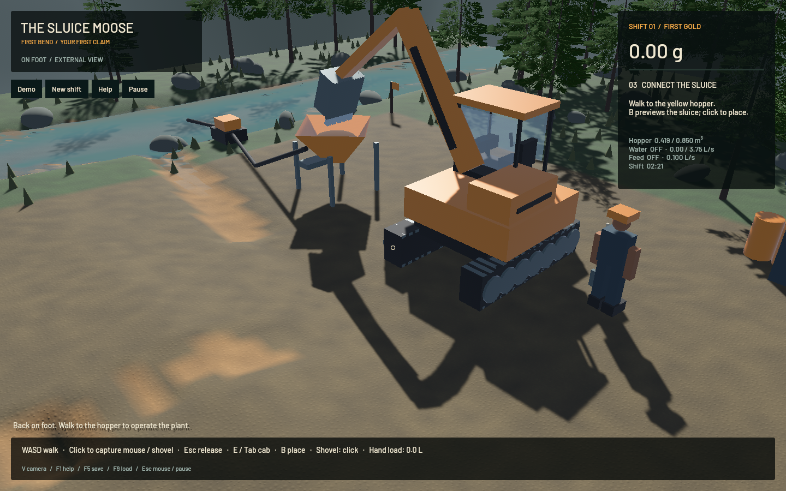
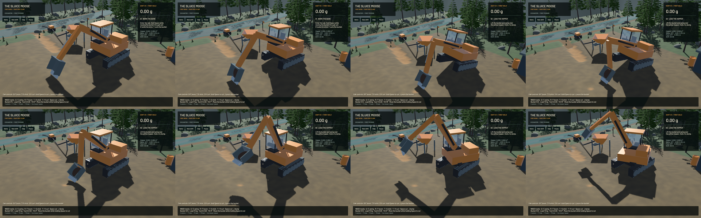

The excavator now uses gravity and oriented track contacts for support, traction and tipping. The actual wet bucket load contributes mass and inertia. Chassis tilt now reaches the arm, finite cutting geometry, visible equipment and cab camera. The [model contract](../physics/machine-contact.md) separates manufacturer reference dimensions from assumed mass splits/friction, ideal belt motors, held links and unresolved deformable-soil/hydraulic physics. The [crest and muddy-column correction](2026-10-23-crest-patches.md) remains in this build; original water/riffle/DEM and terrain-flow equations and shaders are unchanged by this machine stage.

**159 maintained CPU/application checks pass, with 88 ignored in the ordinary run.** Two explicitly executed real-GPU pipeline checks pass on the M2 Max, including ordinary and conservative-validation modes, excavation, pumping and live restore. The remaining ignored checks are not claimed as executed. Thirteen new track/geometry controls cover airborne gravity, rotating free-body COM, equilibrium with wet payload, Coulomb traction, frictionless refusal, two oriented slope directions, support-loss tipping, actual track-corner collision against a 10 mm wall at 12 m/s, outer-step batch invariance, physical-step refinement, moving save continuation, unoccupied dynamics and rigid bucket-frame rotation. Strict maintained all-target Clippy with `--no-deps`, maintained formatting, whitespace and signed packaging pass. Legacy game/sim3d CI/lint debt is not part of a blanket green-workspace claim.

The 120/240/480 Hz ballistic position errors are 2.044/1.021/0.512 mm. Changing 240 to 480 Hz moves the driven endpoint by 2.32 mm after two seconds. Outer 30/60/120 Hz batches with the same 240 Hz mechanical clock produce identical driven states; this is batch invariance, not soil-geometry convergence. Flat empty/loaded reactions are 85,249.45/89,562.12 N for 8,690/9,130 kg, within the unchanged one-percent equilibrium bound. Macro cut volumes are identical at 24.676 L with coordinated boom/crowd/curl controls.

Tests exposed actual defects before accepting this checkpoint: internal heightfield seams acted as bumps; increasing TGS time stages failed steering convergence until internal constraint iterations were corrected; contact clustering required reading solver manifolds for real reaction feedback. The independent bucket-frame control failed on a 5.7 cm heel error because one point calculation retained world-up. It now passes a 5 micrometre rigid-rotation bound. Failed/timeout logs are retained in the artifact directory. Cold dependency compilation exceeded two bounded runs before cached final runs completed; those interrupted runs are not passes.

Fixture changes are explicit: the force/capacity cut now uses a four-second coordinated boom/crowd/curl stroke, replacing the old 2.5-second lowering-only fixture. All original volume, force, power, bedrock and material/gold/water bounds remain. A supported mobile bucket may lift the body, so the bedrock case accepts either actuator refusal or actual measured bucket support while retaining its geometric bounds. The worker checks mouse turn relative to the resulting cab heading, at the same 1e-6 tolerance. The operation test uses real scoop controls to strip overburden before reaching a gold-bearing load. No material is injected to make these tests pass.

The first full native run failed at 0.356 m³ because its fixed four-load script stopped early. Excavated material matched the hopper; it was not an unexplained inventory loss. Aligning the bucket frame also showed that fixed transport angles can miss a hopper beyond reach. The final replay lifts the closed load, drives back to its receiving pad, aims the actual dump mouth with ordinary joint inputs, and returns to the advancing face. It targets the unchanged 0.4 m³ delivery gate with a finite twelve-load guard. Hopper catch geometry and physics tolerances are unchanged.

The final native replay excavates and delivers **0.418540 m³**, leaving an empty bucket and no falling load, then exits the cab. The hopper holds 2.205269 g, still unprocessed. Live save/load during a cut is verified. Whole-claim solid, water and gold residuals are 3.99e-10 m³, 2.24e-07 m³ and 1.82e-12 g. The final save uses version 6; versions 2–5 retain their inventory and migrate absent dynamics to an upright stationary body. Earlier binaries reject the new format. Every native run uses a task-scoped save path, preserving the user's ordinary save.

| Native workload | Mean render FPS | Simulation / wall time | Gate |
|---|---:|---:|---|
| Actual digging/driving/delivery, GPU terrain running, sluice idle | 56.85 | 0.9998× | Delivery, budgets and live restore pass |
| Previous 848bc0b app, ordinary flowing saved sluice, 20 s window | 56.61 | 0.3333× | Real-time failed; budgets pass |
| Final app, same ordinary flowing input, separate 20 s window | 56.71 | 0.3280× | Real-time failed; budgets pass |

These short evolving windows do not establish a speed improvement. Final sluice-water residual is zero; whole-water residual is -7.830 mL and gold residual is -9.09e-13 g. Both bulk/dry-mass gates and water render readiness pass. Flowing-water real time remains open. The separate native input exercise passes all 18 synthetic Bevy keyboard/mouse/toolbar checks, including live flowing-demo restore. It does not exercise OS key delivery or constitute a manual playtest.

[Native machine motion](2026-10-23-track-contact.mp4) retains all 135 source frames in 725 encoded frames at 60 FPS wall timing. Capture targets 12 Hz; duplicated display frames are not additional physics steps. All 134 recorded domain intervals advance. Review includes the eight shown samples, the full midpoint frame and full initial/delivery/final native stills. The full video and manual driving were not reviewed. The excerpt spans 1.617–12.500 physical seconds, first loading and lifting to swing; it intentionally ends before the independent complete replay. The body visibly jacks during cutting, reaching 19.02° in this excerpt. This demonstrates a remaining rigid-soil limit, not calibrated excavator behaviour; `sluice-bucket-soil-contact` tracks consistent cutting resistance, geometry and body reaction budgets.

This is finite rigid-contact progress. Rigid 25 cm ground, held prescribed links, uncalibrated friction/mass distribution and ideal belt motors leave soil failure, sinkage, compaction, wet traction, articulated recoil, engine/hydraulic power closure and calibration open. These checks do not establish construction, washing/recovery, a complete water circuit or the complete game. Stages 2–6 and the full realistic-operation goal remain active. The full [receipt](2026-10-23-track-contact.json) pins source files, binaries, controls, budgets and media.

All heavy work was sequential, with one compiler/encoder job and one native app at a time. Native exits drained the final render on the main thread. Scoped cleanup reports zero agent-browser, Playwright tests, Chrome-for-Testing or owned native/encoder jobs; 16 shared Playwright MCP and 64 Node processes remain. No new panic-full or WindowServer report appeared. Original dirty checkout paths and the user stash are preserved. Installed Beads lacks `bd sync`; only this task's three issue records are exported into the tracked file, preserving other raw rows.
