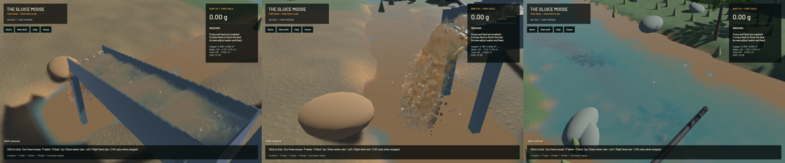
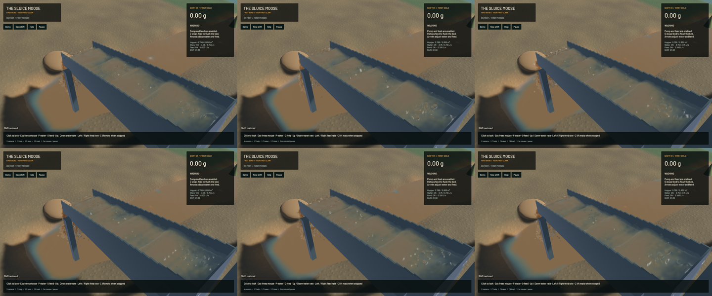

The opt-in sluice solver now carries represented-volume correction through its pressure impulse and blends the complete APIC velocity/affine state. This removes the measured position-remap angular error and force-free energy growth. Physical micrograin inertia is corrected in both solver modes. **The gravity-at-rest gate still fails, so conservative phases remain opt-in and the full accuracy goal stays open.**

The volume target uses the reference-state linearization `r_new = r - dt*R*div(q)` and source `alpha*(r-R)/(R*dt)`. It retains the former 80+40 total sweeps, suppresses underfilled free-surface suction, and refuses invalid source parameters. Blocked cell-kernel weights remain in an admissible home cell; exposed positive-SDF subcell points lump their blocked mass into their available stencil. Actual negative-SDF support still refuses. This is a conservative support approximation, not a complete fractional cut-cell or partial-wetting model. Closed domain bounds use the real faces rather than compressing water into a 1.1-cell inset. See [equations and limits](../physics/phase-response.md).

Force-free smooth flow exposed a separate blend error: 97 percent FLIP point velocity with a fully PIC affine field produced about 1.45 percent extra kinetic energy per step. The corrected affine FLIP increment uses the same old grid, kernel and force limiter as point velocity. At blend ratios 0, 0.5, 0.97 and 1, energy ratios are 0.978036, 0.983898, 0.998745 and 1.000000043; generalized angular residuals stay below 1.6e-7 in that control. Complete-state transfer is informed by the [APIC analysis](https://arxiv.org/abs/1603.06188); these measurements validate the stated probes, not full operating-flow energy conservation.

| Actual-runtime control | Result |
|---|---|
| Volume-enabled angular residual at 120 / 240 Hz | 2.08e-7 / 1.20e-7, versus the former 6.57e-6 position-remap error |
| Full-step relative linear residual | Below 4.3e-8 in the four repair/timestep cases |
| Zero-gravity rest, 18 geometry/mesh/quadrature/timestep cases | Max speed 1.47e-6 m/s, drift 2.24e-8 m, kinetic energy 2.64e-13 J |
| Manufactured volume source | 108 ordinary and 8 invalid/refusal cases pass |
| Boundary volume custody | Closed/open masks, voxel corners, positive-SDF subcell support, reversed order and reserved capacity pass |
| Both 720-fluid-step excavation/pump pipelines | Pass, including live save parse and material budgets |
| Large live shift and storage growth | Exact canonical saved-state continuation in both modes |

The initial live-restore candidate failed: scratch pressure became hidden state after removing the separate position solve. Clearing it for volume-constrained steps, as the former volume solve did, restores exact continuation. Pressure-only storage controls retain and exercise their warm state. The assertion was not relaxed.

The actual mixed pipeline also reproduced two boundary defects. First, a gold grain was in a solid voxel while its interpolated point SDF was positive; shared collision/admission sampling and conservative subcell support resolve that disagreement. Second, pair projection pushed a small grain through the floor after its SDF pass. Validation mode now completes static nonpenetration after pairs and at restoration using the actual trilinear gradient, a bounded trust region and backtracking. It does not integrate another timestep or repeat restitution. Residual penetration above one percent of radius refuses with material retained. Analytic non-unit-gradient, pair-pushed-grain, idempotence, nonfinite geometry and contact-energy controls pass. Monolithic pair/bed convergence remains open.

The old rigid-body inertia floor of 1e-6 kg m² dominated physical gold-grain inertia near 1e-17 kg m². Both modes now sum sphere intrinsic and parallel-axis terms in double precision, normalize before inversion, and retain the physical mobility. Analytic sphere radius/density, compound tensor, size/mass scaling and zero-mass controls pass. This intentionally changes grain trajectories in ordinary gameplay; its phase equations and terrain-flow solver retain their existing models.

**The independent gravity probe fails.** A stationary 0.12 m square column, 0.08 m water, open top and closed other faces develops 0.26–0.32 m/s currents and 14–17 mm drift over 0.1 physical seconds. All ten source on/off, mesh, quadrature, timestep and 120/480-sweep cases fail the unchanged gate of 1 mm/s maximum speed and 0.02 cell drift. More sweeps do not cure it. A compatible gravity/face-mass/pressure boundary discretization is the next diagnostic hypothesis, not a confirmed cause. Reproduce with `cargo +nightly run -p mining-physics --example volume_hydrostatic --profile playable --locked --jobs 1 -- NEW_OUTPUT.json`. `sluice-hydrostatic-boundary` and parent `sluice-volume-constraint` retain this gate.

There are **265 executed CPU/application checks and 19 explicitly executed GPU test functions** for this stage, including the independent phase oracle. The ordinary suite also reports 81 ignored tests; only the separately listed GPU controls are counted as run. Strict all-target Clippy for mining/mining-sim/mining-physics, maintained-package formatting, changed-region whitespace and signed packaging pass. Legacy game/sim3d lint reports 108 existing diagnostics with no changed-primary-span warnings; that is not a clean workspace-wide lint claim. Failed candidate receipts are preserved alongside final results.

| Same saved input, separate 20-second native windows | Ordinary mode | Conservative validation |
|---|---:|---:|
| Mean render FPS | 55.27 | 55.24 |
| p95 frame time | 26.77 ms | 27.65 ms |
| Simulation / wall time | 0.3167× | 0.2665× |
| Final water particles / grains | 116923 / 4651 | 127381 / 5433 |
| Real-time gate | Failed | Failed |

These evolving windows establish no speed improvement. Both modes retain zero sluice-water residual and pass their material gates. Whole-water residuals are about -7.8 mL; dry-mass residuals are 0.000592 / 0.000497 kg, and gold residuals 9.09e-13 / 9.09e-13 g. Both still reach the existing 1.08 m/s water speed cap, with 158 / 257 particles near that limit; clipping impulses and full operating energy are not validated by the zero-force controls.

[Native motion](2026-10-23-volume-constraint.mp4) retains every 45/45/45/44 source frame across ordinary sluice, conservative sluice, outlet and river, presented in 972 encoded frames at 60 FPS wall timing. Capture is 12 Hz; this is not a 60 Hz simulation claim. Every recorded presentation interval advances, with zero recording underruns and first-display delay below 16.67 ms. Review covers six temporal samples per view and full-resolution conservative sluice/outlet frames, not the entire video or a manual operator replay. Broad riffle humps, raised curls, rounded coarse outlet globules, grain stippling, shoreline edges and placeholder environment remain visible.

[Exact receipts](2026-10-23-volume-constraint.json) pin sixteen changed source files, the signed executable, material/performance results, failed gravity matrix and media. The packaged executable has SHA-256 `4dee1be37e384da6836a0428f1cfba688b7d17ff56195dd81982c83e4552eac2`. Full dynamic pressure-work/volume convergence, clipping impulses, partially saturated and dense-bed laws, riffle recovery calibration, real-time performance and Stages 2–6 remain open.

Heavy jobs were serialized with one compiler/encoder job. Scoped cleanup leaves no owned game, test, browser or heavy process; shared automation processes are left untouched and counted in the receipt. No new panic-full or WindowServer report appeared. The original dirty checkout and user stash remain preserved. Installed Beads does not implement `bd sync`; a scoped export updates only four project records and preserves all other canonical lines. The complete realistic-operation goal remains active.

A test-only CI follow-up after native checkpoint `4f3e7ce` replaces `chunks_exact(4)` with fixed-array iteration in the foliage coverage test for the newer CI Clippy rule. Both existing foliage controls and local strict maintained-crate lint pass. Production rendering/physics and the packaged native captures remain unchanged; the CI rerun is separate from those measured receipts.
