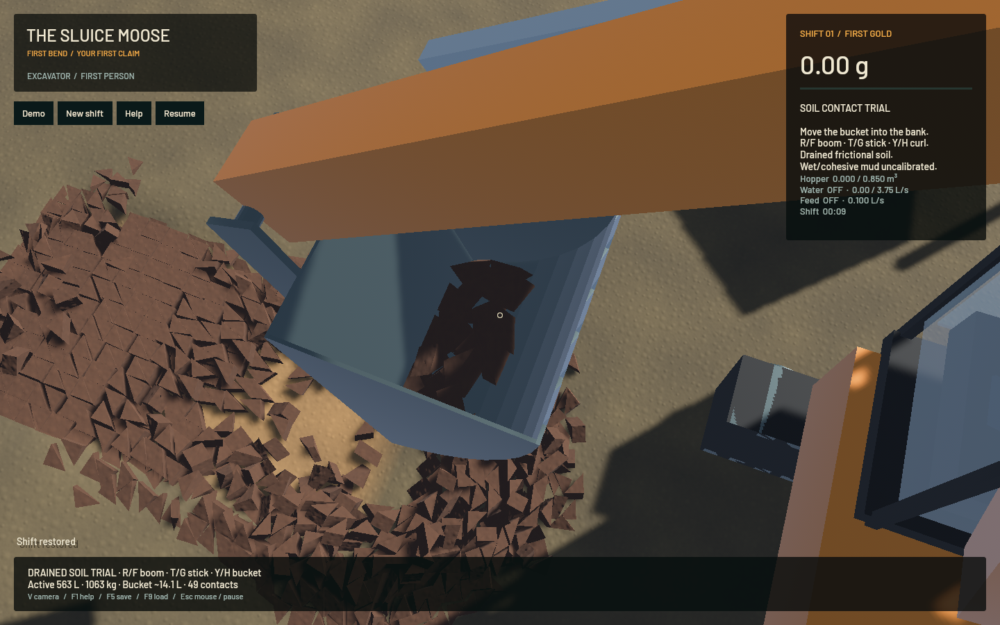
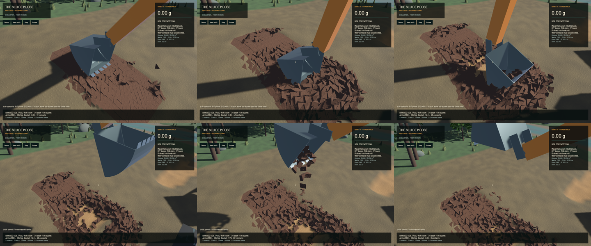

The opt-in physical digging trial now scoops, holds and gravity-dumps independent soil in the native game. Its automatic stroke holds **14.06 litres** airborne and empties completely, preserving all 1,040 moving bodies and their source material. The standalone CPU control holds 4.219 L. These are different feedback/terrain evolutions, not matched productivity or accuracy comparisons. This advances Stage 2; it does not complete calibrated digging or the full operation.

Use [Play Soil Contact Trial.command](../../Play%20Soil%20Contact%20Trial.command) for an interactive fresh bank. E enters the cab; R/F moves boom, T/G stick, Y/H bucket, and V changes view. F5/F9 use a separate `saves/soil-contact-trial.json` slot. The local prebuilt launcher recorded in the receipt starts the verified app without compiling. Neither interactive launcher runs the automatic stroke.

Three physical/operating defects are corrected. MountedShellV2 now lets commanded actuator strain act on the links before the final relief return map; the earlier projection discarded 11.4 kJ before an unloaded 240 Hz mechanism responded. The same one-second free curl changes from a roughly 20% symmetric 240/480 Hz displacement difference to 0.11%, with the existing 30 kW pump bound and final relief intact. Actual rates still differ (-0.440/-0.501/-0.530 rad/s at 240/480/960 Hz), so this does not establish continuous hydraulic or timestep accuracy. Older saved models retain their original ordering.

The prepared bank now activates the complete interpolation support under the requested footprint. The previous selection left only 73.95 mm of the requested 180 mm removed under a steel projection. A projected nodal support halo restores the full depth at three lateral grid phases. All additional stock becomes actual clods before time zero: the default bank changes from 270 L/560 bodies to 562.5 L/1,040 bodies; shifted phases can select 675 L/1,216 bodies. The 25 cm geology, prism subdivision, friction/contact law, 240 Hz cadence and 4 TGS/16 PGS settings remain unchanged. Preparation withdrawal appears in the initial `excavated_m3` counter and is not an operator productivity result.

The guide now measures rake and mouth tilt against gravity and reads the actual collider triangles. It aligns the physical tooth tangent to the 15 degree bank; the old level entry left teeth 30.96 mm above the first shell contact, versus below 1 mm after alignment. Contact begins drawing instead of continually lowering toward the substrate through live clods. A 0.50 rad draw precedes curling; the old 0.15 rad stroke skims an empty bucket. The shallow 0.08 rad attack, 10% force cue and stroke are demo operator choices using ordinary rate-limited joystick axes. They do not prescribe a pose, inject/capture material or calibrate soil strength. Peak native tilt is 4.00 degrees, compared with about 30 degrees in the deadlocked entry.

**238 maintained CPU checks, five explicitly executed real-GPU original-pipeline checks, 18 native input/save checks, strict scoped Clippy/formatting and signed packaging pass.** Three expensive unchanged physical cases are reused from their successful sequential runs; remaining maintained cases, final library and final-camera app checks execute again. Other ignored GPU suites and full-workspace gates are not claimed. Genuine saved versions 7–10 reproduce 24 canonical snapshots byte for byte against the retained old executable. Version 11 schema is unchanged; MountedShellV2 trajectories differ from binaries with the actuator bug.

The initial-overlap check exposed a verification defect: the polygon-clipped contact estimate reports -17.20 micrometres for two hulls with zero true overlap. The test now uses independent double-precision SAT over the actual registered hulls, plus deliberate 20/100 micrometre overlap and separation controls. Its 10 micrometre geometry bound is unchanged. Across 16,486 pairs, worst actual hull overlap is 1.274 micrometres and substrate overlap 0.119 micrometres. Collision behavior and soil geometry were not altered to satisfy the test. The clipped-contact estimate itself remains unresolved under `sluice-contact-distance-20261024`.

The native run reaches 18.02 simulated seconds. The [wall-timed recording](2026-10-24-actuator-relief.mp4) contains 161 source captures covering 17.67 seconds after camera startup; all 160 recorded physical intervals advance. Repeated 30 FPS display frames are not extra physics. The recorder now allows a bounded five wall-minutes for long physical checks; the solver cadence is unchanged. The held save restores every clod's complete geometry, material and dynamic state exactly in four frozen captures per inspection build. The final app differs from the full-cycle build only in its bucket inspection-camera offset; source and binary hashes record both. Review covers six temporal samples, the full held views and the frozen water comparison; whole-video viewing and manual OS input are not claimed. Native source-class inventories remain exact; whole bulk/dry/water/gold residuals are recorded in the [receipt](2026-10-24-actuator-relief.json).

| Separate 20-second native windows | Washing fixture | Idle physical bank |
|---|---:|---:|
| Mean render FPS | 55.68 | 55.86 |
| p95 frame time | 26.14 ms | 19.23 ms |
| Simulation / wall | 0.3214× | 0.0750× |
| Physical real-time gate | Failed | Failed |

Both bulk/dry-material gates pass. No speedup is claimed. The original water/riffle/terrain-flow solvers, physical fluid resolution and particle counts are unchanged; matched frozen water clocks, tracks, flow, render kernels and full RGB are identical to the preceding water build.

Bulk accuracy remains open. The earlier narrower-bank fixed 1,080-command tape retains 0.586 L at 240 Hz versus 4.102 L at 480 Hz (150% symmetric difference), with 11.66 cm sampled tooth-path disagreement. That failed control is preserved; the larger bank/new feedback stroke cannot erase it or validate new yield convergence. Continuous activation, wet/cohesive mud, compaction, pads, shaker decks, coupled buildup, constructed settling circuits, responsive real-time physics and the remaining Stages 2–6 requirements are unfinished.

Heavy jobs and encoding ran sequentially with one compiler/test/encoder worker. Required scoped cleanup and preservation checks are recorded for landing. No personal browser was used. Original dirty files and the user stash are preserved; only the scoped project issue rows are exported because this installed Beads version rejects `bd sync`. The full goal stays active.
