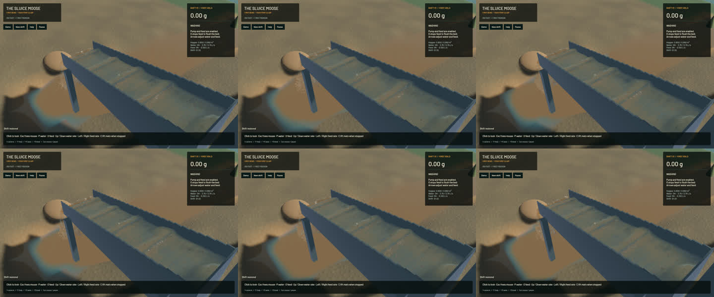

# Bounded fine-contact axis masks

The loaded sluice advances faster with the same saved physical result. The final fixed-step A/B/B/A comparison reduces mean pair processing from **22.259 to 15.000 ms (32.6%)** and improves headless physical throughput from **0.3502x to 0.4210x (20.2%)**. All four complete saved states match SHA-256 `e6934203145f8f31f1ddb61d6fc1ccff5b0ad6a5a32caa25723c0bd7a827256d`. Only three unordered contact-history arrays are sorted by their tuple keys; no particles, fields or floating-point differences are discarded. Full canonical state and binary/input hashes are retained in the [receipt](2026-10-24-contact-axis.json) and artifact directory.

Small-grain searches now intersect three current axis memberships. Each bit refers to the same target ID on every axis. The original coarse snapshot and increasing pair order remain authoritative; the new masks only discard impossible candidates. A source correction refreshes its query when necessary, and moved targets update their membership before later sources visit them. Radius grouping changes scratch indexing, not any physical grain size or material. This avoids the repeated hash lookups of the saved experimental candidate, which remained **11.0% slower** despite exact states and was rejected.

Axis masks are capped at **8 MiB**, plus linear body metadata. An excessive domain, unrepresentable coordinate, tiny-spacing padding overflow or out-of-domain target move falls back to the original search. No position, velocity, grain count, water grid, pressure iteration, time step or force/response law is relaxed. All rendering, water/riffle/terrain and material sources outside the three accelerator paths retain their committed bytes.

**137 sim3d tests, 51 app tests and 5 explicit real-GPU integration checks pass.** The two contact-chain controls fail as expected when source refresh or moved-target updates are deliberately removed. The restored candidate passes all tests. Differential coverage includes compound shapes, rotations, wet/dry Coulomb response, template/population edits, 63/64/65 boundaries, late-created contacts and bounded fallback. Strict scoped all-target Clippy and formatting pass; sim3d library Clippy retains ten pre-existing warnings outside the changed paths, with none in the new module. One app profiling test remains ignored. The signed Mach-O native app builds and launches; this is not a full soil/gameplay calibration or manual-controls check.

| Matched initial scene, sequential 20-second native windows | Before | After |
|---|---:|---:|
| Render FPS | 55.73 | 55.77 |
| p95 frame time | 25.31 ms | 26.70 ms |
| Physical simulation / wall time | 0.3316x | 0.3831x |
| Per-window bulk and dry-mass budgets | Pass | Pass |
| Physical real-time gate | Fail | Fail |

Native physical throughput improves **15.5%** in these short windows. Mean rendering holds near 56 FPS, while p95 frame time rises by 1.38 ms; this is not evidence of better render pacing. Final sluice-water error is 0 m3 and gold error -9.09e-13 g. The faster run advances farther physically and ends with a different population; only the controlled fixed-step comparisons claim complete state equality. Real-time remains unfinished.

Frozen sluice, outlet and river views retain identical clocks, solver steps, selected physical tracks, flow, machine/material fields and render kernels. **All three full RGB images are byte-identical** to the latest crest/slurry rendering build.

The [wall-timed preview](2026-10-24-contact-axis.mp4) uses all 34 source frames in 185 display frames at 60 FPS. Capture targets 12 Hz and spans 2.988 wall seconds / 1.100 physical seconds. All 33 presentation intervals and all 33 worker intervals advance, with zero presentation-buffer underruns. Review covers [all 34 temporal crops](2026-10-24-contact-axis.temporal.jpg) and six full samples; whole-video playback is not claimed. Display holds are not extra physics steps.

The signed app is `/Users/simonheikkila/.codex/visualizations/2026/10/18/01a14ce3-309f-7782-9a7c-ccd0efaf3227/contact-query-eval-20261024/final-app/First Bend.app`. Heavy jobs ran sequentially. Cleanup reports zero owned games, compilers, encoders or test browsers; 14 shared MCP and 56 Node processes remain untouched. No new panic-full or WindowServer report appeared. Two superseded task-generated app bundles were byte-verified against ZIP archives before removing their expanded copies; restore manifests are retained, and the current baseline, user saves, original checkout and stash are preserved.

The next measured throughput targets remain fluid/readback work (about 39.87 ms per native packet), remaining DEM work (about 33.83 ms) and asynchronous surface builds (mean 78.17 ms). The broad digging, pads, shaker, mud/buildup/settling and gameplay objective remains active; this stage does not establish their completion or physical calibration.
