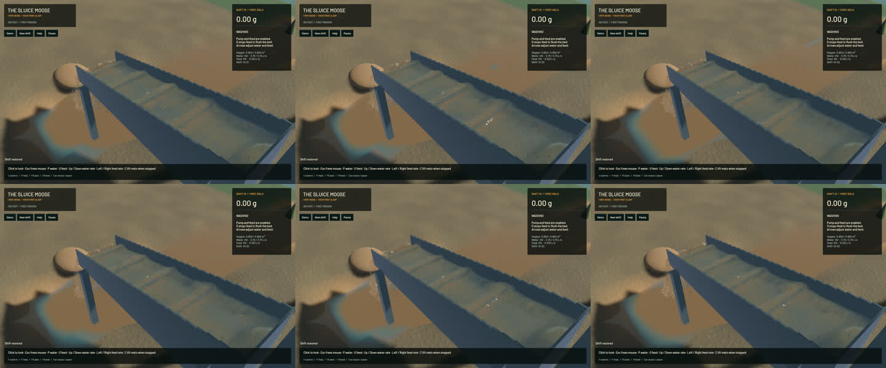

# Dense grain-contact rejection optimization

Dense grain contacts were spending time assembling four scalar lane bits even when no bounding spheres overlapped. The loop now first reduces the same comparison vector with `any()`. An empty vector exits immediately; a surviving vector follows the original mask, pair order and response. Distance arithmetic, conservative rounding margin, snapshot candidate membership, physical timestep, pressure work, grain counts and all water/riffle/terrain models are unchanged. No unsafe code, dependency, cache or persistent state was added.

The Apple M2 Max assembly confirms a `umaxv`/`fmov`/`tbz` empty-block path before lane extraction. The final formatted probe is **byte-identical** to the measured candidate, so its four controlled runs directly cover the final compiled code.

Four serial A/B/B/A runs use the same saved117,544-water/4,308-grain input,12 warm-up ticks and120 measured ticks (two physical seconds). All complete end states match exactly, including116,139 water particles and4,430 grains. Only the three explicitly unordered contact-history arrays are sorted; no particle/grain reordering, field removal or numeric tolerance is used. The complete canonical state is retained under SHA-256 `e6934203145f8f31f1ddb61d6fc1ccff5b0ad6a5a32caa25723c0bd7a827256d`. Signed zero is retained. Each raw output hash is recorded before removing that temporary output after roundtrip archive verification.

| Controlled headless means | Before | After |
|---|---:|---:|
| Grain-pair time per60Hz domain tick | 24.730 ms | 22.364 ms |
| Physical simulation / wall time | 0.33445x | 0.34959x |

Pair time falls **9.57%** and isolated total physical throughput improves **4.53%**. These are short loaded-scene measurements on this Mac, not guarantees for every population or platform.

**186 scoped tests pass:**130 sim3d checks,51 app checks and five explicitly executed real-GPU coupled pipeline/live-restore controls. One app profiling check remains ignored. The contact oracle includes rotations, Coulomb on/off, static/compound bodies, template edits, and63/64/65-body population transitions. Its previously uncommitted regression is formatted and included here. Strict all-target Clippy for mining/mining-physics, changed-file and maintained-package formatting, whitespace and signed native packaging pass. Standard sim3d library Clippy completes with ten existing warnings outside changed lines; warning-free sim3d and full-workspace validation are not claimed. The unrelated long full-bank soil replay timeout remains tracked and was not rerun.

| Matched sequential20-second native windows | Before | After |
|---|---:|---:|
| Render FPS | 55.90 | 55.67 |
| p95 frame time | 25.24 ms | 25.43 ms |
| Physical simulation / wall time | 0.32640x | 0.33486x |
| Worker grain phase | 53.41 ms | 48.78 ms |
| Bulk/dry-mass budgets | Pass | Pass |
| Physical real-time gate | Fail | Fail |

Native physical throughput improves **2.59%**. Native fluid/readback time is higher in the after window, so the total native improvement is smaller than the controlled headless result; these windows advance different physical amounts and do not isolate one cause. Real time remains unachieved. Water and gold budgets remain within their existing gates.

Full frozen sluice, outlet and river RGB are **byte-identical** to the prior build, with identical physical clocks/tracks, machine/material fields and render kernels. Render and gameplay sources are unchanged.

The [wall-timed flow preview](2026-10-24-contact-mask.mp4) retains all34 captured source frames in186 display frames. Capture targets12Hz; the recording spans2.994 wall seconds and0.967 physical seconds. All33 presentation intervals advance,29 worker snapshots advance, and no presentation-buffer underruns occur. Review covers [all34 local temporal crops](2026-10-24-contact-mask.temporal.jpg), six full samples and the three matched views. Repeated60FPS display frames are holds, not extra physical steps. Whole-video playback and manual controls are not claimed. The [receipt](2026-10-24-contact-mask.json) records inputs, binaries, source/evidence hashes and verification scope.

The signed build is `/Users/simonheikkila/.codex/visualizations/2026/10/18/01a14ce3-309f-7782-9a7c-ccd0efaf3227/contact-mask-20261024/final-app/First Bend.app`. Full native PNGs, assembly, canonical state archive and logs remain in the same artifact directory. To make room on the nearly full disk, four specifically identified superseded task-generated app bundles were ZIP archived using `ditto`; every file was hash-verified before removing expanded copies. Restore commands and archive hashes are recorded, and the prior current build, saves and original working files remain intact. Current duplicate Cargo executable outputs were removed after signing; the standalone app remains valid.

Heavy jobs ran sequentially with one compiler/encoder worker. Cleanup leaves zero owned games/compilers/encoders or test browsers.14 shared MCP and56 Node processes remain untouched; no new macOS panic-full or WindowServer report appeared. The previous inertia-cache experiment is closed as rejected for zero measured benefit; it is not part of this implementation. `sluice-realtime` and the wider realistic-game objective remain active.
