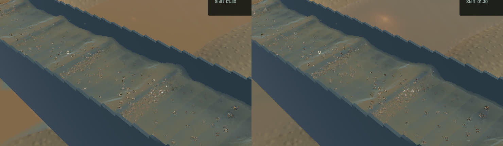
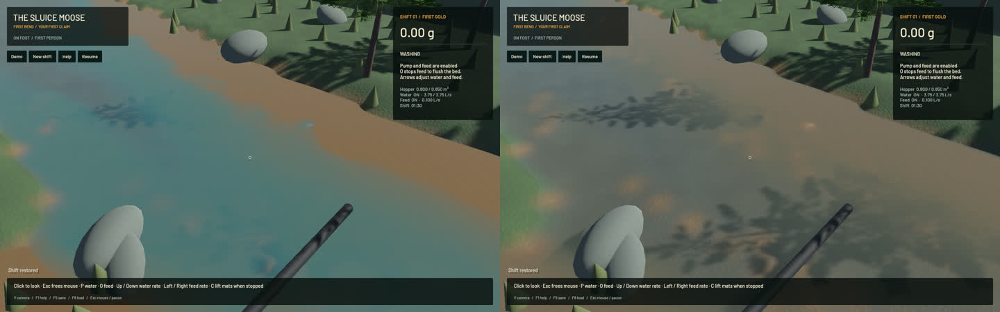

The sluice crest correction now reaches the complete production render chain. Two legacy broad blur draws still followed the corrected geometry draws, rounding waves again. The renderer now shares its six-pass schedule with a real render-target GPU regression: four crest-preserving geometry draws followed by two optical exchanges. The old sequence reproduces 9.990–11.820 mm ridge error; the corrected sequence stays within 0.01873 mm on both screen axes and four pixel phases. Uniform suspension remains uniform, and the later visible-optics draws leave geometry bit-identical. The existing RGBA32F targets and pass count are retained; two unused pipeline preparations are removed. Detached outlet geometry retains its four original filters.

River shading now reconstructs mineral cross section from the existing four class sizes (0.1/1/10/2 mm), dry densities and Qext=2, matching the channel's represented-grain convention. Previously every class used the same 2400/m concentration multiplier. Extinction-weighted volume source mixing replaces the river's independent colour threshold, and camera-Z gaps are converted to eye-ray distances. The existing channel albedo .95, anisotropy .85 and environment-light .8 factors remain presentation approximations, not soil calibration. Real fine-sediment plumes remain; coarse gravel no longer clouds water as much as the same mineral volume of fine silt. No physical concentration, water stock or transport is reduced.

55 application checks pass, with one profiling check ignored. All 20 explicitly executed real-GPU checks pass: the new complete-chain regression, the new river helper control, 13 existing optics checks and five visible-column checks. The river helper control compares 264 homogeneous analytic columns across depth, mineral cross section and camera angle; it is not a full-scene calibration. Strict scoped all-target Clippy, formatting, whitespace checks, signed packaging and native launch pass. Full soil/gameplay suites and manual controls were not rerun for this rendering correction.

Six frozen native pairs retain identical clocks, solver steps, selected particle tracks, machine/material fields and selected render-kernel diagnostics. All 644 protected simulation/vendor source files match the starting commit. Wave lips and glints look sharper; the river is less uniformly tan. Broad physical standing waves, genuine suspension and granular stippling remain. The previous rectangular outlet RGB crop changes because it includes the river; exact crop identity is not claimed. The detached outlet shading branch and physical flow are preserved.

| Sequential 20-second native windows | Before | After |
|---|---:|---:|
| Render FPS | 55.63 | 55.76 |
| p95 frame time | 27.19 ms | 27.14 ms |
| Physical simulation / wall time | 0.3847x | 0.3816x |
| Bulk and dry-mass budgets | Pass | Pass |
| Physical real-time gate | Fail | Fail |

These short windows show similar throughput, not a speedup or real-time simulation. Final sluice-water error is zero, whole-water residual is -7.850 mL and gold residual is 1.82e-12 g. The benchmark exits1 for the failed real-time gate; it is not a full benchmark pass.

The [wall-timed flow preview](2026-10-24-crest-chain.mp4) retains all34 captured source frames across2.980 wall seconds/1.167 physical seconds. All33 presentation and worker intervals advance, with zero recording underruns. Review includes the full sluice/river/outlet stills, matched layer comparison, six full temporal samples and [all34 temporal crops](2026-10-24-crest-chain.temporal.jpg). Display holds are not additional physical steps; whole-video playback is not claimed.

The signed build is `/Users/simonheikkila/.codex/visualizations/2026/10/18/01a14ce3-309f-7782-9a7c-ccd0efaf3227/crest-chain-20261024/app/First Bend.app`. Test/native/encoder jobs run sequentially with one compiler or encoder worker. Scoped cleanup leaves no owned native/build/encoder or test-browser process;14 shared Playwright MCP and56 Node processes remain untouched. No new panic-full or WindowServer report appears. Six named old generated diagnostic traces are losslessly compressed with hashes and restore commands; original checkout files, stash, baseline app and input save remain intact. New capture-exit saves are hashed then discarded; the benchmark exit save is retained compressed. Beads sync is unsupported by the installed CLI; only touched project rows are exported for the commit. The [receipt](2026-10-24-crest-chain.json) records source and evidence hashes. Broader water art, shoreline treatment and full operation remain open.
