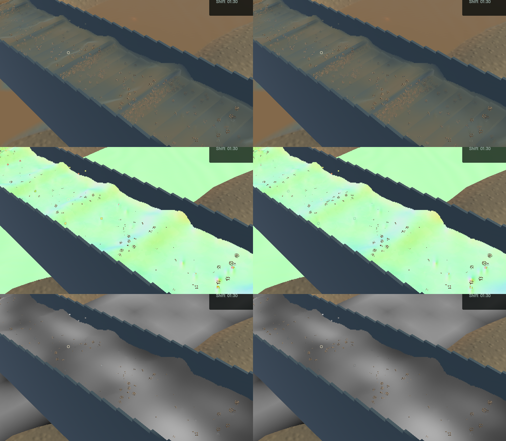
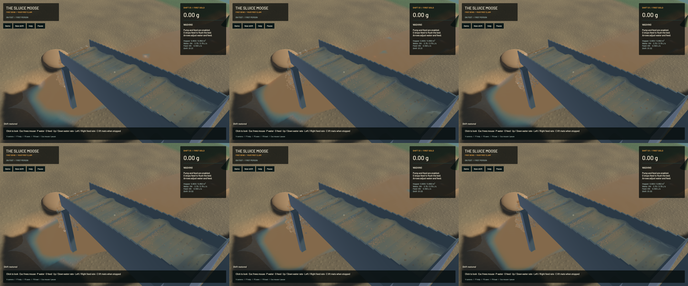

The connected-water filter now preserves curvature through a resolved crest instead of treating its shoulders as a plane. The same curved footprint gathers the surface normal and the two additive optical moments, reducing false cap highlights and uneven muddy-water shading. Its intercept and tangent move together through full-size pixel phases. Separate depth layers, shallow films and detached outlet water retain their existing visibility controls; water/riffle/terrain solvers, physical particles, cadence and reconstruction targets/passes are unchanged.

The production GPU regression first fails against the previous shader on an analytically curved sheet: normal vector error is 0.091586 (about 5.25 degrees) and a smooth optical path is biased by 1.054%. The final shader reduces those errors to 0.00000885 and 0.0635%. The unchanged analytic input passes tighter 0.001 normal-vector and 0.2% optical-path bounds across 256 full-resolution samples. The existing flat/grazing planes, layer-edge, optical-volume, constant-mixture, shallow-water and outlet controls also pass.

**51 application checks and ten explicitly executed real-GPU optics checks pass**, with one application profiling test ignored. Strict scoped all-target Clippy, maintained rendering-package formatting, whitespace and signed macOS packaging pass. This is not a full-workspace or calibrated fluid-accuracy claim. One accidental uncached check was stopped before execution and replaced with the shared-cache checks; its interrupted build is not counted as passed.

Native colour changes at 64,789 pixels. The visual improvement is localized: crest shading follows a continuous wave more consistently, while broad physical riffle waves and grain speckling remain visible. All five matched frozen views retain identical simulation/fluid clocks, solver steps, selected authoritative particle tracks, flow, machine state and render kernels. Full river RGB and the accepted 280×230 falling-outlet crop are byte-identical. The whole outlet view includes some channel water and need not be identical.

| Sequential 20-second windows from the same saved state | Before | After |
|---|---:|---:|
| Mean render FPS | 55.66 | 55.62 |
| p95 frame time | 25.94 ms | 25.90 ms |
| Simulation / wall time | 0.3215× | 0.3231× |
| Physical real-time gate | Failed | Failed |

These short windows establish no speedup. Both bulk-material and dry-mass checks pass. Final whole-water residual is -7.819 mL, sluice-water residual 0 mL, and gold residual 1.36e-12 g.

The [wall-timed preview](2026-10-24-crest-curvature.mp4) retains all 65 captured frames in 356 display frames at 60 FPS; repeated display frames are not extra physics. All 64 presentation intervals advance, with 0 recording underruns and no worker rewind. Review covers the six samples, three full temporal frames and matched final/normal/extinction views; whole-video viewing and manual OS controls are not claimed. [The receipt](2026-10-24-crest-curvature.json) records hashes, timing and conservation results.

Heavy jobs ran one at a time with one compiler/encoder job. No new panic-full/WindowServer diagnostic appeared. Scoped cleanup leaves no owned native game, build or encoder. The nine existing unfinished contact-history files, the original dirty checkout and the user stash are preserved; the rendering commit excludes that unfinished physics work. The native build uses the default feature set and records the actual build-source hashes. Installed Beads rejects `bd sync`, so only the two touched rendering issue rows are merged from its export. Broad water presentation and the larger playable-game objective remain open.
