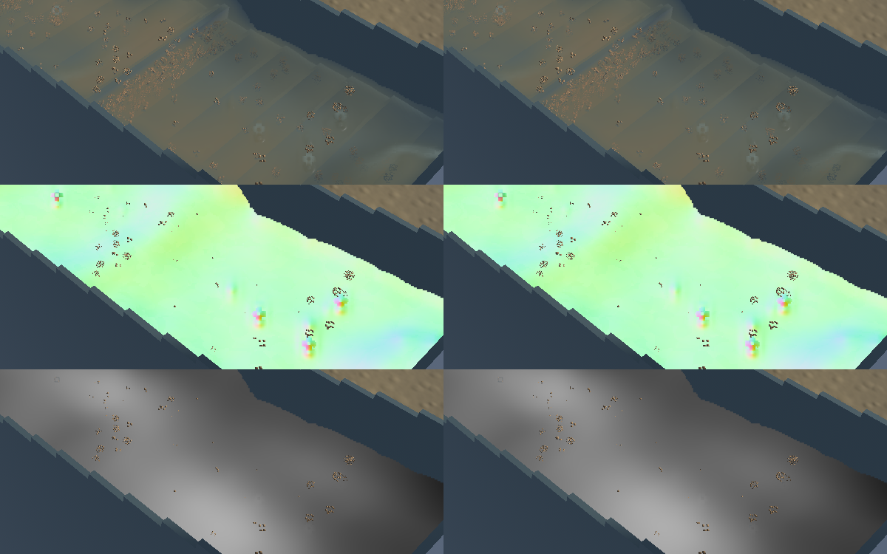
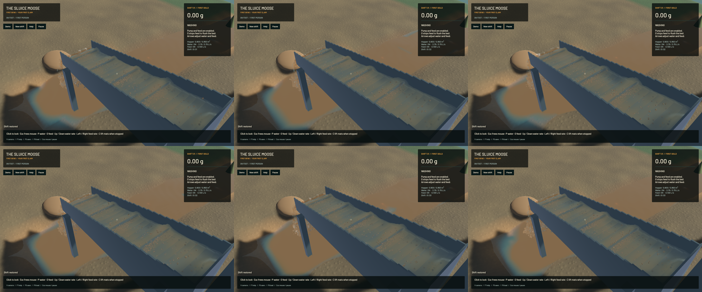

Connected water now upsamples about its local projective slope instead of rejecting neighbours by camera-depth difference alone. The old filter turned an exact grazing plane at 3 m into a 2.9126215 m sample: **87.38 mm of false depth stepping**. The corrected production shader passes the unchanged 10 micrometre depth bound through every full-resolution pixel phase and a nearest-reference crossover. This is a focused interpolation repair; the visible native improvement is small and broader water appearance remains unfinished.

Two-sided limited reciprocal-depth slopes retain true layer steps. A smooth geometric range weight replaces the hard channel cutoff, while detached water keeps its existing arithmetic path. Joined normals avoid four redundant depth gathers per channel pixel; the original fallback remains for failed fits. This introduces no additional render target, pass or particle.

**51 application checks and ten explicitly executed real-GPU water-optics checks pass.** One application check remains ignored. Strict scoped all-target Clippy, maintained formatting, whitespace checks and signed macOS packaging pass. The strengthened GPU regression first fails against the old production shader. Controls retain the independent inclined/grazing analytic normals, homogeneous slurry, separated optical columns, a genuine 40 cm layer step, dry coverage and channel/outlet isolation. Full-workspace CI and other ignored GPU suites are not claimed.

Only the water composition shader and its GPU regression change among 697 checked Rust/shader/config sources. All authoritative water, riffle, terrain, sediment and machine solvers remain byte-identical to `93b5db2`. Frozen clocks, solver steps, physical tracks, flow, reconstructed render kernels, machine, excavation and delivery fields match exactly. The full river RGB image and the accepted 280×230 falling-outlet crop are identical. The full outlet-camera image differs at 471 pixels because it includes some channel water above the lip. No whole-outlet-view identity is claimed. Final sluice RGB differs at 1,118 pixels, so the comparison does not establish a wholesale visual transformation.

| Sequential 20-second native windows, identical saved input | Before | After |
|---|---:|---:|
| Mean render FPS | 55.77 | 55.76 |
| p95 frame time | 25.88 ms | 26.00 ms |
| Simulation / wall | 0.3182× | 0.3215× |
| Physical real-time gate | Failed | Failed |

Both material-budget gates pass. Final whole-water residual is -7.819 mL, sluice-water residual 0, and gold residual 1.36e-12 g. These short windows show similar rendering performance and establish no speedup. The simulation still runs below real time.

The [6.1-second wall-timed replay](2026-10-24-crest-depth.mp4) retains all 67 source captures in 366 display frames at 60 FPS. Repeated display frames are not extra physics. All 66 recorded presentation intervals advance, with zero recording underruns. Worker snapshots advance in 56 intervals and hold in 10; presentation interpolation bridges those known states without a clock rewind. Review covers six temporal samples, the full midpoint and matched frozen final/normal/extinction views. Whole-video viewing and manual OS input were not checked.

Broader standing-wave bands, occasional rounded spray, coarse grain speckling, river opacity/environment art and sediment calibration remain open under `sluice-water-polish`. This repair does not claim those are solved or that a physically accurate playable operation is complete. The [receipt](2026-10-24-crest-depth.json) records source/input/binary/media hashes and checks.

Heavy jobs ran sequentially, with one compiler or encoder job. Required scoped cleanup leaves no owned game/encoder, agent-browser, Playwright test or Chrome-for-Testing processes. Fourteen shared Playwright MCP and 56 Node processes remain untouched. No new panic-full or WindowServer report appeared. The original dirty checkout and user stash are preserved. Installed Beads rejects `bd sync`; only the new defect and broader water-polish rows are merged from its export for the scoped commit/push.
