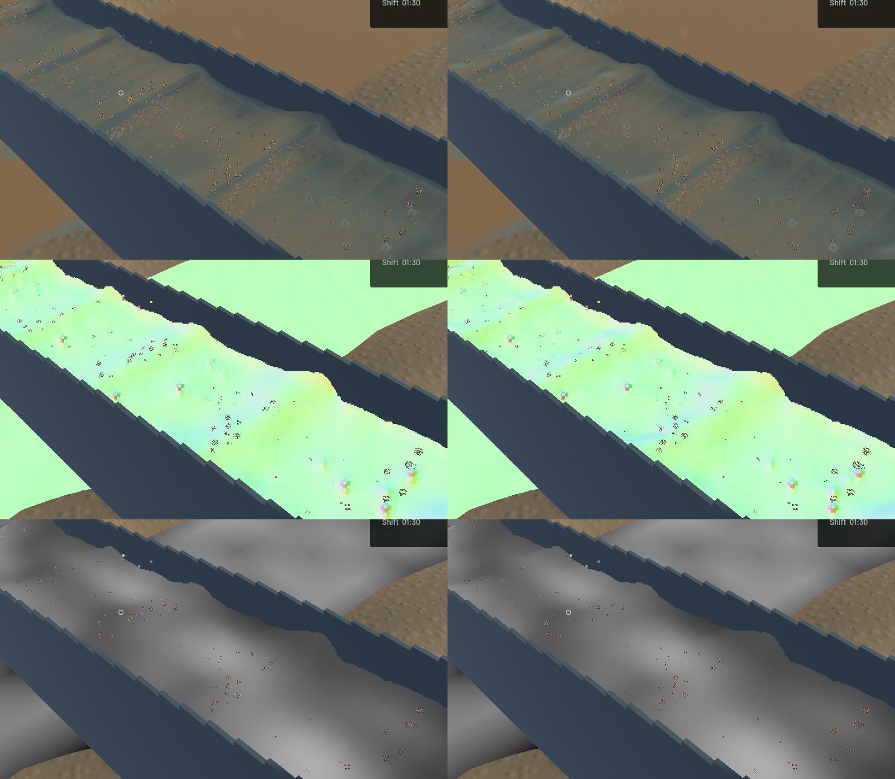
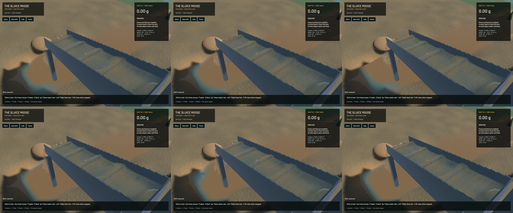

Connected-water smoothing now distinguishes a continuous crest from a sharp depth edge. The old tangent used a secant across both sides, inventing a sloping sheet through separate layers and carrying muddy optical material across that edge. Outer one-sided reciprocal-depth slopes now limit the tangent, and uncertain fits blend continuously back to the centre. The existing range, 30 mm footprint, four smoothing passes and accepted detached-water path stay in place; no new targets or particles are added.

The native difference is localized: some crest and opacity transitions are cleaner, while the overall water appearance remains similar. Final sluice RGB changes at 80,539 pixels. Coherent physical waves, some rounded spray and grain speckling remain; this is not a claim that the entire water presentation is finished.

The strengthened production-shader GPU test first fails against the old shader: a genuine 40 cm layer step shifts the front depth by 70.9 micrometres and imports mineral extinction. The final shader passes the unchanged 1 micrometre depth and 0.001/m concentration bounds on both sides, retaining dry coverage. Existing grazing-plane, optical-volume, uniform-mixture, delayed-interface and outlet controls also pass. A broader geometric-range trial failed its turbidity check (313.6/m against a 200/m bound) and was rejected; that alternative is absent from the delivered shader.

**51 application checks and ten explicitly executed real-GPU optics checks pass**, together with strict scoped all-target Clippy, maintained-package formatting and signed macOS packaging. One application check remains ignored. Full-workspace checks and the other ignored GPU suites are not claimed.

The candidate was built from isolated committed `4d920f6` sources plus the shader change, excluding nine preserved unfinished machine/documentation files. Only the water blur shader and its GPU regression change among the checked build sources. All authoritative water, riffle, sediment, terrain and machine solvers, particle counts and physical cadence are unchanged. Five frozen views have identical physical clocks, solver steps, tracks, flow and render kernels. Full river RGB and the accepted 280×230 falling-outlet crop are identical; the whole outlet-camera image includes changed channel water and is not identical.

| Sequential 20-second windows, same saved input | Before | After |
|---|---:|---:|
| Mean render FPS | 55.75 | 55.97 |
| p95 frame time | 25.29 ms | 25.93 ms |
| Simulation / wall time | 0.3031× | 0.3215× |
| Physical real-time gate | Failed | Failed |

These short windows establish no speedup. Both bulk/dry-material checks pass. Final whole-water residual is -7.819 mL, sluice-water residual 0, and gold residual 1.36e-12 g.

The [wall-timed preview](2026-10-24-crest-edges.mp4) retains all 89 captured source frames in 484 display frames at 60 FPS; repeated display frames are not extra physics. All 88 presentation intervals advance, with zero recording underruns. Worker snapshots advance in 73 intervals and hold in 15, with no rewind. Review covers six temporal samples, the full midpoint and the matched frozen final/normal/extinction views; whole-video viewing and manual OS input are not claimed. The [receipt](2026-10-24-crest-edges.json) records hashes and measurements.

Heavy work ran sequentially with one compiler or encoder job. Required scoped cleanup leaves no owned game/encoder, agent-browser, Playwright test or Chrome-for-Testing process; 14 shared Playwright MCP and 56 Node processes remain untouched. No new panic-full/WindowServer report appeared. Existing unfinished files, the original dirty checkout and the user stash are preserved. Beads' installed version rejects `bd sync`; only the two touched rendering issue rows are merged from its export for commit/push. Broad water polish and the overall game goal remain open.
