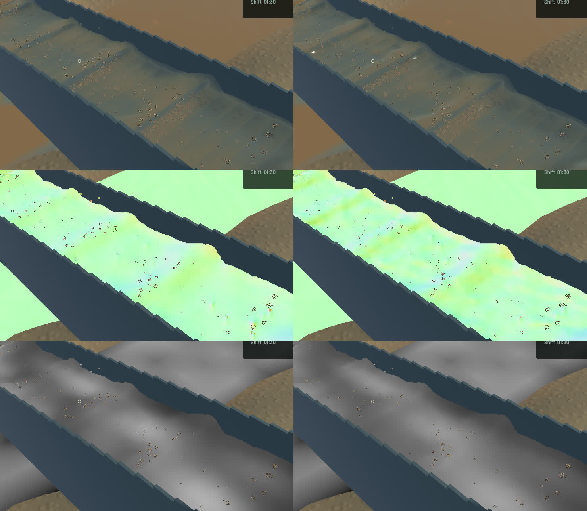
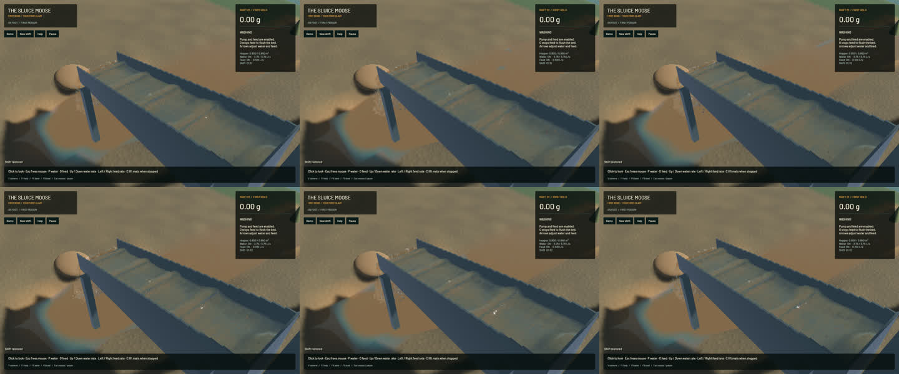

# Crest and fine-sediment reconstruction correction

This is a verified rendering correction, not completion of the water art or the full game. Broad standing waves and grain stippling remain visible; `sluice-oblique-crest-20261024` and `sluice-water-surface-art` stay in progress.

The connected-water filter now smooths reciprocal-depth residuals about the measured quadratic sheet, retaining resolved crest curvature instead of spreading its shoulders on each pass. The production GPU control reproduces **10.662 mm** old crest error and **0.000119 mm** corrected error. Angle-aware shared density probes reach the connected sheet at grazing angles. The closest envelope stores a common bounded scale, used consistently by all overlapping kernels, reconstruction and the final visibility gather. The scaled-profile control reproduces a **50 mm** old helper error; the correction meets the **2 micrometre** test bound. Opaque geometry still bounds every probe. Eight samples, existing buffers and fullscreen pass count are retained.

Fine suspended parcels now reconstruct along a **12 cm** streamwise footprint, versus about8 cm previously. The cross-channel footprint, bed stratification, outlet concentration sample and authoritative particles remain intact. Independent impulse, concentration-gradient, positivity and total-moment tests verify the footprint and show that real broad plumes survive. This is a read-only optical field, not physical sediment diffusion or a colour/opacity clamp. All fluid, riffle, terrain and grain-stepping sources remain unchanged; the existing contact regression diff is preserved separately.

**11 explicit real-GPU optics checks pass.** The broader serial command completed51 app checks,20 library checks and102 integration checks, then timed out at240 seconds inside the unchanged1080-tick full-bank soil replay. It is not a full-suite pass; uncompleted soil and later tests remain unrun. Follow-up: `sluice-soil-replay-runtime-20261024`. Strict scoped all-target Clippy, maintained-package formatting, whitespace, shell syntax and signed native packaging pass. The packager now rejects invalid non-Mach-O output: a low-disk rust-objcopy failure had produced a3 KB data file despite Cargo returning success. The final app passes format/signature checks and actually launches.

Six frozen view pairs retain identical clocks, particle tracks, machine/material fields and render kernels. Native colour changes at156,156 pixels. The river has22 changed RGB components and the accepted falling-outlet crop155, each by at most **one 8-bit level**. Strict pixel identity failed; no exact-identity claim is made. The wider outlet camera contains changed channel water as well.

| Matched sequential20-second native windows | Before | After |
|---|---:|---:|
| Render FPS | 55.76 | 55.78 |
| p95 frame time | 25.87 ms | 25.68 ms |
| Physical simulation / wall time | 0.3197x | 0.3199x |
| Bulk and dry-mass budgets | Pass | Pass |
| Physical real-time gate | Fail | Fail |

These short windows show similar throughput; they do not prove a speedup or real-time simulation. The final sluice-water budget error is0 m3 and gold error3.64e-12 g.

The [wall-timed flow preview](2026-10-24-crest-mud.mp4) uses all33 captured source frames in182 display frames at60 FPS. Capture targets12 Hz and spans2.929 wall seconds /0.900 physical seconds. All32 presentation intervals advance,27 worker snapshots advance, and no presentation buffer underruns occur. Review covers [all33 temporal crops](2026-10-24-crest-mud.temporal.jpg), six full samples and the matched debug layers. Repeated video frames are display holds, not additional physical steps. Whole-video playback and manual control checks are not claimed. The [receipt](2026-10-24-crest-mud.json) records source, input, binary, verification and media hashes.

The signed local build is `/Users/simonheikkila/.codex/visualizations/2026/10/18/01a14ce3-309f-7782-9a7c-ccd0efaf3227/crest-mud-fix-20261024/final-app/First Bend.app`. Detailed native captures, complete-source hashes and logs are in the same artifact directory. Only this turn's generated intermediate frames and disposable binaries were removed after recording hashes/review media to make room on the nearly full disk; original sources, saves, historical baseline build and user stash remain intact. Heavy jobs ran sequentially. Cleanup leaves zero owned games/compilers/encoders or test browsers;14 shared MCP and56 Node processes remain untouched. No new macOS panic-full or WindowServer report appeared.
