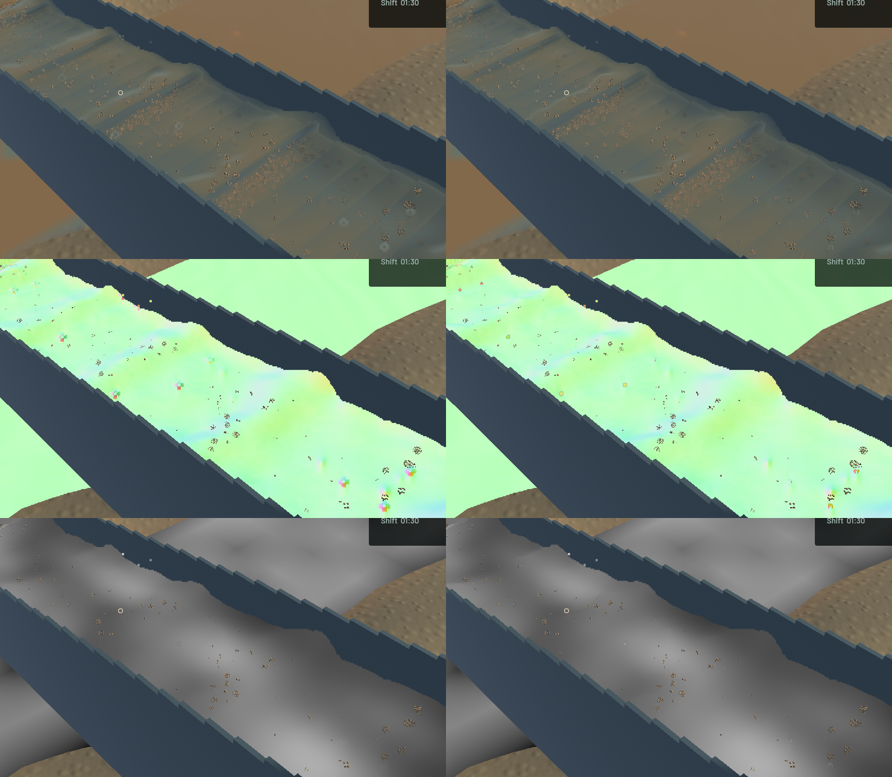
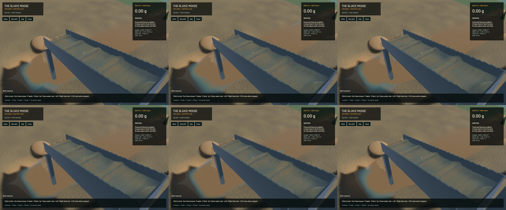

The final channel shading pass now rejects a false tangent across separate water layers. It previously fitted a secant through both sides of an edge, tilting a flat surface and carrying sediment extinction across the gap. One-sided reciprocal-depth slopes and continuous plane-agreement weights now retain independent layers while preserving connected grazing sheets. The correction adds four texture reads per channel pixel, with no new pass, target or particle.

The new actual-GPU regression fails against the old production shader: a flat clear layer acquires normal `(0.60365, 0, 0.79725)` and extinction `53.38276/m` instead of `50/m`, three texels before a 12 cm step. The fixed shader retains the analytic normal and both `50/m` and `900/m` columns through 16 probes across both screen axes, within the unchanged 0.00015 normal and 0.001/m extinction bounds. Existing inclined/grazing planes, uniform slurry, optical volume, layer coverage and outlet controls pass.

**51 application CPU checks and ten explicitly executed real-GPU optics checks pass**, with one profiling check still ignored. Strict scoped all-target Clippy, formatting and signed macOS packaging pass. Full-workspace checks are not claimed. Only the composition shader and its regression change among 740 tracked build sources; all authoritative water, riffle, terrain, sediment and machine sources remain identical to `63a918e`.

Five matched frozen views retain physical clocks, solver steps, selected tracks, flow, machine/material fields and reconstructed-kernel diagnostics. River RGB and the accepted falling-outlet crop are byte-identical. The outlet camera also includes channel water, so its entire image changes. Final sluice colour changes at 14,571 pixels. The visible improvement is localized: some false crest tilts and muddy edges are cleaner; broad waves, rounded spray and grain speckling remain in the broader water-polish issues.

| Sequential 20-second native windows, same saved input | Before | After |
|---|---:|---:|
| Mean render FPS | 55.774 | 55.772 |
| p95 frame time | 25.813 ms | 25.923 ms |
| Simulation / wall time | 0.32156x | 0.32154x |
| Real-time gate | Failed | Failed |

Both material-budget gates pass. Before/after residuals match: whole water -7.819 mL, sluice water zero, bulk 0.335 mL, dry mass 0.000602 kg and gold 1.36e-12 g. These short windows show similar performance, with no speedup claim; physical real time remains unresolved.

The [wall-timed flow preview](2026-10-24-crest-shading.mp4) retains all 67 captured frames in 363 display frames at 60 FPS. Repeated display frames are not additional simulation. All 66 presentation intervals advance, worker snapshots advance in 54 intervals and hold in 12, and recording underruns are zero. Review covers six temporal samples, full final sluice/normal views and the matched frozen crops; whole-video viewing and manual OS input are not claimed. The [receipt](2026-10-24-crest-shading.json) records source, input, binary and media hashes.

Heavy jobs ran sequentially with one compiler/encoder worker. Required scoped cleanup leaves zero owned game/encoder, agent-browser, Playwright test or Chrome-for-Testing processes. Fourteen shared Playwright MCP and 56 Node processes remain untouched; no new panic-full/WindowServer report appeared. The original dirty checkout and user stash are preserved. Installed Beads rejects `bd sync`; only the touched project rows are merged from its export before the scoped commit and push. The overall game objective remains active.
