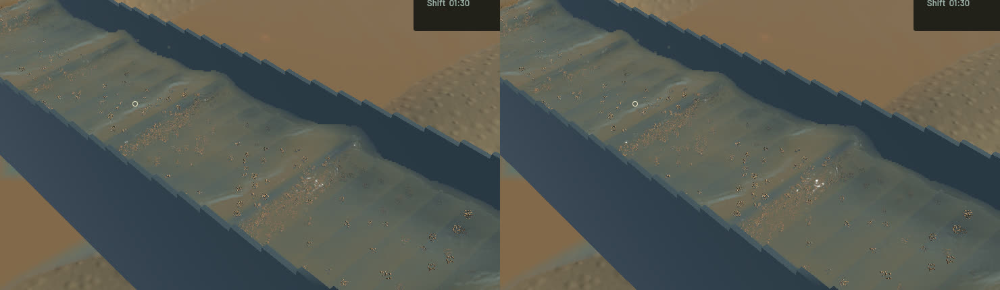

# Crest boundary and suspended-sand presentation

Thick free crests previously relied on particle covariance alone. A volumetric neighborhood could retain rounded support at its free boundary. Channel reconstruction now also uses the continuous local moment deficit to identify an upward liquid boundary, thin its normal support and join its tangential footprint. Filled interiors, side-wall deficits and detached spray do not supply that boundary cue. Kernel normalization still retains represented water volume. This is a render approximation; no physical particle is displaced and no water/riffle/terrain solver changes.

Travelling normal detail now filters each wave against the two actual tangent-plane pixel axes. The old single grazing footprint erased resolved transverse detail along with unresolved detail. A real-GPU analytic control retains the independently expected **0.990248** transverse amplitude across an elongated pixel while rejecting its unresolved direction. Several optical bands break up the smooth shoulder highlights; the existing stationary-water, bounded-normal and phase-reset controls pass.

Every non-resting sand parcel already contributes to the conservative slurry optics. Opaque geometry previously also drew suspended sand above 1.5 mm, duplicating its appearance and writing brown interruptions into scene depth. Suspended sand now uses that one optical representation. Deposited sand, gravel and gold retain geometry. An independent 2 mm sand control verifies its full optical volume, absence of duplicate geometry and return to geometry when deposited. **The matched native fixture has no suspended sand above 1.5 mm**, so that particular correction is established by the control, not falsely credited with this frame's colour change.

The native comparison changes **97,468** colour pixels and 3,929 extinction-debug pixels. Crest shoulders and highlights improve locally, while broad standing waves, sediment plumes and grain stippling remain visible. This is not acceptance of the whole requested water appearance. Full river RGB and the accepted falling-outlet crop remain byte-identical. All five matched view pairs have exactly equal simulation/fluid clocks, solver steps, selected physical tracks, flow, machine and material fields. Render kernels intentionally change. All 642 tracked physical source files remain byte-identical to the base commit.

**54 application and 13 explicitly run actual-GPU optics checks pass.** One application profiling check stays ignored. Strict scoped all-target Clippy, formatting, signed native packaging and launch pass. The existing unused game constructor warning remains. Full gameplay, retained-soil accuracy and manual OS controls were not rerun for these rendering changes.

| Sequential 20-second native windows | Before | After |
|---|---:|---:|
| Render FPS | 55.76 | 55.75 |
| p95 frame time | 26.34 ms | 27.17 ms |
| Physical simulation / wall time | 0.3817x | 0.3800x |
| Material/dry-mass budgets | Pass | Pass |
| Physical real-time gate | Fail | Fail |

The short windows establish similar throughput, not a speedup. Final whole-water residual is -7.8394313e-06 m³, sluice-water residual 0.0 m³ and gold residual -4.55e-13 g.

The [wall-timed video](2026-10-24-crest-slurry.mp4) contains every one of the34 native source frames, over 2.958 wall seconds / 1.100 physical seconds. All33 presentation and worker intervals advance, with zero capture buffer underruns. Repeated video frames are display holds. Review covers [all34 temporal crops](2026-10-24-crest-slurry.temporal.jpg), six full samples and the matched outlet/river views; whole-video playback is not claimed.

The signed app is `/Users/simonheikkila/.codex/visualizations/2026/10/18/01a14ce3-309f-7782-9a7c-ccd0efaf3227/crest-slurry-finish-20261024/final-app/First Bend.app`. Heavy jobs ran serially. One link failed for lack of disk space;46 older task-generated benchmark output snapshots were losslessly compressed and byte-verified, releasing869,374,410 bytes. Inputs, source, user saves and signed apps were retained. Compression paths, hashes and restoration commands are in the local manifest referenced by the [receipt](2026-10-24-crest-slurry.json). The earlier rejected physics prototype was separately preserved before restoring the unchanged production solver. No new panic/WindowServer report appeared. Cleanup leaves no owned test/browser/native/build process;14 shared Playwright MCP and56 Node processes are untouched. Broad water art, physical real time, retained contact convergence and the staged playable-game objective remain open.
