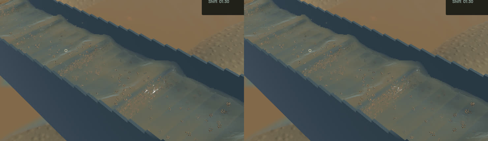

# Travelling crest detail and joined fine suspension

Surface detail previously took velocity from the nearest particle envelope. A front-particle switch could move the reflection/refraction phase of an entire patch. The real-GPU control reproduces a **0.8 m/s** switch; the shared positive water-column gather reduces the adjacent-sample change to **0.000288 m/s**. Bounded, band-filtered millimetre-scale normal detail now travels with that joined flow and stays tangent to the reconstructed sheet. Stationary water and unresolved detail receive no extra disturbance; phase-reset continuity is tested. No surface displacement, extra particle, target or fullscreen pass is introduced.

Fine sediment's read-only optical footprint expands from about 3 cm to **6 cm across the channel**, retaining its 12 cm streamwise footprint. This joins undersampled fine parcels into smoother suspension instead of separate round brown patches. Positive water/fine/cross-section moments, domain-edge totals, uniform concentration, actual broad concentration gradients and vertical bed/bulk strata pass independent controls. The new cross-channel footprint intentionally filters narrow optical features; it is a presentation approximation, not simulated sediment diffusion or calibrated turbidity. The outlet is sampled before this channel-only reconstruction.

The native improvement is localized to travelling highlights, refraction and smoother suspended shading. Broad standing waves, actual muddy plumes and grain stippling remain; broader water art stays open. The complete river RGB, accepted airborne-outlet crop and water-path debug RGB are byte-identical. Sediment debug changes as intended. Frozen physical clocks, steps, tracks, flow, machine/material fields and sampled surface geometry match. All water/riffle/terrain stepping, force laws, particle populations and cadence are unchanged relative to the separate actuator correction.

**52 app, five slurry unit, five slurry integration and 12 explicitly run real-GPU optics checks pass.** One render profiling test remains ignored. Strict scoped all-target Clippy, formatting, signed Mach-O packaging and native launch pass. The pre-existing unused game constructor warning remains. Full soil/gameplay and manual OS controls are not rerun for this rendering change.

| Serial 20-second native windows | Before | After |
|---|---:|---:|
| Render FPS | 55.49 | 55.68 |
| p95 frame time | 26.33 ms | 26.34 ms |
| Physical simulation / wall time | 0.3816x | 0.3832x |
| Bulk and dry-mass budgets | Pass | Pass |
| Physical real-time gate | Fail | Fail |

These short developing-scene windows show similar throughput, not a demonstrated speedup. The final water-balance error is -7.84994e-06 m³ and gold error 1.82e-12 g.

The [wall-timed preview](2026-10-24-crest-transport.mp4) retains all 44 source frames over 3.918 wall seconds / 1.433 physical seconds. All 43 presentation/worker intervals advance, with zero buffer underruns. Review includes [all temporal crops](2026-10-24-crest-transport.temporal.jpg), six full samples and full outlet/river views. Repeated video frames are display holds; whole-video playback is not claimed.

The signed app is `/Users/simonheikkila/.codex/visualizations/2026/10/18/01a14ce3-309f-7782-9a7c-ccd0efaf3227/crest-flow-polish-20261024/final-app/First Bend.app`. All heavy jobs ran sequentially. Scoped cleanup leaves zero test/browser processes; 14 shared Playwright MCP and 56 Node processes are untouched. Only the audited regenerable mining/mining-sim playable caches were cleared after verification, preserving source, saves and the signed app. Source/binary/media hashes and conservation evidence are in the [receipt](2026-10-24-crest-transport.json). The already-tested actuator correction is saved separately in [its report](2026-10-24-zero-actuator.md); retained contact accuracy remains unresolved. Real-time simulation and the full game remain open.
