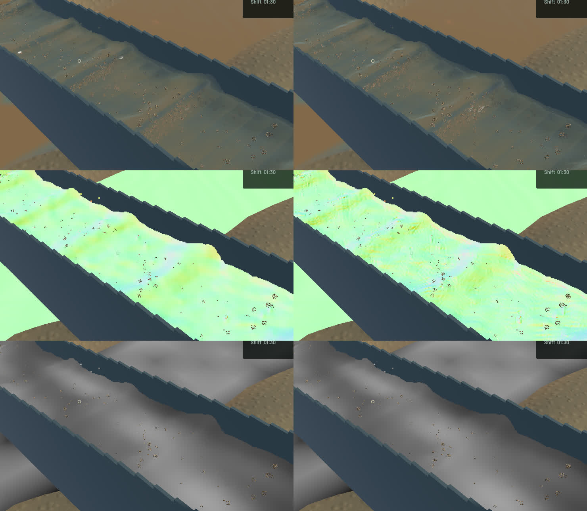
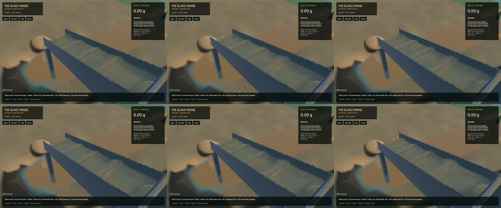

# Local crest and slurry shading correction

Connected channel water now uses a continuous local reciprocal-depth surface for subpixel position, tangent and slurry visibility. The old distant-shoulder fit was accurate on quadratic sheets but rounded sharper travelling ridges. An independent real-GPU sinusoidal-ridge control reproduces **0.930 mm** position error and **0.4863** maximum normal-vector error. The corrected control measures **0.117 mm** and **0.0161**; an oblique ridge measures **0.085 mm** and **0.0100**. Existing layer, dry-edge, shallow-column, volume and concentration controls remain intact. This corrects reconstruction artifacts while retaining the actual dirt plumes and physical standing waves.

The first native trial exposed fine depth noise previously hidden by the broad normal fit. The final two existing passes now reject unresolved texel oscillation with a compact sixth-difference filter. It retains degree-five reciprocal-depth profiles and over 99.9% amplitude of a ten-texel wave. The GPU noise control reproduces a **0.999 mm** ripple before the correction and **0 mm** afterward; the resolved quadratic crest remains within 2 micrometres. Channel boundaries and the accepted outlet retain their existing handling. No render target, fullscreen pass, particle or simulation grid is added.

**11 explicit real-GPU optics checks, 5 explicit GPU integration checks and 51 app tests pass.** One profiling test remains deliberately ignored. Strict scoped all-target Clippy, formatting, whitespace and signed Mach-O app packaging pass. The [receipt](2026-10-24-local-crest.json) retains failed reproduction logs, final checks, source and binary hashes. Full soil/gameplay suites and manual controls were not rerun for this rendering change.

Exactly three rendering/test source files differ from `84a507c`. All 121 protected tracked simulation sources retain their committed bytes. Five frozen pairs match clocks, solver steps, selected authoritative particle tracks, flow, machine/material fields and render kernels. Colour changes at 92,125 pixels. The **full river RGB and 280×230 falling-outlet control crop are byte-identical**; the wider outlet view also contains changed channel water.

| Matched sequential 20-second native windows | Before | After |
|---|---:|---:|
| Render FPS | 55.67 | 55.74 |
| p95 frame time | 25.65 ms | 25.44 ms |
| Physical simulation / wall time | 0.3315x | 0.3348x |
| Bulk and dry-mass budgets | Pass | Pass |
| Physical real-time gate | Fail | Fail |

These short windows show similar throughput, not a proven speedup. Final sluice-water balance error is 0 m³ and gold error 3.64e-12 g. Physics remains slower than real time; broader water art and simulation work remain open.

The [wall-timed flow preview](2026-10-24-local-crest.mp4) uses all 33 native source frames in 182 display frames at 60 FPS. Capture targets 12 Hz, spanning 2.932 wall seconds /0.900 physical seconds. All 32 presentation intervals advance, 27 worker snapshots advance and no presentation buffer underruns occur. Review includes [every temporal crop](2026-10-24-local-crest.temporal.jpg), six full flow samples and the debug layers. Display holds are not additional physical steps; whole-video playback is not claimed.

The signed playable app is `/Users/simonheikkila/.codex/visualizations/2026/10/18/01a14ce3-309f-7782-9a7c-ccd0efaf3227/crest-patch-20261024/final-app/First Bend.app`. Builds, tests and native captures ran sequentially. Cleanup reports no task-owned games, compilers, encoders or test browsers; 14 shared MCP and 56 Node processes remain untouched. No new panic-full or WindowServer report appeared. Older named task-generated app bundles were compressed and every original file verified against its ZIP before removing the expanded copy. Current app, previous baseline, original checkout and user stash are preserved.

The unaccepted contact-query optimization is preserved byte-for-byte in `/Users/simonheikkila/.codex/visualizations/2026/10/18/01a14ce3-309f-7782-9a7c-ccd0efaf3227/crest-patch-20261024/pending-physics`, with restore instructions and earlier evidence in `contact-scan-20261024`. It is excluded from the active playable source/build; its first scalar version was rejected for a ninefold pair-time regression, and the revised unit-tested version still needs controlled performance verification. Follow-up remains `sluice-contact-fine-grid-20261024`.
