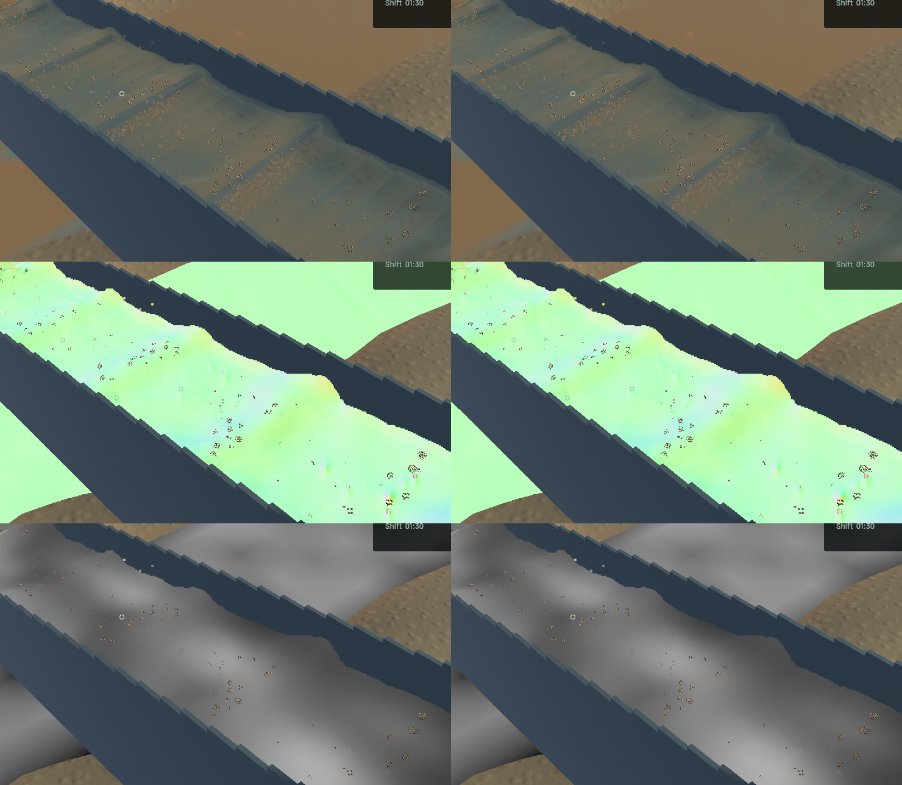
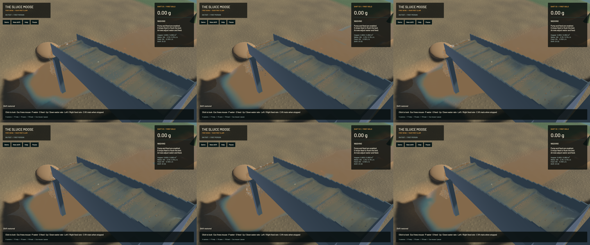

Connected-water reconstruction now retains the diagonal curvature of an oblique crest. Previously, only the two screen-axis curvature terms were available; the resulting normal fit could add a rounded shoulder and change its optical footprint with camera orientation. Four diagonal depth samples supply the missing term only when they agree with the same curved sheet. Its confidence fades continuously, and the intercept, tangent and normal fit use it consistently through full-resolution pixel phases. This adds at most four texture reads per channel pixel, with no new pass, render target or simulated particle.

The visible change is small. Matched sluice colour changes at 2,596 pixels, normals at 9,333 and extinction at only 16 pixels. **The requested muddy-patch fix remains in progress.** Broad rounded standing waves and muddy regions are still visible; this checkpoint does not declare the water presentation complete. Additional native scene-only and optical-column captures separate opaque background from water path, but do not establish one cause for the remaining patches. Continue that investigation under `sluice-oblique-crest-20261024` and the broader water-art issue.

The exact final GPU regression fails against the previous production shader: analytic oblique-sheet normal vector error is 0.0269286 (about 1.54 degrees). The corrected shader gives at most 0.00000888, about 0.00051 degrees, against the unchanged 0.001 vector-error bound. Both diagonal orientations and the original axis-aligned crest pass; smooth optical-path error stays below 0.082% and uniform suspension keeps its concentration. Horizontal, vertical and diagonal independent clear/muddy layer edges retain their own analytic normals and extinction. The remaining inclined/grazing sheet, shallow film, optical volume and outlet controls pass.

**51 application checks and ten explicitly executed real-GPU optics checks pass**; one application profiling check is still ignored. Strict scoped all-target Clippy, formatting, whitespace and signed macOS packaging pass. This is scoped verification, not a full-workspace check. All 322 tracked authoritative solver sources in the audit are identical to the baseline; among build sources only the composition shader and its GPU test change. Water/riffle/terrain dynamics, material stocks, physical cadence and render kernels are preserved.

Five before/after frozen views retain identical physical clocks, solver steps, selected particle tracks, machine/material fields and render kernels. Full river RGB and the accepted falling-outlet crop are byte-identical. The wider outlet image includes channel water and changes locally.

| Sequential 20-second windows from the same saved input | Before | After |
|---|---:|---:|
| Mean render FPS | 55.79 | 55.62 |
| p95 frame time | 25.67 ms | 25.87 ms |
| Simulation / wall time | 0.3248× | 0.3199× |
| Physical real-time gate | Failed | Failed |

These short windows show no speedup. Both bulk-material and dry-mass budget gates pass. After-run whole-water residual is -7.819 mL, sluice water 0.000 mL and gold 3.64e-12 g. Rendering FPS and physical throughput remain separate.

The [wall-timed preview](2026-10-24-oblique-crest.mp4) retains all 66 captured frames in 364 display frames at 60 FPS. Repeated display frames are not extra physics. All 65 presentation intervals advance; worker snapshots advance in 57 intervals and hold in eight, with zero recording underruns. Review covers the six temporal samples, full frozen output and separate scene/column diagnostic layers. Whole-video viewing and manual OS input are not claimed. One diagnostic invocation used the invalid `thickness` label and exited before capture; the corrected `column` capture completed. The [receipt](2026-10-24-oblique-crest.json) records hashes and scope.

All heavy jobs ran sequentially with one compiler/encoder worker. Required scoped cleanup leaves zero agent-browser, Playwright test or Chrome-for-Testing processes; 14 shared Playwright MCP and 56 Node processes remain untouched. Native workers exited after draining their render frames. No new panic-full/WindowServer report appeared. The original dirty checkout and user stash remain preserved. Installed Beads rejects `bd sync`; only the two touched project rows are merged from its export. This is a committed rendering checkpoint in the continuing game goal.
