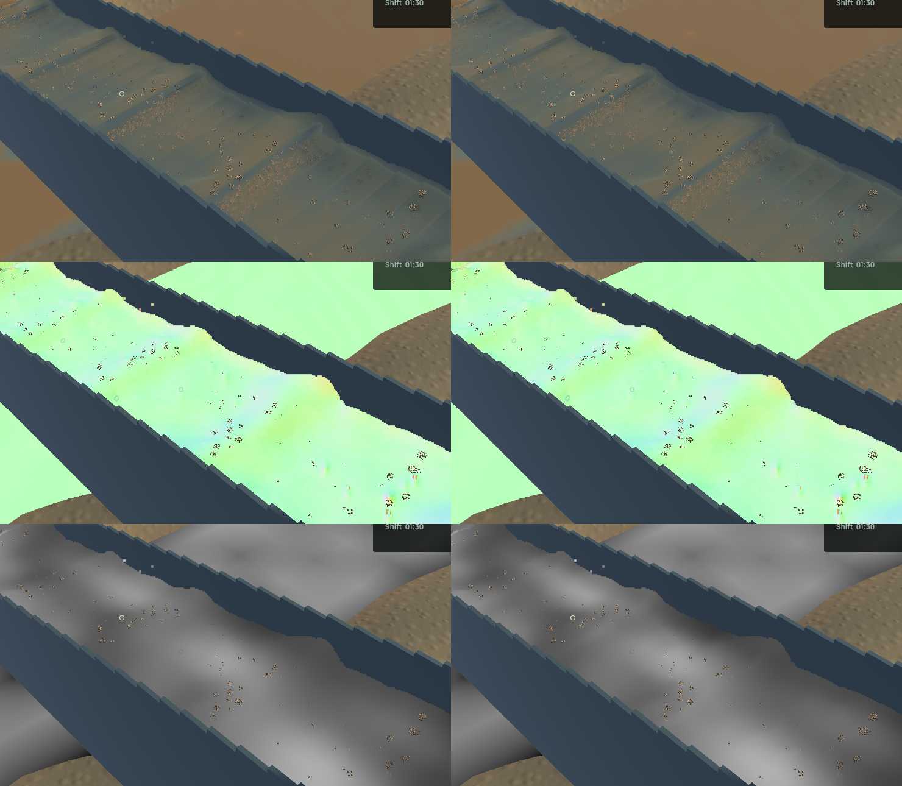
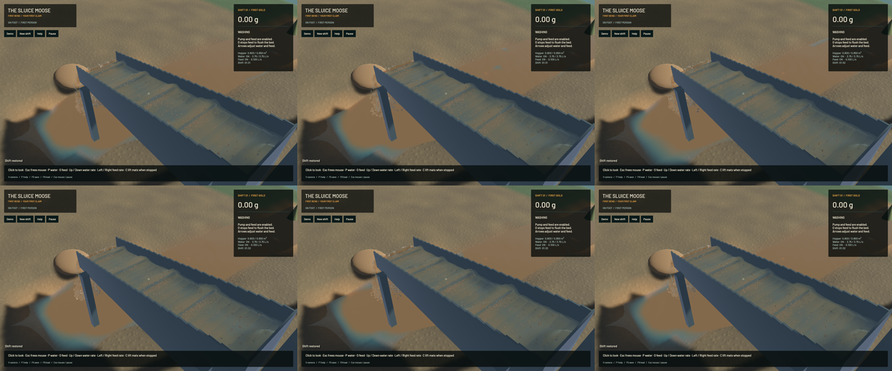

The channel-water filter now exchanges additive optical water and sediment moments without the previous loss at a thinning wet edge. It uses symmetric positive exchanges between connected samples; the connection fades continuously as water support vanishes. A new GPU control exposed 10.53% water-ray-column loss in one old filter pass, and a complete grazing-sheet control exposed 28.27% loss of the additive sediment moment after the old four-filter sequence. These are **rendering data errors, not losses from the physical water or material ledgers**.

The same positive pair weights update both moments. Each of eight reachable neighbours has weight at most one eighth, so the output is a nonnegative combination; equal and opposite exchanges cancel in the summed ray columns. A zero-water gap blocks the entire path. The measured optical-impulse RMS footprint is 14.13 mm; its one-pass bound is 45 mm divided by sqrt(e), about 27.3 mm. This is a presentation reconstruction, not sediment diffusion in the physical solver.

Geometry is established before its distances drive the optical exchange. Four original shape filters and four optical exchanges share six fullscreen draws and the existing ping/pong targets. There are two additional draws, no added target or particle, and no change to physical cadence. The depth-filter body is byte-identical to the baseline. Airborne outlet water keeps its original four filters; the final optical-only draws copy it unchanged.

The regression now judges the complete filter and final optical gather, rather than rewarding an intermediate filter for deleting the optical impulse. The unchanged visible-crest bound is 200/m: final extinction is 160.87/m while conserving both staged ray moments to within 7.60e-9 relative error in that fixture. The old sequence gives 65.69/m but loses 28.27% of its sediment moment. A transparent compatibility alias and two no-op slots reproduce those four old filters in the new staged probe; the original filter body is unchanged.

Finite-sheet phase and disconnected-film controls retain both additive sums within 5.71e-08 relative error, against an unchanged 2e-6 bound. Independent films keep their own turbidity, and dry coverage stays dry. Adding 1e-12 m of optical water at a new texel causes **zero measured float32 change** to established columns in the birth control. A reflected-boundary candidate was rejected: although it preserved the static sums, the actual GPU birth control produced a 16.3% established-column jump.

**51 application checks and ten explicitly executed real-GPU optics checks pass**; one application profiling check remains ignored. Scoped strict all-target Clippy, maintained-package formatting, whitespace and signed macOS packaging pass. This is not a full-workspace or manual-controls check. All 322 audited authoritative solver sources are identical to the baseline; this change touches the rendering pipeline, blur shader and its GPU test.

Six matched frozen view pairs retain identical physical clocks, solver steps, selected particle tracks, machine/material fields and render kernels. Full normal RGB, full river RGB and the accepted falling-outlet crop are byte-identical. Sluice colour changes at 94,044 pixels, extinction at 125,411 and optical path at 51,111. The visible change is local opacity and turbidity reconstruction; broad standing waves and granular speckling remain visible, and full water-art completion is not claimed.

| Sequential 20-second windows from the same saved input | Before | After |
|---|---:|---:|
| Mean render FPS | 55.79 | 55.73 |
| p95 frame time | 26.15 ms | 25.82 ms |
| Simulation / wall time | 0.3216× | 0.3214× |
| Physical real-time gate | Failed | Failed |

Both bulk-material and dry-mass gates pass. After-run whole-water residual is -7.819 mL, sluice water 0.000 mL and gold 1.36e-12 g. These short windows show similar performance, with no speedup claim. Rendering FPS remains separate from physical real time.

The [wall-timed flow preview](2026-10-24-optical-exchange.mp4) retains all 57 saved frames in 181 display frames at 60 FPS. Capture targeted 24 Hz and saved about 19 Hz; repeated display frames are not additional physics. All 56 presentation intervals advance. Worker snapshots advance in 28 intervals and hold in 28, with zero **presentation-buffer** underruns. The recording spans 2.958 wall seconds and 0.933 simulated seconds. Review covers [all 57 local temporal crops](2026-10-24-optical-exchange.temporal.png), six full temporal samples, the full midpoint and matched colour/normal/path/extinction layers. Whole-video playback and manual OS input are not claimed. The [receipt](2026-10-24-optical-exchange.json) records source, input, binary, timing and media hashes.

The conservation claim is deliberately limited to additive **ray-column** moments. Exact perspective-weighted 3D optical volume and calibrated sediment phase lighting remain open under `sluice-optical-projection-20261024`; projected ray areas vary with camera depth and angle. The broader crest/mud presentation and the full mining-game goal remain active. Physical fluid, riffle, terrain and material ownership remain authoritative.

Heavy checks ran sequentially with one compiler/encoder worker. No owned game, compiler, encoder, agent-browser, Playwright test or Chrome-for-Testing process remains; 14 shared Playwright MCP and 56 Node processes were left untouched. No new panic-full/WindowServer report appeared. Automatic approval review rejected a wider artifact deduplication because of unrelated inode/link-state risk; the safe cleanup linked only byte-identical PNGs inside the previous turn's owned capture folder and discarded this turn's rejected generated app. Original working files and the user stash remain preserved. Installed Beads rejects `bd sync`; only the four touched project issue rows are exported for the scoped checkpoint.
