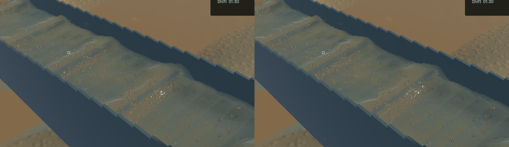

Connected water now keeps its measured tangential kernel footprint when normal support is thinned. The old compensation spread crest shoulders and their muddy optical columns sideways by up to √2 per tangent. Actual represented water volume was already normalized separately; support-volume preservation was unnecessary. The existing particle-volume and GPU column-integral controls still pass. No particle is moved and the rendering diff changes no water, riffle, terrain or sediment-stepping source.

Fine travelling detail now integrates over the actual pixel parallelogram and fades before Nyquist. The former Gaussian interpreted the full pixel width as one standard deviation, twelve times its true footprint variance. Independent 128×128 numerical quadrature and the actual old GPU function reproduce a **0.462498 normal-gradient error**; the corrected GPU result meets the **0.00001** bound. Directional filtering, stationary-water behavior, bounded normals and phase-reset continuity remain covered. Buffer sizes and draw-pass count are unchanged.

The matched frame changes 123,540 colour pixels and 11,985 extinction-debug pixels. Highlights break into finer travelling detail and the reconstructed optical shoulders narrow. Broad physical wave envelopes, real slurry plumes and granular stippling remain visible: this is a correction of two rendering defects, not complete acceptance or calibration of the water art. Five saved-view pairs retain identical clocks, solver steps, selected physical tracks, flow, machine and material fields. Render kernels intentionally change. Full river RGB and the accepted falling-outlet crop remain byte-identical; the wider outlet view also contains changed channel water. The actual bundled flowing demo is separately launched and inspected, with matching frozen physical fields before and after.

**54 application checks and 13 explicitly executed real-GPU checks pass.** One profiling check stays ignored. After strengthening the test-only negative control, the modified application case and all GPU checks pass again. Strict scoped all-target Clippy, formatting, signed native packaging and launch pass. The final binary is byte-identical to the reviewed capture binary. Full gameplay and manual controls are not rerun for this rendering diff. The separate experimental-soil checkpoint is documented in [its own report](2026-10-24-contact-warm-projection.md); it remains outside ordinary Session and fails its passivity gate.

| Sequential 20-second native windows | Before | After |
|---|---:|---:|
| Render FPS | 55.70 | 55.67 |
| p95 frame time | 27.26 ms | 26.85 ms |
| Physical simulation / wall time | 0.3814x | 0.4066x |
| Material/dry-mass budgets | Pass | Pass |
| Physical real-time gate | Fail | Fail |

These short windows show similar rendering throughput and do not establish a physics speedup. Final whole-water residual is -7.89709126e-06 m³, sluice-water residual 0.0 m³ and gold residual 0.0 g.

The [wall-timed preview](2026-10-24-pixel-support.mp4) contains all 45 native source frames across 3.953 wall seconds / 1.633 physical seconds. All 44 presentation and worker intervals advance, with zero recording underruns. Review covers [every temporal crop](2026-10-24-pixel-support.temporal.jpg), six full samples, matched debug layers and the bundled demo. Repeated video frames are display holds; whole-video playback is not claimed.

The signed local app is `/Users/simonheikkila/.codex/visualizations/2026/10/18/01a14ce3-309f-7782-9a7c-ccd0efaf3227/crest-pixel-support-20261024/final-app/First Bend.app`. One packaging attempt failed at stripping because the disk was full; the packager refused the invalid non-Mach-O output. Thirty-one older task-generated benchmark output snapshots were losslessly compressed, with byte verification and restoration commands retained in the local manifest, releasing 504,919,249 logical bytes. Only regenerable application build cache was cleared before a successful rebuild. Original inputs, user saves, historical signed apps and the user stash are retained. Heavy jobs ran sequentially. Scoped cleanup leaves zero owned test/browser/native/build processes; 14 shared Playwright MCP and 56 Node processes remain untouched. No new panic-full or WindowServer diagnostic appeared. The [receipt](2026-10-24-pixel-support.json) records source, binary, fixture, media and check evidence. Broader water art and the full playable-operation goal remain open.
