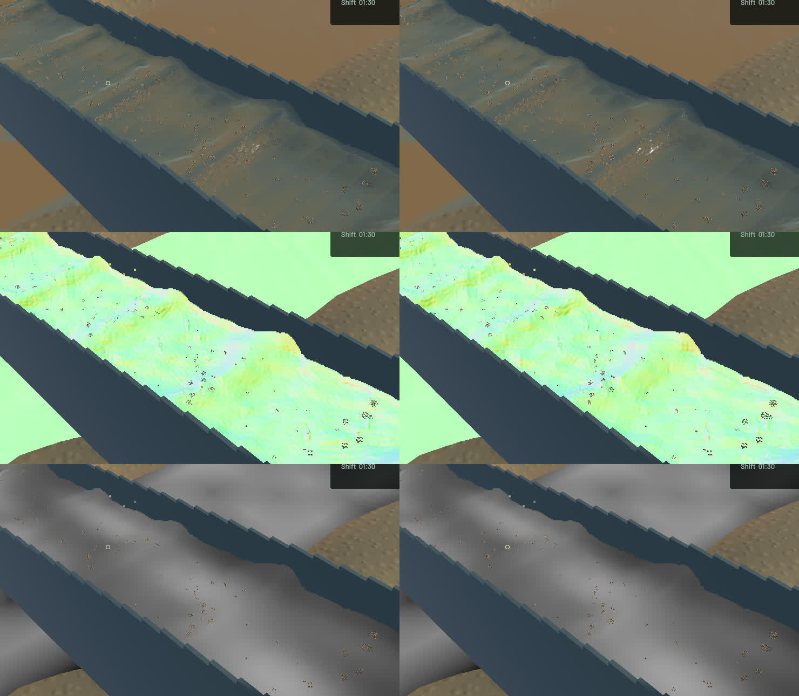
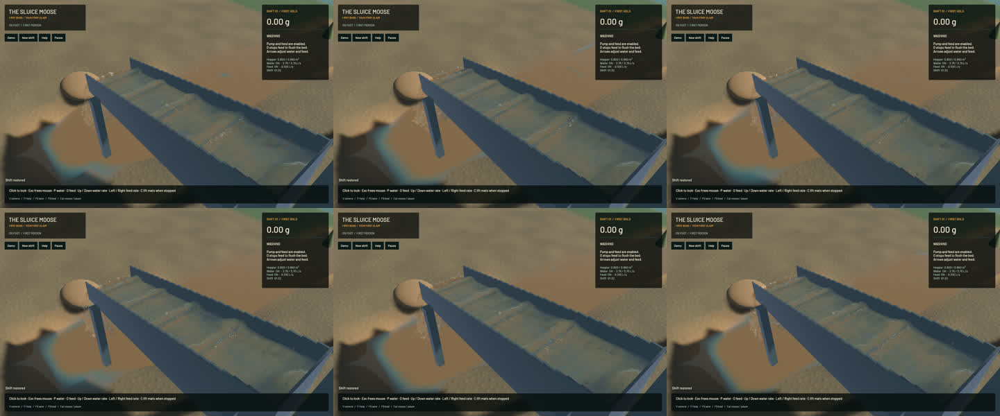

# Preserve travelling crests through geometry reconstruction

The production geometry filter was rounding a resolved travelling ridge before the final compositor could reconstruct its normal or clip its muddy-water column. Its distant shoulder fit retained quadratic fixtures, but a twelve-texel sinusoidal ridge reproduced **8.076 mm** of depth error. The connected sheet now uses the existing compact high-order noise filter in the geometry passes. Real-GPU controls on both screen axes and four pixel phases measure at most **0.00573 mm** error. Dilute support blends continuously; detached outlet water retains its existing filter. Water/sediment optical moments keep their conservative exchange passes. No simulation grid, timestep, particle, force law, target or fullscreen pass is added or removed.

The native improvement is localized: wave lips and highlights are sharper, and the visible optical gather follows that corrected interface. Broad physical standing waves, suspended dirt plumes and grain stippling remain; this does not finish water art or calibrate sediment lighting. The complete river RGB and accepted falling-outlet crop remain byte-identical. Five frozen comparisons retain matching physical clocks, steps, tracks, flow, machine and material fields. All **201 protected simulation sources** match the committed baseline; only the blur shader and its rendering regression change.

**11 explicit real-GPU optics checks and 51 app checks pass**, with one profiling test deliberately ignored. Strict scoped Clippy and formatting pass. The game dependency still reports its pre-existing unused constructor warning. The old shader fails the new ridge control; the corrected shader retains existing layer, shallow-path, concentration and optical-volume controls. Full soil/gameplay and manual controls were not rerun for this rendering change.

| Sequential 20-second native windows | Before | After |
|---|---:|---:|
| Render FPS | 55.74 | 55.71 |
| p95 frame time | 26.90 ms | 26.93 ms |
| Physical simulation / wall time | 0.3796x | 0.3780x |
| Bulk and dry-mass budgets | Pass | Pass |
| Real-time gate | Fail | Fail |

These short windows do not establish a performance improvement. Final sluice-water balance error is 0 m³ and gold error 2.27e-12 g. Physical simulation remains slower than real time.

The [wall-timed flow preview](2026-10-24-resolved-crest.mp4) retains every one of 34 captured source frames. The capture spans 2.973 wall seconds / 1.100 physical seconds, with 33 presentation advances, 33 worker advances and 0 buffer underruns. Review includes [all temporal crops](2026-10-24-resolved-crest.temporal.jpg), six full samples and matched debug layers. Display holds are not additional simulation steps; whole-video playback is not claimed.

The signed app is `/Users/simonheikkila/.codex/visualizations/2026/10/18/01a14ce3-309f-7782-9a7c-ccd0efaf3227/crest-resolved-20261024/final-app/First Bend.app`. All heavy jobs ran sequentially. A low-disk strip failure was caught by the Mach-O packaging guard. Named obsolete generated cache executables and rejected diagnostic probes were reversibly archived and verified before relinking; current baseline app, input saves, original checkout changes and user stash are preserved. The unfinished active-pressure prototype is backed up under `/Users/simonheikkila/.codex/visualizations/2026/10/18/01a14ce3-309f-7782-9a7c-ccd0efaf3227/crest-resolved-20261024/pending-pressure` with hashes and restore instructions, and excluded from this build. Cleanup and crash-report checks are retained with the [receipt](2026-10-24-resolved-crest.json).
