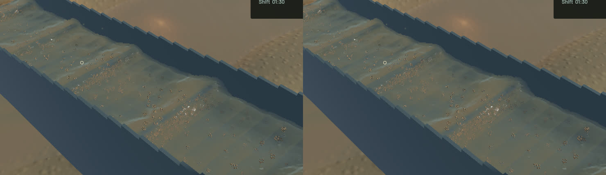

The corrected normal-directed crest support now uses a smaller matrix calculation. With original support axes A and compression S, form B=S A, diagonalize the right Gram matrix BᵀB, then return B V. Orthogonal V preserves the full support tensor B V Vᵀ Bᵀ=S C S. The existing five Jacobi sweeps, exact bypasses, normal thinning, tangent footprint and determinant normalization remain. The old corrected world-tensor method is retained only for tests; its body is byte-identical to a48a22c. There is no new runtime allocation, render pass or simulation policy.



All 62 ordinary application tests pass. Both normally ignored CPU profiles were explicitly executed and pass, along with the complete-chain GPU regression, strict scoped all-target Clippy, formatting, whitespace, signed packaging and native launch. Independent f64 controls cover repeated eigenvalues, rotated/signed/permuted frames, arbitrary normals, continuous phases and exact bypasses. They check tensor, orthogonality, determinant, tangent support, admitted axis lengths and shader ray interpretation at the unchanged 2e-5 bound. A negative control has the right tensor but non-orthogonal axes and is rejected by the oracle. Tensor identity alone is insufficient.

The saved scene captures every selected channel kernel: 60097 inputs, fingerprint 88533c5fa06bbdb3. Capture is disabled before timing, and neither timed method pays the TLS hook. Eight alternating full-dataset batches reduce median support math from 21.242 to 11.349 ms (46.6% less time). Maximum new shader radial error is 4.36e-07; maximum axis-pair cosine is 1.68e-07. The separate-process full-rebuild profile changes from 94.004 to 91.627 ms; this smaller unpaired result is not substituted for native throughput.

| Sequential 20-second native windows | Before | After |
|---|---:|---:|
| Mean surface-worker build ms | 99.95 | 90.66 |
| Render FPS | 55.69 | 55.68 |
| p95 frame ms | 26.46 | 26.13 |
| Physical simulation / wall time | 0.3933x | 0.3880x |
| Bulk and dry-mass budgets | Pass | Pass |
| Physical real-time gate | Fail | Fail |

Surface-worker cost falls 9.3% in these short native windows. Overall rendering and physical throughput remain similar; this is not a physical real-time gain. The benchmark exits 1 because the unchanged real-time gate fails. Full soil/gameplay suites and manual controls were not rerun for this rendering-math change.

Six frozen pairs retain selected physical clocks, tracks, flow, machine/material and excavation fields; all 688 simulation/vendor source files match the baseline. River RGB and accepted airborne-outlet crop are byte-identical. The sluice final image changes only 644 pixels, at most 2 of 255 per colour channel (mean 0.000201). The output basis/order may differ; complete instance byte equality is not claimed. Independent support/ray controls and native comparisons establish the relevant geometry equivalence.

The [wall-timed flow preview](2026-10-24-support-gram.mp4) retains all 46 captured frames across 3.993 wall / 1.567 physical seconds. All 45 presentation and 45 worker intervals advance, with zero capture underruns. Review includes the matched final/normal/extinction/column images, full native views, six temporal samples and [all temporal crops](2026-10-24-support-gram.temporal.jpg). Display holds are not additional simulation steps; whole-video playback is not claimed.

Signed app: `/Users/simonheikkila/.codex/visualizations/2026/10/18/01a14ce3-309f-7782-9a7c-ccd0efaf3227/support-gram-20261024/app/First Bend.app`. Heavy jobs ran serially, with one compiler or encoder worker. Scoped cleanup leaves no owned game/build/encoder or test-browser process; 16 shared Playwright MCP and 64 Node processes remain untouched. No new panic-full or WindowServer report appeared. Original dirty files, stash, previous app and saved input are preserved. Two generated benchmark-exit saves are losslessly compressed with hashes and restore commands. Installed Beads does not support bd sync; its failure is logged and only two project rows are exported. The [receipt](2026-10-24-support-gram.json) records source/evidence hashes. Broad water art, real-time simulation, digging qualification and operation stages remain open.

Reproduce the saved-kernel profile from the current worktree; the input path and SHA-256 are recorded in the receipt:

```bash
CARGO_TARGET_DIR=/Users/simonheikkila/Documents/12-Coding/the-sluice-moose/target \
SLUICE_SURFACE_LOAD=/Users/simonheikkila/.codex/visualizations/2026/10/18/01a14ce3-309f-7782-9a7c-ccd0efaf3227/storage-final-2026-10-23/grown.json.save.json \
cargo +nightly test -p mining --profile playable --locked --jobs 1 \
  profile_saved_native_corrected_support -- --ignored --test-threads=1 --nocapture
```
