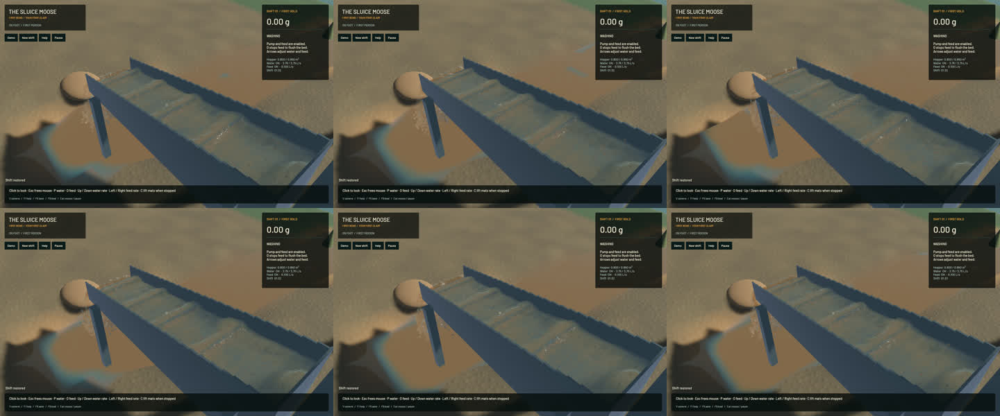

# Faster water reconstruction with identical output

Water surface preparation now caches immutable placement values and the actual stepped wall heights once per render snapshot. It rebuilds those values for each snapshot, covering changes in placement, slope and hydraulic profile. The same positive slurry filter now gathers lower/centre/upper contributions in the original floating-point order, writing each destination once. All 35 optical reconstruction passes, their footprint and additive water/fine/area moments are retained. Physical particles, water/riffle/terrain solvers, force laws, cadence and rendering targets/passes are unchanged.

Eight alternating baseline/candidate runs on the same saved 117,544-water / 4,308-grain scene reduce median surface reconstruction from **74.72 to 68.06 ms (8.92%)**. Cache alone measured 3.70% in its separate eight-run sequence. Every trial retains the complete paired-instance byte fingerprint `97e27b0260ef8398` across all 65,536 records. The profiling fixture moves water by velocity/120 to exercise correspondence; it is not a physics benchmark.

**52 app checks, 4 slurry unit checks, 5 slurry integration checks and 11 explicit real-GPU optics checks pass.** One default-suite profiling test is ignored and was run explicitly for the timings. Exact transform/wall comparisons cover both hydraulic profiles, four rotations and three slopes. An independent copy of the original scatter matches every f64 moment bit through all axes and clamped/singleton boundaries; reversing addition order deliberately fails that control. Strict scoped all-target Clippy, formatting, Mach-O packaging and signing pass. The existing game dependency's unused-constructor warning remains. Full soil/gameplay suites and manual controls were not rerun for this read-only rendering change.

All **200 protected simulation sources** match the baseline. The read-only exception is `mining-sim/src/slurry.rs`, where optical reconstruction is bit-equivalent. The complete frozen sluice, outlet and river RGB images are **byte-identical**; their recorded physical clocks, steps, tracks and material/flow fields match.

| Sequential 20-second native windows | Before | After |
|---|---:|---:|
| Mean surface build | 77.92 ms | 68.77 ms |
| Render FPS | 55.59 | 55.68 |
| p95 frame time | 26.69 ms | 26.39 ms |
| Physical simulation / wall time | 0.3782x | 0.3847x |
| Bulk and dry-mass budgets | Pass | Pass |
| Physical real-time gate | Fail | Fail |

The controlled render-profile result is the performance claim. These short native windows advance different physical amounts and do not establish a simulation speedup. Native physical speed remains below real time. Final sluice-water balance error is 0 m³ and gold error -4.55e-13 g.

The [wall-timed preview](2026-10-24-surface-cache.mp4) includes all 34 captured source frames, spanning 2.959 wall seconds / 1.100 physical seconds. All 33 presentation and 33 worker intervals advance, with 0 buffer underruns. Review includes [every temporal crop](2026-10-24-surface-cache.temporal.jpg), six full frames and the full outlet/river views. Display holds are not extra simulation steps; whole-video playback is not claimed.

The preserved direct active-pressure candidate was also measured. Its complete saved physical state remains `e6934203145f8f31f1ddb61d6fc1ccff5b0ad6a5a32caa25723c0bd7a827256d`, but one live profile measures 4.430 ms pressure against the earlier 4.270 ms baseline, with no demonstrated useful gain. Those separate profiles do not establish a rigorous regression. The candidate is rejected, all pressure sources are restored, and evidence remains in `pressure-direct-20261024`.

The signed app is `/Users/simonheikkila/.codex/visualizations/2026/10/18/01a14ce3-309f-7782-9a7c-ccd0efaf3227/surface-cache-20261024/final-app/First Bend.app`. Heavy jobs ran sequentially. After inspecting Cargo dry runs and waiting for all tests/games to finish, only regenerable `mining` and `mining-sim` playable build outputs were cleared. Free space rose from 340 to 1232 MiB. Hash checks preserve all 17 protected app/input/source/original-checkout/diagnostic files; other dependency packages were outside the cleanup selection. Source and saves were not cleaned. Previous named obsolete cache binaries were also reversibly archived with verified round trips. Cleanup reports zero test/browser processes; 14 shared Playwright MCP and 56 Node processes are untouched. The [receipt](2026-10-24-surface-cache.json) contains timings, source/binary hashes, negative-control results and conservation evidence. Real-time simulation, broader water art and the full mining-game goal remain active.
