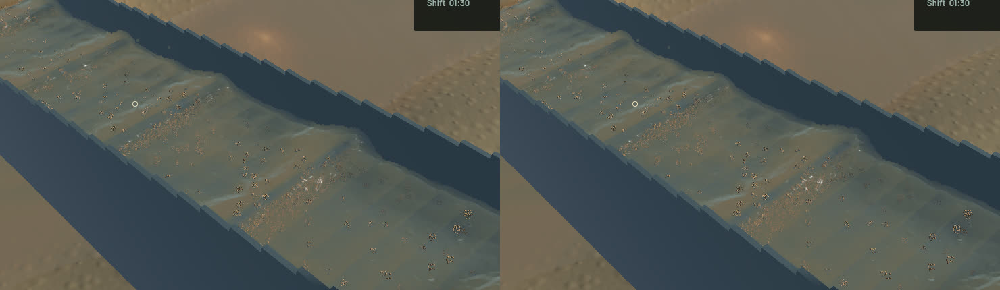
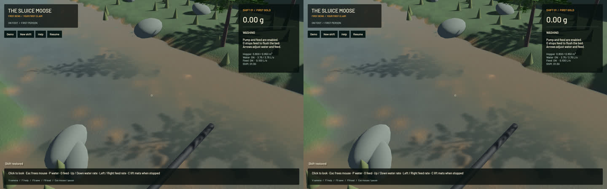

Oblique channel crests now retain their measured tangential covariance. The former free-boundary reconstruction kept only two arbitrary tangent diagonals: a 3:1 ridge at 45 degrees acquired a round tangent footprint. The replacement projects the complete covariance onto the tangent plane and floors only unresolved minor variance, preserving the resolved major footprint. Final support compression follows the measured surface normal. The old shortest-axis choice could squeeze a tangent when variance bounds made two axes equal. A continuous tensor compression preserves every tangential footprint, then recovers orthogonal axes for the existing shader. Determinant-normalized represented water volume, interpolation and the separate outlet path remain in place. Rotation and thin-support controls exercise the actual helper, including twelve orientations and the former lost cross term; a final-support control rotates the degenerate eigenframe and verifies normal compression, tangential support and determinant.

Shoreline optical support now follows the already extended water surface. Previously a single uniformly turbid wet corner lost three quarters of its extinction at a still-visible cell centre because dry support corners supplied zero extinction. Dry corners now extend a positive, depth-weighted optical-moment/water ratio from actual wet neighbours. Wet samples, signed shore clipping and physical stocks stay unchanged; actual clear water still dilutes muddy neighbours. This is a boundary coefficient reconstruction, not proof of globally conserved rendered optical volume. No physical sediment concentration is reduced.

All 60 application tests and the explicitly executed complete-chain GPU regression pass. One pre-existing profiling test remains ignored. New controls cover rotated anisotropy, continuous positive thin support, uniform muddy shores, unequal-depth muddy/clear mixtures, exact wet samples and exactly clear water. Scoped strict all-target Clippy, formatting, whitespace, signed packaging and native launch pass. Full soil/gameplay suites were not rerun for these two render-only files.

Six matched frozen views retain the selected physical clocks, particle tracks, flow, machine/material and excavation fields. All 688 tracked simulation/vendor source files match the starting commit. The accepted airborne-outlet crop is byte-identical. The sluice comparison changes 89456 colour pixels, and the river changes 13757; the visual change is local and modest. Broad standing waves, real suspension and granular stippling remain. Complete water art is still open.

| Sequential 20-second native windows | Before | After |
|---|---:|---:|
| Render FPS | 55.80 | 55.83 |
| Physical simulation / wall time | 0.3867x | 0.3879x |
| Mean render-surface build ms | 80.59 | 103.21 |
| Bulk and dry-mass budgets | Pass | Pass |
| Physical real-time gate | Fail | Fail |

Normal-directed reconstruction increases mean surface-worker build cost by 28.1 percent in this short sample. Rendering and physical throughput remain similar, with no capture underruns. Further optimization is tracked in sluice-normal-support-cost-20261024.

The benchmark exits 1 because the unchanged real-time gate fails. These short samples show similar throughput, not a speedup. Water residual is -7.871 mL and gold residual is -4.55e-13 g.

The [wall-timed native flow preview](2026-10-24-surface-polish.mp4) retains all 45 captured source frames over 3.947 wall seconds / 1.567 physical seconds. All 44 presentation intervals and 44 worker intervals advance, with zero recording underruns. Review covered the full sluice/river/outlet stills, final/normal/extinction/column comparison, six temporal samples and [all 45 temporal crops](2026-10-24-surface-polish.temporal.jpg). Display holds are not additional physical steps; whole-video playback is not claimed.

Signed app: `/Users/simonheikkila/.codex/visualizations/2026/10/18/01a14ce3-309f-7782-9a7c-ccd0efaf3227/surface-polish-20261024/app/First Bend.app`. Heavy jobs ran sequentially, with one compiler or encoder worker. Scoped cleanup leaves no owned native/build/encoder or test-browser process; 16 shared Playwright MCP and 64 Node processes remain untouched. No new panic-full or WindowServer report appeared. Original dirty checkout files, stash, previous app and saved input remain intact. The installed Beads CLI does not support bd sync; the attempted command is logged and only the three touched project issue rows are exported. The [receipt](2026-10-24-surface-polish.json) records source and evidence hashes.
