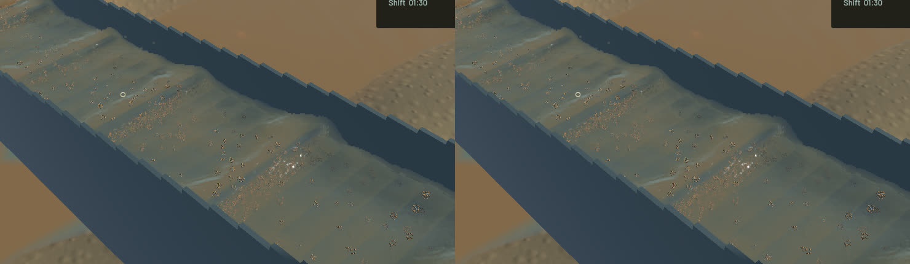

The renderer now evaluates sediment colour and fallback crest normals at the joined water surface. Previously, optical integration started at the front particle envelope; shortening its accumulated water and sediment moments uniformly retained the colour of hidden foreground slurry. A separate gradient probe at that envelope could give a connected crest the highlight of foreground spray. Both are rendering ownership defects. Real standing waves, slurry plumes and grain stippling remain visible; broader water art stays in progress.

After geometry reconstruction, an additive particle pass integrates each kernel only from the joined interface to the opaque back surface, also respecting the physical channel walls. Its second attachment sums bulk-weighted density gradients at that same shared point. A zero gradient retains the established normal fallback. Two positive symmetric exchanges reconstruct the new optical moments while copying geometry unchanged. The three added draws reuse thickness, normal-sum and ping/pong targets; no render target, particle buffer or simulation grid is added. The accepted outlet keeps its original chord and draw order; river handling is unchanged.

Independent real-GPU controls reproduce more than **350/m** false extinction from the old uniform-rescale method in stratified water; corrected concentration meets **0.01/m**, including the reverse muddy/clear arrangement and uniform mixtures. Numerical integration covers front/back/empty intervals, a 513-position interface sweep and full/partitioned represented volume. The joined gradient agrees with an independent f64 finite difference to **1e-4 relative error**. A zero-bulk foreground drop leaves it exactly unchanged; old front and unweighted-gradient controls measurably disagree. **18 explicitly executed GPU checks and 54 application tests pass**, with one profiling test ignored. The modified test assertion was rerun after a lint-only cleanup; strict scoped all-target Clippy and formatting pass. The initial test-local shader naming error and test lint failure are retained in the local evidence. Full physics/gameplay suites and manual controls were not rerun for this rendering change.

Six frozen view pairs retain identical clocks, solver steps, selected authoritative particle tracks, machine/material fields and selected render kernels. The matched sluice image changes 64,263 colour pixels. Fine normals can change because both their fallback gradient and their optical flow weights now belong to visible water; geometry and particles are retained. Full river RGB and the accepted falling-outlet crop are byte-identical. The wider outlet view includes changed channel water. Visual improvement is local: muddy crest colouring and fallback highlights are corrected, while broad waves and granular presentation still need review.

| Sequential 20-second native windows | Before | After |
|---|---:|---:|
| Render FPS | 55.83 | 55.69 |
| p95 frame time | 27.33 ms | 26.85 ms |
| Physical simulation / wall time | 0.4049x | 0.3898x |
| Material/dry-mass budgets | Pass | Pass |
| Physical real-time gate | Fail | Fail |

The short windows do not establish a simulation speedup. Final whole-water residual is -7.8707381e-06 m³, sluice-water residual 0 m³ and gold residual 5.00222086e-12 g. Benchmark exit1 reports the still-failed real-time gate; it is not counted as a full benchmark pass.

The [wall-timed motion preview](2026-10-24-visible-crest.mp4) retains all 34 captured source frames across 2.968 wall seconds /1.200 physical seconds. All 33 presentation intervals advance, 33 worker intervals advance, and recording underruns are zero. Review covers [all temporal crops](2026-10-24-visible-crest.temporal.jpg), six full samples, matched final/normal/extinction/column views and the native app launch. Display holds are not additional physical steps. Whole-video playback is not claimed.

The signed app is `/Users/simonheikkila/.codex/visualizations/2026/10/18/01a14ce3-309f-7782-9a7c-ccd0efaf3227/visible-crest-optics-20261024/final/final-app/First Bend.app`. 414 simulation/vendor source files are unchanged from this turn's starting state. The existing unfinished experimental-soil edits are preserved byte-for-byte, remain outside ordinary Session, and are excluded from this render commit. Builds, captures, tests, benchmarks and encoding run sequentially. Eight named older generated diagnostic outputs were losslessly compressed with byte verification and restoration commands, reclaiming 407,556,781 logical bytes; source, saves and historical signed builds remain intact. Scoped cleanup leaves zero owned native/build/encoder or test-browser processes; 14 shared Playwright MCP and 56 Node processes remain untouched. No new panic-full or WindowServer diagnostic appeared. Cleanup and crash-report checks are recorded in the [receipt](2026-10-24-visible-crest.json). Broader water art and the full operation remain open.

To reproduce the optical controls from the repository, run `cargo +nightly test -p mining-physics --test visible_water_column --profile playable --locked --jobs 1 -- --ignored --test-threads=1 --nocapture`. Existing optics use `--test water_optics` with the same flags. Package with `bash scripts/package-mining-macos.sh /private/tmp/visible-water-app`.
