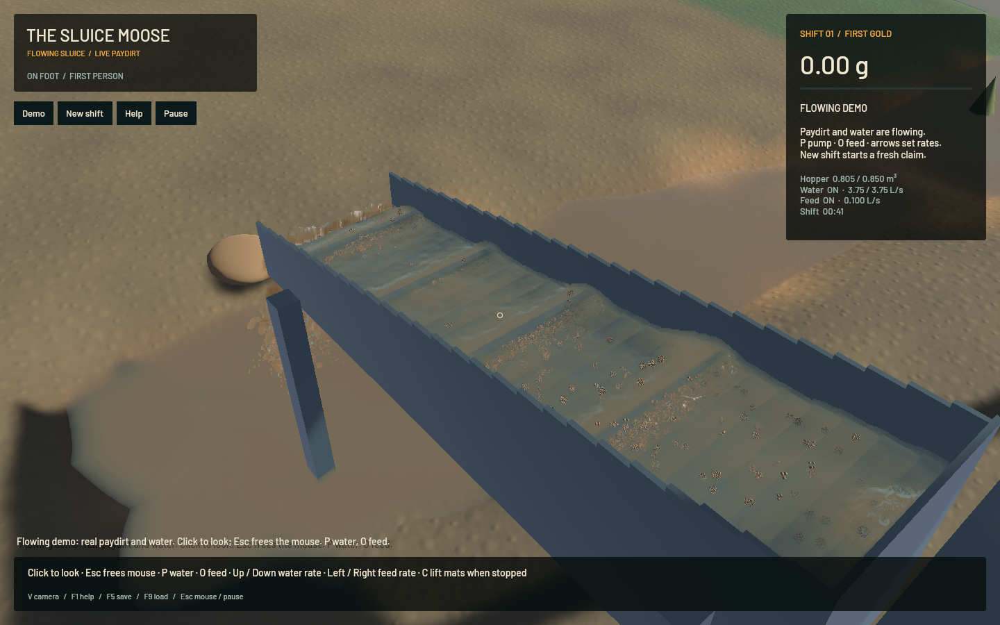

The current signed app contains the crest and muddy-shore fixes from `7204600`, `a48a22c` and `2e1b29d`. It is now also available at the normal local bundle path:

`/Users/simonheikkila/Documents/12-Coding/the-sluice-moose/target/bundles/First Bend.app`

This delivery copies the already tested signed bundle without rebuilding it. Its binary SHA-256 is `812a61d64b17f2c4e8c6bfa3d565a2e70e15834e800ec561d57f7bafa1326dcd`, matching the retained source receipt and original bundle; strict code-sign verification passes. The original dirty main checkout, user saves and stash are preserved. Launching its source launcher still builds that checkout, so use this bundle to review the current branch.

Oblique crests keep the complete measured tangent covariance, and normal thinning follows the water normal even when support eigenvalues tie. Four crest-preserving geometry passes are followed by optical exchanges. Visible water and mineral optical depth use the same joined surface and floor clipping; shoreline coefficients extend positive depth-weighted optical/water moments through the visible shallow boundary. Physical sediment is retained. The latest support-math optimization preserves this corrected shape while reducing native surface-worker cost 9.3% in the previously recorded short windows.

Fresh native launches of the delivered app exercise the bundled demo, rather than a separately loaded saved fixture. The sluice capture contains 45 source frames over 3.989 wall seconds and 2.217 simulated seconds. All 44 presentation and worker intervals advance, with zero recording underruns. Review covered the full native still and all 45 temporal crops. A separate river launch captures two advancing frames and exits cleanly. These checks establish current presentation, not full gameplay or real-time performance. Broad physical standing waves, actual suspended plumes and grain stippling remain visible; complete water art remains open.

The unchanged rendering sources and packaged binary were rehashed against the [previous complete validation receipt](2026-10-24-support-gram.json). That run passed 62 ordinary app tests, two explicit CPU profiles, one complete-chain GPU regression, scoped strict lint, format and signing. Those tests and its 20-second benchmark were not rerun for this copy/documentation step. Its 55.68 render FPS and 0.3880x physical speed remain the latest measured loaded-fixture result; real-time simulation still fails. The accepted airborne outlet and original water/riffle/terrain solvers are preserved.

Heavy jobs run serially: one native app or one single-worker contact-sheet encoder at a time. No task-owned process is intentionally left running. The [delivery receipt](2026-10-24-visual-delivery.json) records fresh captures, binary/source identity, retained validation, cleanup and crash checks. Unfinished digging diagnostics are preserved separately as an unapplied [experiment checkpoint](../physics/rigid-work-observer-checkpoint.md); no physics policy from that work enters this app.
