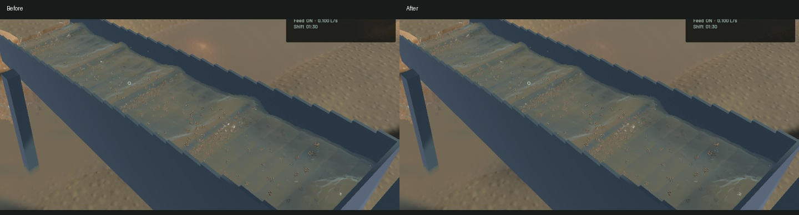
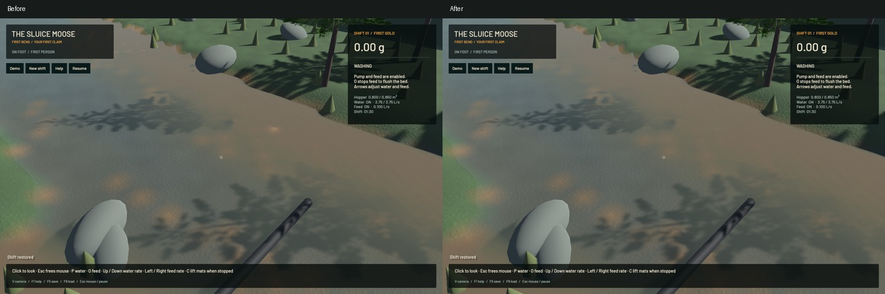

# Continuous crest profiles and shallow wet-ground transitions

The surface resolver previously used linear density crossings and selected dilute-water maxima by one of eight fixed depth-probe indices. That rounded curved profiles and stepped a travelling dilute crest between probes. It now uses a nonuniform continuous cubic profile, including interior maxima, and finds the first half-density crossing inside the existing bounded search. Compact-support zeros retain affine positive ramps. Float-height ties retain the refined peak position. The same joined interface still owns visible optical integration, normals and floor clipping.

A separate terrain artifact switched soil colour abruptly when water crossed 15 mm depth. Soil now wets smoothly over the first 3 mm of visible water, with 64 small albedo levels and matching chunk-cache invalidation. Saturated colour and dry colour retain their endpoints. This is visual wetting, not a soil-saturation model. True transported sediment is retained.

The retained legacy GPU control has 8.695 mm maximum crossing error versus 1.337 mm for the corrected interpolation. These are unscaled profile coordinates in the selected analytic poly6 controls, not a universal world-space accuracy certificate. Crossings beyond the 51 mm search are explicitly unobserved and only checked for bounded fallback. Across 256 phases of an independently known moving dilute peak, the largest old step is 4.542 mm versus 0.0272 mm of smooth physical translation now. Fourteen explicitly executed real-GPU optics checks pass, including existing optical-volume, separated-layer, grazing-angle, spray, shallow-water and outlet controls. The first attempt exposed a clamped-ramp regression and float-height tie; both were corrected before packaging. Failed logs remain in the artifact directory.

All 63 ordinary app tests pass; two CPU profiling tests remain deliberately unrun. Scoped strict Clippy, formatting, whitespace, signed packaging and native launches pass. No simulation timestep, grid, water particle, grain inventory, force, material or riffle setting changes. All 385 other crate source files match this turn's baseline, including the preserved unfinished contact experiments; tracked vendor sources are unchanged. There is no extra render target or pass.

| Sequential 20-second native windows | Before | After |
|---|---:|---:|
| Render FPS | 55.95 | 55.63 |
| p95 frame ms | 26.01 | 26.68 |
| Physical simulation / wall | 0.3896x | 0.3947x |
| Bulk and dry-mass budgets | Pass | Pass |
| Real-time gate | Fail | Fail |

These short windows show similar performance, not a speedup. Both benchmarks exit 1 for the physical real-time gate. Frozen final, normal, column, extinction, river and outlet comparisons retain identical selected physical clocks, steps, tracks, machine, flow, render-kernel and material fields. Full-frame image changes include the intended wet-ground colour change and must not be attributed entirely to crest reconstruction.

The [wall-timed flow preview](2026-10-25-profile-wetting.mp4) retains 55 captured source frames across 3.977 wall seconds and 1.600 physical seconds. All 54 presentation intervals advance; 48 worker intervals advance and six hold, with zero capture underruns. Review covers every captured flow crop and full native stills, including a separate fresh preloaded demo launch with paydirt and water already running. The video uses 245 display frames at 60 FPS; display holds are not new physics. Whole-video playback and manual controls were not tested.

The visual improvement is localized. Broad simulated standing waves, real muddy plumes, granular stippling and coarse environmental optical detail remain visible. This does not finish water art, qualify full digging physics or achieve real-time simulation; the broader rendering issues and stagewise goal stay open.

Updated signed app: `/Users/simonheikkila/Documents/12-Coding/the-sluice-moose/target/bundles/First Bend.app`. The old signed bundle is retained alongside the evidence. Original dirty checkout files, input save and user stash remain unchanged. Heavy jobs ran serially with one build/test/encoder worker; no personal browser was used. Source, app, media and validation hashes are in the [receipt](2026-10-25-profile-wetting.json).

Installed Beads rejects `bd sync`; the failure is retained, and only the two rendering issue rows are merged into the project export. Pre-existing contact work is backed up with a manifest under the artifact directory and excluded from this rendering commit.
