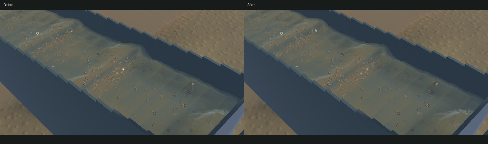
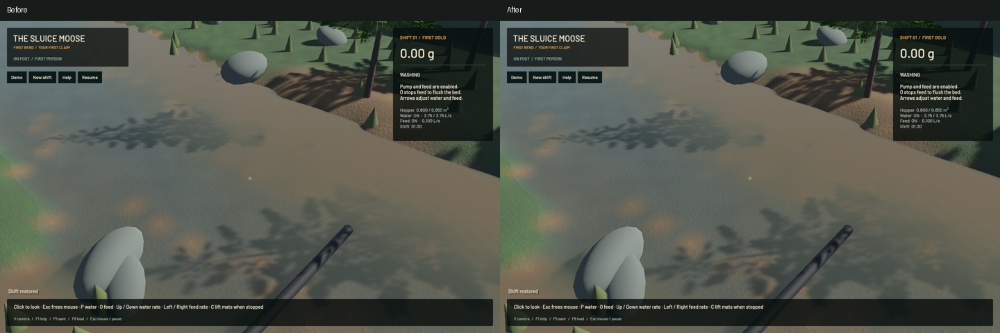
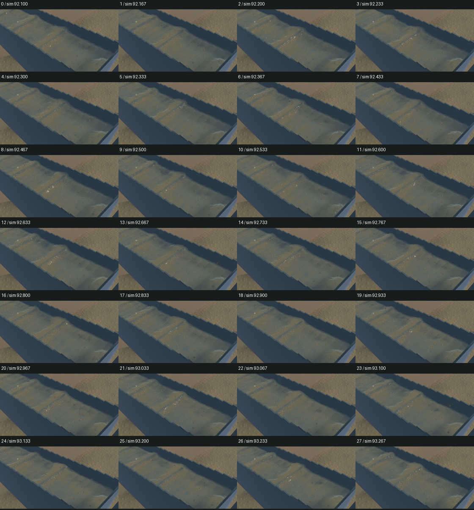
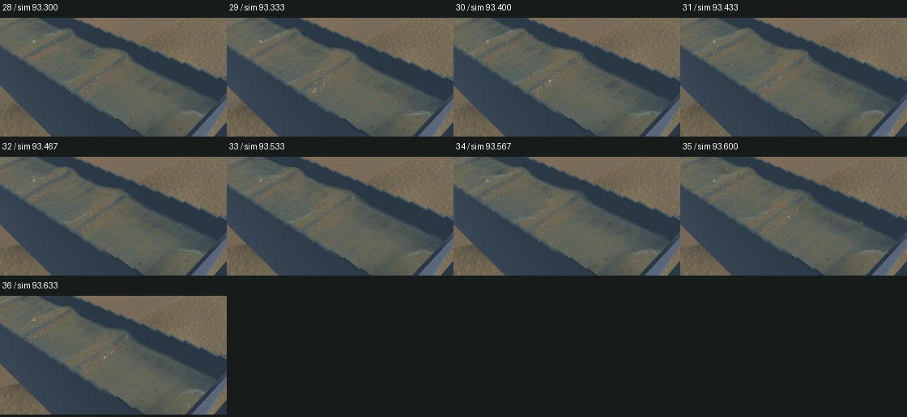

# Smooth crest support and deposited-mud transitions

Channel reconstruction now deposits and queries positive quadratic B-spline moments. The former tent stencil changed support variance from zero to h²/4 across a cell and had slope kinks. The new stencil has phase-independent variance, retains partition of unity and first moments, and uses a narrower lattice to match the former average footprint. Physical water, riffles, grains and terrain solvers are untouched. Detached outlet support retains its existing path.

Terrain mud cover now uses bounded, shape-preserving cubic interpolation at the fine render vertices. It retains measured nodal cover, dry intervals and matching chunk-edge values while smoothing colour ramps. Heights and deposited material amounts do not change. The separate synthetic frozen deposit control changes 46,944 pixels by at most 3 colour levels; this is a subtle material-transition correction, not evidence of physical deposition.

All 67 ordinary app checks, 16 explicit real-GPU optics checks, the full GPU surface-chain check, strict scoped Clippy and formatting pass. One saved-scene support check also validates 60,097 kernels. Engine cache hashing preserves their exact fingerprint while recovering part of the first candidate's extra CPU cost. One unrelated opt-in profiling check and the full soil replay were not run.

Five frozen view pairs retain the selected physical clocks, tracks, flow, machine and material fields. River RGB and the falling-outlet crop at (750, 260)–(1000, 750) are byte-identical. The full outlet camera includes changed channel water. Final physical saves at 99.866671875 s have equal values after ordering the keyed SDF contact cache by particle ID; their serialized byte order differs.

| Sequential 20-second windows | Before | After |
|---|---:|---:|
| Render FPS |55.69|55.72|
| p95 frame time |26.66 ms|28.51 ms|
| Physical simulation / wall |0.38644×|0.38651×|
| Mean surface-worker build |89.95 ms|110.19 ms|
| Material and dry-mass budgets |Pass|Pass|
| Physical real-time gate |Fail|Fail|

The smoother reconstruction costs more CPU. Cache optimization reduced the intermediate moving-capture mean from 147.08 ms to 111.75 ms, but the final build remains slower than the previous surface worker. Similar draw FPS does not establish a speedup or real-time physics. Sluice water residual is 0 m³; gold residual is 4.55e-13 g.

The [wall-timed preview](2026-10-25-smooth-crest-field.mp4) retains all 37 source frames over 3.887 wall seconds / 1.533 physical seconds. All 36 sampled physical and presentation intervals advance, with zero recording underruns. Review covers every temporal crop, full native frames, final/normal/sediment views, mud control, river and outlet. Repeated video frames are display holds. Manual controls and whole-video playback were not rechecked.

This is a localized rendering improvement. Broad physical standing waves, real suspended plumes, grain stippling and overall water art remain open. The signed app is installed at `/Users/simonheikkila/Documents/12-Coding/the-sluice-moose/target/bundles/First Bend.app`; the prior signed app and detailed sources/logs are retained in the [receipt](2026-10-25-smooth-crest-field.json). The unfinished finite-pressure experiment, original dirty checkout and user stash are preserved.

Heavy jobs ran sequentially; the encoder used one thread. No new panic-full or WindowServer report appeared. Scoped cleanup leaves no owned game/compiler/encoder/test browser; 16 shared Playwright MCP and 64 Node processes remain untouched. Installed Beads rejects `bd sync`; the fallback updates the touched issue and adds the measured CPU-cost follow-up in the 228-line export. The broad game and real-time goals remain active.

The measured surface-worker cost is tracked in `menace-xma`; the broader rendering issue stays in progress.
