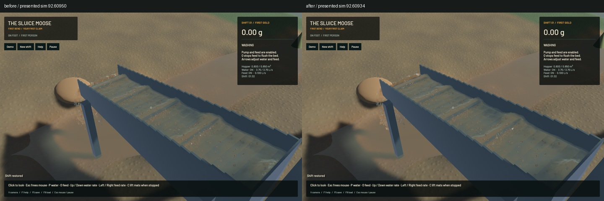
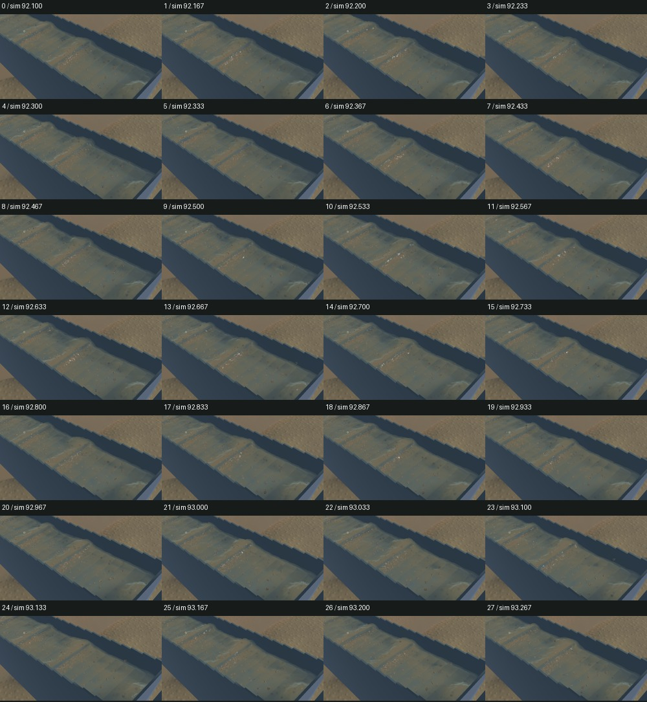

# Stop temporal crest swelling and false muddy-water pulses

Channel splats interpolated density independently of radius and anisotropic support. Their product did not retain represented water between solver snapshots; sediment extinction inherited the same error. Interpolating rotating axis vectors also shortened the kernel before restoring it at the next snapshot. Both defects could make water breathe around a riffle.

The production vertex now uses a tested presentation helper. Principal support lengths interpolate separately from orientation. Represented water and sediment-extinction moments interpolate first; density and concentration are then obtained from the actual interpolated ellipsoid volume. Paired channel samples receive the correction. Outlet, birth/death fades and channel/outlet transfers retain their existing policy. No physical particle, solver, grid, target or fullscreen pass changes.

The real-GPU regression covers 396 case/phase combinations: changing radius, deformation, rotation, represented volume/concentration, stationary endpoints, zero material, fades and transfers. Extracted old production interpolation renders 5.8624 times the intended water/extinction in the strongest **synthetic stress fixture**. This is not a measured amplification of the native sluice. A separate density-only control still contracts rotating support by 18.0848%. Final water, extinction and support errors are below 2.39e-7 relative; outlet/fade/transfer agreement is within 2.85e-6.

All 16 explicit GPU optics functions, one full render-chain GPU function and 64 ordinary app tests pass. Two opt-in profiling tests remain unrun. Scoped strict all-target Clippy, formatting, whitespace and signed packaging pass. The unchanged game dependency emits its existing unused-constructor warning. All 722 other Rust/WGSL sources match the start manifest.

Five frozen native pairs retain all selected clocks, physical tracks, render centres, machine/material and flow fields. River, outlet and sediment-debug RGB are byte-identical. Final sluice differs at six pixels by at most one colour level; normals differ at 19 pixels by one level. Endpoints should retain their appearance: these are compatibility controls, not static improvement evidence.

The flowing comparison above uses presentation times 0.000162 seconds apart. Worker schedules differ, so it is not an exact frozen A/B. The native change is local and subtle. Broad hydraulic standing waves, actual suspended plumes and grain stippling remain visible.

The [wall-timed native preview](2026-10-25-temporal-crest.mp4) retains all 28 source frames across 2.917 wall seconds / 1.167 physical seconds. All 27 presentation and worker intervals advance, with zero recording underruns. Review covers every temporal crop, a full midpoint, frozen colour/normal/sediment views, river/outlet controls and the before sequence. Display repeats are not additional physics. Whole-video playback and manual controls are not claimed.

| Sequential 20-second windows | Before | After |
|---|---:|---:|
| Render FPS | 55.88 | 55.68 |
| p95 frame time | 26.55 ms | 26.21 ms |
| Physical simulation / wall time | 0.3898x | 0.3863x |
| Bulk and dry-mass budgets | Pass | Pass |
| Physical real-time gate | Fail | Fail |

Throughput is similar in these short windows. The after sluice-water budget error is zero and gold error is 5.0e-12 g. Physical real time remains unresolved.

The signed app is installed at `/Users/simonheikkila/Documents/12-Coding/the-sluice-moose/target/bundles/First Bend.app`. Its predecessor, source hashes, logs, intermediate failures and detailed results are retained in the [receipt](2026-10-25-temporal-crest.json). Original nine dirty paths and the user stash are preserved. Four verified files from the unfinished contact-dynamics experiment are archived with restore instructions and excluded from this build; that experiment remains unvalidated and in progress.

Jobs ran sequentially. Scoped cleanup ran; no task game, compiler, encoder or test browser remains. Shared automation was untouched. No new panic-full or WindowServer report appeared. Beads lacks `bd sync`; only the two touched issue rows were merged into the 227-line export, preserving unrelated literal lines. The broader realistic-game and real-time objectives remain active.
