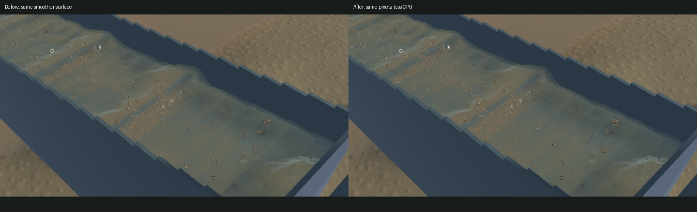
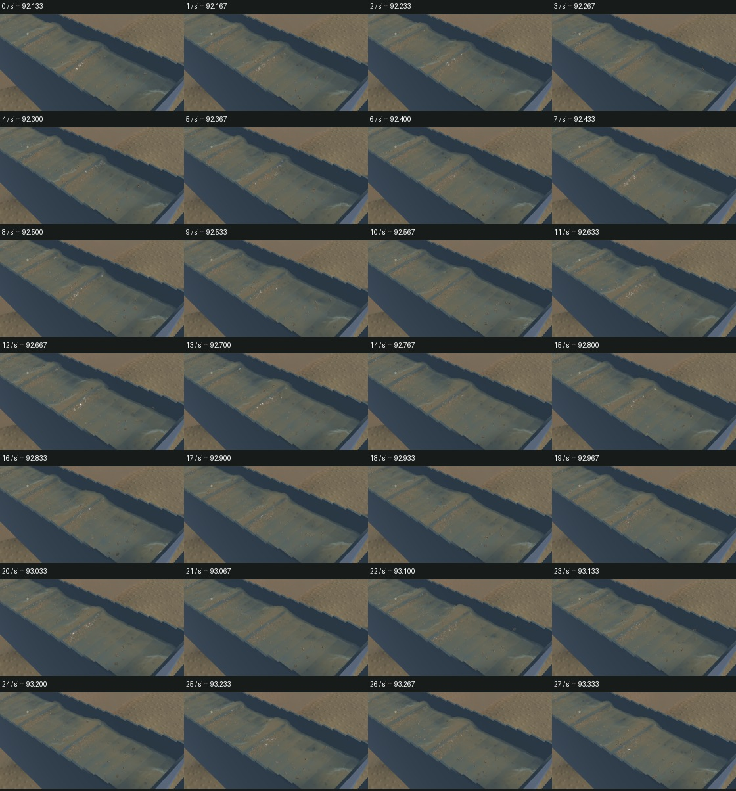
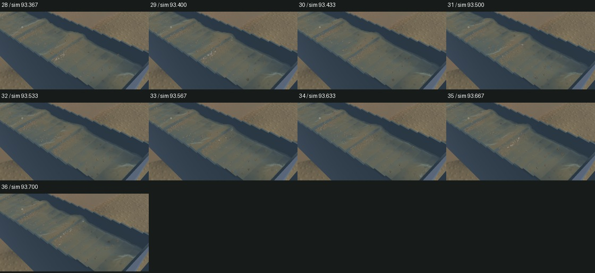

# Water-surface cache performance checkpoint

The accepted smoother crest and mud appearance is retained. Water reconstruction now caches each deposition cell's 27 node addresses and centres, reuses the query weights, borrows a cached moment block with one lookup, and avoids computing legacy PCA in bins that only contain channel water. Shared outlet bins still warm from their original first particle. Particle selection, floating-point accumulation order, represented volume/extinction, shaders and physical solvers do not change.

The saved 65,536-instance workload falls from **108.71 ms to 91.59 ms**. Both full output fingerprints remain `c0e3126d2bcc4681`. The separate 60,097-kernel support check retains `d7af11f5c9fe6c4c`. A vectorized accumulator trial produced the same bytes but no further timing benefit; its larger blocks were removed.

Two 20-second native windows per build ran in before/after/after/before order, each with its own warmup and the same saved scene. Means below describe these four short windows, not a universal speed guarantee.

| Measured native result | Before | After |
|---|---:|---:|
| Mean surface-worker build |106.79 ms|100.37 ms|
| Mean draw FPS |55.73|55.78|
| Mean p95 frame time across windows |28.55 ms|28.61 ms|
| Physical simulation / wall |0.38828x|0.38659x|
| Material and dry-mass budgets |Pass|Pass|
| Physical real-time gate |Fail|Fail|

Surface-worker cost falls by **6.0%** in these native windows. Draw FPS and simulation throughput remain separate measurements. All four windows preserve the material checks; no failing real-time gate is counted as passed.

Five matched frozen view pairs—sluice final, sluice normals, river, outlet and synthetic deposited mud—have **zero differing RGB pixels**, with equal selected clocks, particle tracks, flow, machine and material fields. The mud control is synthetic appearance evidence. It does not establish new physical deposition.

Both four-second motion captures advance their physical and presented clocks at every sampled interval, with zero buffer underruns. The new capture contains 37 frames spanning 3.949 wall seconds and 1.567 physical seconds. All temporal crops and full native surface views were inspected; broader standing-wave humps, suspended plumes and grain appearance remain open. Manual controls and whole-video playback were not rechecked.

[Wall-timed native preview](2026-10-25-water-surface-cache.mp4)

All **69 ordinary app tests**, both explicit saved-scene profiles, strict scoped all-target Clippy, formatting, whitespace, signed packaging and native captures pass. New scalar controls check cached moments/kernel bytes at cell edges and the first representative in mixed channel/outlet bins. GPU unit suites and the full soil integration replay were not rerun. All **735 other initial Rust/WGSL sources** remain byte-identical, including every water/riffle/terrain/contact solver, mud material and shader source. This stage does not change the finite-contact reference or select it for gameplay.

The verified signed app is installed at `/Users/simonheikkila/Documents/12-Coding/the-sluice-moose/target/bundles/First Bend.app`; the previous signed app is preserved. Source/input/app hashes, individual windows, commands and custody checks are in the [receipt](2026-10-25-water-surface-cache.json). The original dirty checkout and user stash are preserved.

Heavy jobs ran sequentially with no new worker, panic-full or WindowServer report. Scoped cleanup leaves zero owned game/compiler/test-browser processes. Its remaining 16 shared Playwright MCP and 64 Node processes were left untouched. `menace-xma` is closed; `sluice-realtime` and `sluice-terrain-throughput` remain in progress. Installed Beads rejects `bd sync`; one scoped row is merged into the 230-line export while 229 unrelated literal rows are preserved. The broad game goal remains active.
