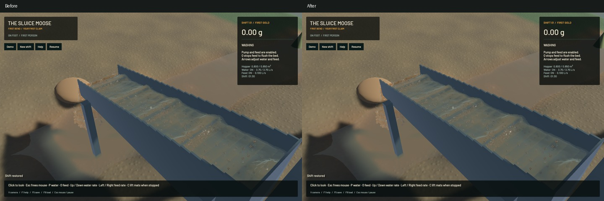
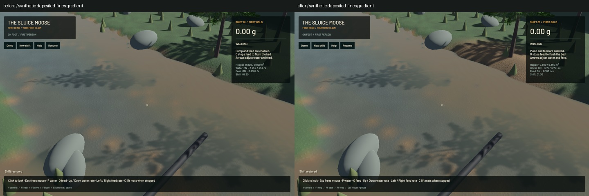

# World-space crest fairing and gradual deposited-mud colour

The previous high-order surface filter operated at one screen texel. Close views retained particle-scale domes spanning several pixels. Its stencil now follows the measured world-space tangent targeting a 6 mm sampling step with a one-to-four-texel limit and continuous reciprocal-depth sampling. It retains inclined planes and riffle-scale shape while removing millimetre-scale sampling caps. The unchanged shared interface also bounds the visible muddy-water integral. No render target, fullscreen pass, simulation grid or particle is added or removed.

An independent real-GPU fixture combines a 120 mm wave and 12 mm sampling ripple at 2 mm per texel across eight phases. The old shader fails with 0.98437 RMS residual relative to the input ripple; the correction measures 0.02147. This synthetic fixture measures rendering accuracy; it does not validate the fluid solver. Fifteen explicitly executed GPU optics checks and the complete surface-pass-chain check pass, retaining volume, shallow water, separated layers, spray, broad crests and outlet controls.

Terrain had a separate binary deposited-sediment colour switch at 15 mm. Deposited fines now cover the underlying material gradually over 0–15 mm, blending in linear light; the quantized coverage also belongs to the terrain mesh cache key. Deposits can cover grass outside the work pad. The native gradient below is a **synthetic, frozen appearance fixture**, not erosion, transport or material-conservation evidence. Its first version was rejected by the save validator after raised terrain reduced the suspended-remainder precision allowance; rejected fallback images are excluded. The corrected control preserves water depth, explicitly clears subprecision suspension remainders in its changed cells, and verifies the saved clock actually loads.

All 64 ordinary app tests pass; two opt-in profiling tests remain unrun. Strict scoped all-target Clippy, final formatting, whitespace and signed packaging pass. An intermediate formatting check failed and was corrected before final packaging. The dependency's pre-existing unused-constructor warning remains. All 712 other Rust/WGSL sources match the initial manifest, including water, riffle, terrain-flow and contact solvers. Original dirty checkout files and user stash remain unchanged.

Six native frozen pairs retain identical selected clocks, steps, tracks, machine/material fields and render kernels. The ordinary river frame is byte-identical because that save contains no deposited terrain sediment. The outlet camera includes changed channel water; no full-outlet-image identity claim is made. Existing outlet GPU controls pass.

| Sequential 20-second native windows | Before | After |
|---|---:|---:|
| Render FPS |57.77|57.62|
| p95 frame time |25.41 ms|25.71 ms|
| Physical simulation / wall time |0.3849×|0.3865×|
| Bulk and dry-mass budgets |Pass|Pass|
| Physical real-time gate |Fail|Fail|

Short windows show similar throughput and do not establish a speedup. Sluice water-budget error is 0 m³ after the window. Physical real-time performance remains unresolved.

The [wall-timed flow preview](2026-10-25-world-crest.mp4) retains every one of 53 source frames across 3.935 wall seconds / 1.567 physical seconds. All 52 presentation intervals advance; 47 worker intervals advance and five hold. There are 0 capture underruns. Review covers every temporal crop, full frozen colour/normal/column/sediment layers, river/outlet views and a separate fresh running demo. Display holds are not new physics. Whole-video playback, manual controls and the full soil replay were not rerun.

Broad hydraulic standing waves, real transported sediment plumes and granular stippling remain. These fixes improve rendering; they do not complete water art, qualify full digging physics or make the full simulation real time.

The updated signed app is `/Users/simonheikkila/Documents/12-Coding/the-sluice-moose/target/bundles/First Bend.app`. The prior signed app and detailed source/native evidence remain under `/Users/simonheikkila/.codex/visualizations/2026/10/18/01a14ce3-309f-7782-9a7c-ccd0efaf3227/crest-bed-20261025`. Jobs ran serially. Scoped cleanup leaves 0 task games/compilers/encoders/test browsers; 16 shared Playwright MCP and 64 Node processes remain untouched. No new macOS panic-full or WindowServer diagnostic appeared. Installed Beads rejects `bd sync`; the recorded fallback merges only the one touched rendering issue, preserving every other export line. Hashes and measured results are in the [receipt](2026-10-25-world-crest.json).
