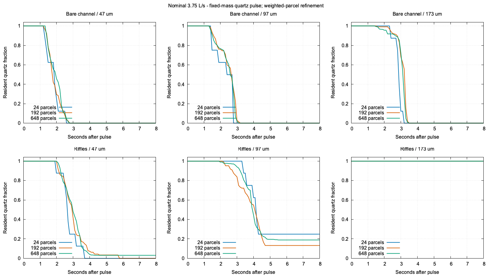
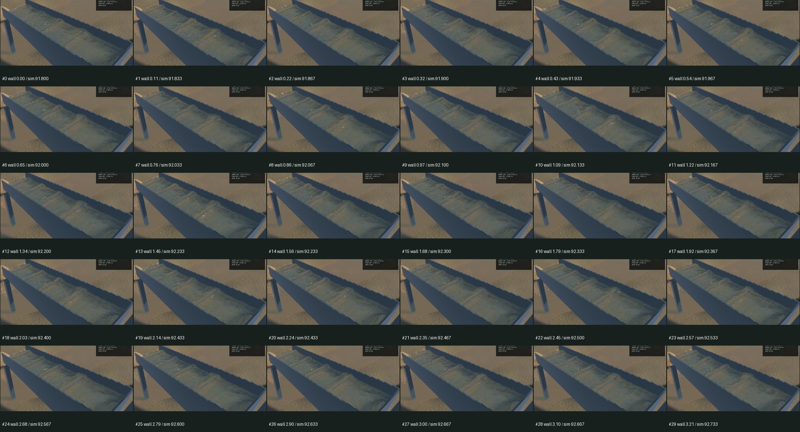
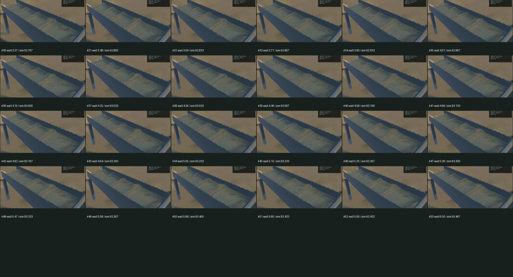
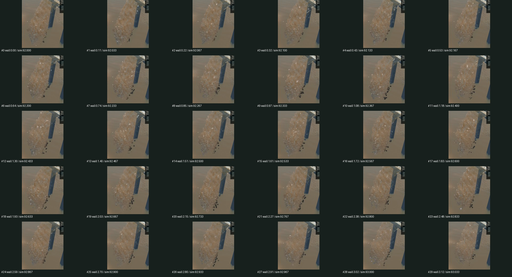
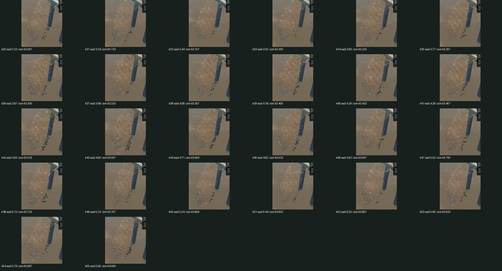
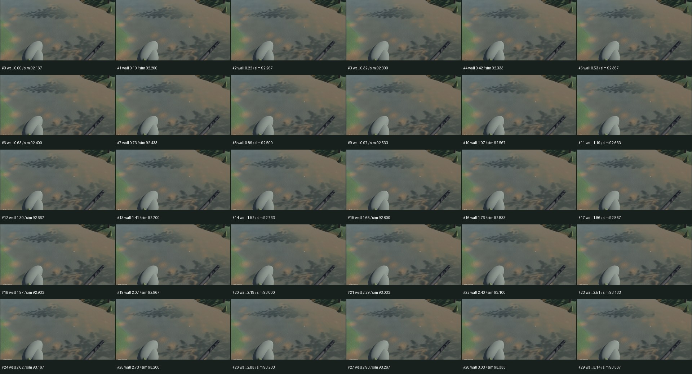
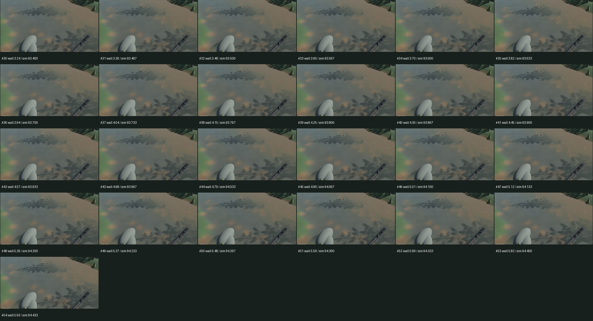

# Supported carrier flow and complete placer-operation scope

Ordinary sediment gathering previously treated water-grid nodes with no particle contribution as stationary water. In a uniform co-moving thin sheet this falsely slowed grains by up to 0.71874964 m/s from an expected 1 m/s. The actual old GPU path fails 90 of 135 sparse controls while 675 dense/stationary/dry controls pass. This is an interpolation defect, independently demonstrated without fitting recovery outcomes.

P2G now publishes an explicit 0/1 support plane from positive quantized water weight. G2P normalizes each ordinary carrier component by its supported stencil weights, preserving supported stationary water. No component data means no carrier drag on that component; absent vertical data uses full dry gravity. Signed dry grains retain their ballistic path. This fallback describes unavailable data, not calibrated immersion. The mixture velocity/affine and water FLIP/PIC arithmetic remain intact. Paired/separate and sorted/cell-centric routes copy and bind the full support plane; conservative phase buffers retain their separate layout and are not enabled by this change. The existing velocity-only constructor retains its legacy contract for explicitly manufactured inputs. Each ordinary P2G producer adds support planes to its three float output grids, adding linear storage and reads; no water grid, timestep, pressure iteration or riffle/contact resolution is reduced.

The corrected maximum sparse error is 1.1920929e-7 m/s; all 135 sparse and 675 controls pass. The legacy expression remains an explicit failing witness inside the passing regression. Five absent-component cases check the fallback. Six full-solver paths check constant velocity and actual Euler displacement, not just a disconnected shader. Nine unique selected real-GPU tests pass, including ordinary/phase transfer, zero atomics, storage growth, the original excavation/pumping/save-restore pipeline and worker refusal. The gold/quartz terminal-settling regression is additionally rerun with explicit supported stationary water; its original size, density, dry gravity and timestep assertions remain. Selected strict Clippy, changed-package formatting, signed packaging and installed smoke pass. Game-library Clippy exits zero with existing warnings; it is not warning-free. A full workspace suite and manual driving/placement replay were not repeated.

## Fixed-input flowing-sluice comparison

All six complete pure-water warm states are canonically equal to the previous revision. Only JSON key order and three unordered contact-history maps are normalized; every other value and array remains significant. Thus clear-water arithmetic is preserved in these six actual runs, rather than inferred from source inspection.

After the same 8-second warmup and two restart ticks, each of six bare/riffled low/nominal/high flow conditions receives the same fixed quartz pulse at 24/192/648 weighted parcels. Every initial pulse record matches the corresponding old trial exactly. All 18 corrected eight-second runs pass independent pulse/tailings and water budgets. Maximum pulse-relative residual is 1.65436123e-15; maximum independent tailings-relative error 1.54407048e-15; local water error is zero and maximum whole-water residual 2.25956882e-07 m³. All 4,201 observed removal endpoints are beyond the 1.5 m lip, with {'4': 4059, '6': 129, '2': 13} face counts in the buffered solver domain. Pure +X is not all discharge.

| Nominal riffled 97 µm quartz discharged by eight seconds | 24 parcels | 192 parcels | 648 parcels |
|---|---:|---:|---:|
| Previous implementation | 100.00% | 86.16% | 73.96% |
| Explicit carrier support | 75.00% | 86.97% | 81.03% |

The final-pair difference is 5.94 percentage points, and the largest final-pair difference across conditions is still 9.58 points for low-flow riffled 173 µm quartz. These nonmonotonic changes do not establish convergence or calibrated gold recovery. Initial contact overlaps, nonnested higher source moments, quantized P2G deposition and phase-response limits remain. Resident time is censored at eight seconds and includes downstream buffer flight. No friction/drag/blur coefficient was fitted to make these curves agree.

[Class summary CSV](2026-10-27-carrier-support.csv), [spread plot](2026-10-27-carrier-support.spread.png), [raw reports, source snapshots and reproduction scripts](2026-10-27-carrier-support.reports.zip), [complete receipt](2026-10-27-carrier-support.json).

## Native result and actual limits

Frozen sluice, falling outlet and river RGB are byte-identical across the two signed apps, and all captured physical fields excluding wall/file/presentation timing match. The installed app also reproduces the candidate frozen image and fields exactly. All 165 candidate temporal samples were inspected using the six sheets below. These are snapshots, not a claim of whole-video playback or fully natural water. The outlet continuously changes and falls through its established route; sluice standing crests/highlighted grains and subdued river detail remain visually limited.

| Sequential 20-second benchmark | Render FPS | p95 frame | Physical / wall | Bulk/dry budgets | Physical real time |
|---|---:|---:|---:|---|---|
| Previous installed app | 54.98 | 33.17 ms | 0.31496× | Pass | Fail |
| Carrier correction | 55.78 | 37.32 ms | 0.28982× | Pass | Fail |

The candidate's physical throughput is lower in this single window. No speedup or causal performance conclusion is claimed. Candidate sluice motion records 47 worker advances and 52 presentation advances over 53 intervals, with zero presentation regressions and zero reported buffer underruns. Held intervals remain visible evidence against claiming smooth real-time animation. Outlet and river presentation advance in every captured interval. Motion windows have different physical timing and are not matched trajectories.

## Complete mining-operation milestone

Simon explicitly requires real placer gold mining like the Gold Rush operation: gold washout, progressive sluice loading/clogging, modifying/upgrading wash plants, overburden clearance, transporting actual paydirt, both trommel and shaker options, constructed settling ponds and tailings handling. The [canonical operation plan](../../plans/2026-10-22-realistic-operation.md) now leads with the complete acceptance bar, implementation gaps and next integrated shift. The current Session still has one excavator and one sluice; its tailings mesh represents an inventory rather than deposited terrain. These gaps are not completed by this carrier correction.

Next integrate finite bench → separate spoil/pay stocks → driven haul/load → hopper and first actual wet screen → existing sluice → spatial tailings/dug pond → recirculation/cleanup and saved continuation. Demonstrate a meaningful physical plant change, overfeed/clogging and flow-driven gold loss. Reuse existing configuration and geometry while retaining full Grain/water custody and transactional capacity; the archived washplant transfer path loses material metadata and can duplicate/drop particles, so it is not admitted as the new runtime. Bind modules through stable saved IDs/ports and advance GPU backends sequentially. One screen can come first; both screen types remain required. Integrate after finite-transfer, geometry, failure-retention and persistence gates, keeping empirical calibration explicit rather than postponing the whole playable loop behind further isolated diagnostics.

Only the carrier defect menace-d6y.1.1 is closed. Transport menace-d6y.1 and the operation epic remain in progress; the next complete-shift milestone is menace-sfu. The scoped tracker handoff changes four owned rows, preserves all 252 unrelated starting lines literally and retains the parent's original dependencies. No global tracker sync/export is invoked. The installed signed bundle is at `/Users/simonheikkila/Documents/12-Coding/the-sluice-moose/target/bundles/First Bend.app`; the complete previous signed bundle is preserved in the artifact directory. Nine original dirty files and the stash remain intact. Heavy jobs ran one at a time for this task, with availability checks before launches. Required cleanup reports zero agent-browser, Playwright test/MCP and Chrome-for-Testing processes and leaves nine existing Node processes untouched. Other tasks’ headless browser processes were not targeted; final process roots are recorded in the receipt. No new panic/WindowServer report appeared.

Reproduce the actual GPU regressions with `cargo +nightly test -p mining-physics --test carrier_support --test carrier_paths --test settling --profile playable --locked --jobs 1 -- --ignored --test-threads=1 --nocapture`. Build `slurry_transport`, then run `slurry_transport warm riffles_nominal OUT_WARM 8` and `slurry_transport pulse OUT_WARM OUT_PULSE 6 8`; use fresh output paths. The reports archive contains all 24 run reports and the exact source/commands/limits used here. Benchmark failures and earlier rejected availability prechecks are preserved in the receipt rather than counted as passes.
