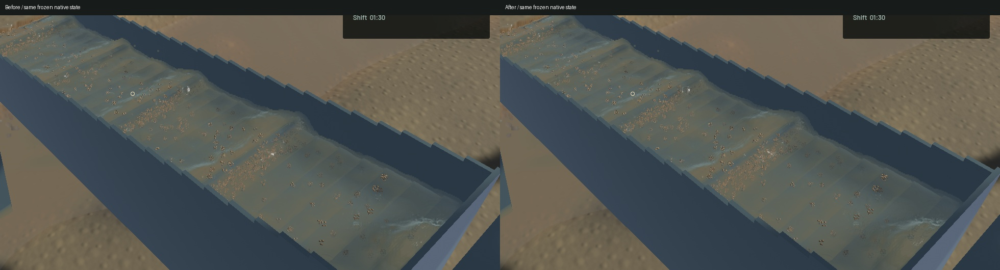
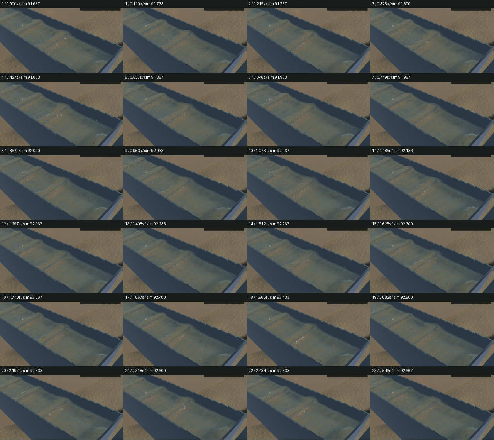
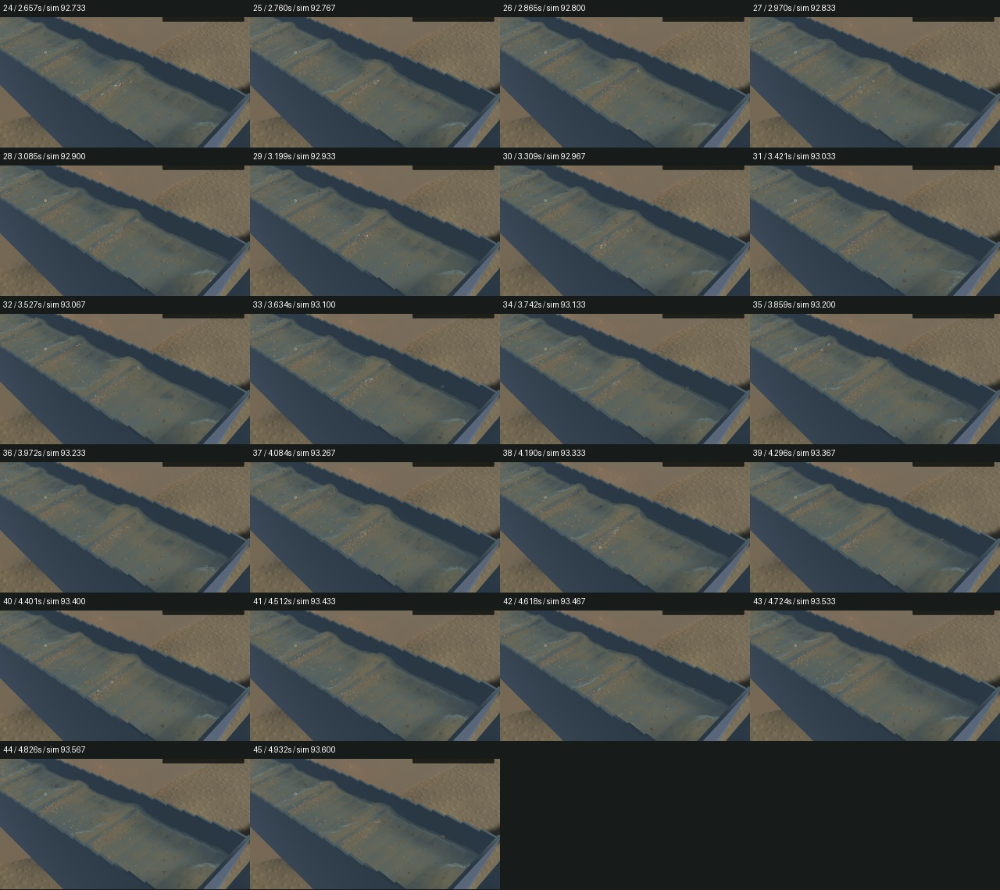

# Correct diagonal crest caps and local slurry shading

The crest filter removed small bumps along the screen axes while leaving equivalent diagonal bumps mostly intact. The two existing pre-integration passes now each filter one axis and one diagonal, using the measured tangent distance in metres. Cubic interpolation follows a scalar lattice-line coordinate, including the negative diagonal. Missing support and layer discontinuities retain their guarded path. The visible water and mineral moments are integrated against the resulting shared geometry; neither optics exchange nor any physical solver changes.

The new real-GPU fixture rotates a 24 mm cap over a 120 mm hydraulic wave through 12 angles. Worst cap RMS retention falls from80.70% to24.74%; at 45 degrees it falls from80.70% to3.30%. The synthetic fixture is not a measurement of native crest amplitudes. Pure 120 mm waves change by at most0.000274 mm, and uniform water/mineral/coverage moments remain exact. Angular response is not perfectly uniform: the 15 degree noisy case slightly worsens from22.52% to24.18%. The existing complete-chain wave error is0.03746 mm, below its unchanged0.05 mm limit.

All 19 GPU optics, five visible-column, one complete-chain and 69 ordinary app checks pass, along with strict scoped Clippy, formatting, whitespace and signed packaging. Two optional app profiles remain unrun; the existing game constructor warning remains.

Native improvement is localized around small crest highlights and refraction/opacity transitions. Broad hydraulic standing waves, actual suspended plumes and grain stippling remain. Every selected physical clock, particle track, render-centre sample, machine, flow and material field matches across five frozen pairs. River RGB and the 280 ×460 detached-outlet crop are byte-identical. The full outlet view changes where channel water is visible. The sediment debug image changes at 1205 pixels, reflecting its new visible geometry; the suspension model remains unchanged.

The [native motion preview](2026-10-27-crest-diagonal.mp4) retains all 46 captured frames over 4.932 wall seconds / 1.933 physical seconds. All 45 presentation and worker intervals advance, with zero recorded buffer underruns. Review covers every temporal crop and the full frozen views. Whole-video playback and manual operator controls were not rechecked. Moving before/after clips cover different physical intervals, so they are not trajectory-matched comparisons.

The first cold-start frozen capture for each binary caught a capture-before-restore race and correctly failed its constant-clock assertion. Those failures are retained, and follow-up menace-hzf tracks the readiness fix. Warmed frozen controls pass without changing the gate. Reference budgets from that capture harness are not used to qualify material conservation; the separate flow benchmark checks its loaded scene.

| Sequential 20-second windows | Before | After |
|---|---:|---:|
| Render FPS | 55.85 | 55.54 |
| p95 frame time | 28.40 ms | 28.52 ms |
| Physical simulation / wall time | 0.38485 × | 0.38487 × |
| Bulk and dry-mass budgets | Pass | Pass |
| Physical real-time gate | Fail | Fail |

These windows show similar throughput, with no speedup or physical-real-time claim. The existing two filters do more texture reads; no targets, passes, particles or simulation simplifications are added.

The signed app is installed at `/Users/simonheikkila/Documents/12-Coding/the-sluice-moose/target/bundles/First Bend.app`. The previous signed app and all unfinished hydrostatic diagnostic/marker-transport changes are preserved separately with hashes and restoration instructions. The latter remain unqualified and are absent from this build. Original dirty files and the user stash remain intact. Heavy work ran sequentially; scoped cleanup reports zero task-owned browser, Playwright or Node processes, all owned native/compiler/encoder jobs have exited, and no new panic or WindowServer report appeared. Detailed evidence and limits are in the [receipt](2026-10-27-crest-diagonal.json). Broader water art and the full playable-game goal remain open.
