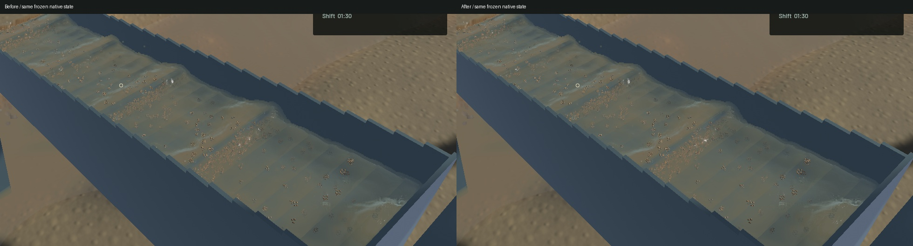
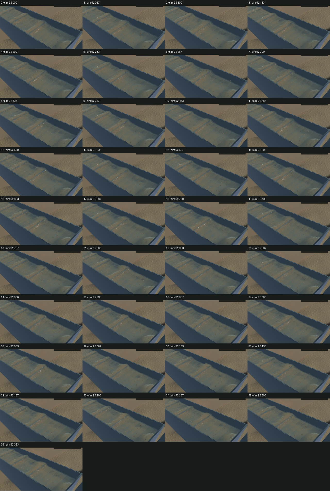

# Reduce kernel-sized crest caps and opacity patches

The existing 6 mm reconstruction step rejected 12 mm sampling noise while leaving larger particle-kernel caps. The last two pre-integration filters now use an 11 mm step and a sharper response to remove 20–30 mm caps while retaining resolved riffle waves. Continuous reciprocal-depth sampling avoids the crest sag caused by linear subpixel interpolation. Separate layers and missing-water boundaries keep their guarded path. The existing visible-column integration clips sediment against this final surface; no material is added or mixed by the geometry filter.

A real-GPU 24 mm synthetic bump retains 87.65% RMS before and 12.81% after. This measures a fixture, not the native sluice. Two initial candidates failed the unchanged full-chain wave gate and were rejected. The final chain's maximum ridge error is 0.04056 mm, below the existing 0.05 mm limit. Uniform water/sediment moments remain exact in the new fixture. All 17 GPU optics, five visible-column, one complete-chain and 69 ordinary app tests pass, along with strict scoped Clippy, formatting, whitespace and signed packaging. Two optional app profiles remain unrun; the existing game constructor warning remains.

Native improvement is localized around small crest highlights and opacity transitions. Broad hydraulic standing waves, real suspension plumes and grain stippling remain visible; the overall water-art task stays open. Five frozen controls retain the selected simulation clocks, steps, physical tracks, render centres, machine/material and flow fields exactly. River RGB and the 280×460 detached-outlet control are byte-identical. The full outlet view changes where channel water is visible.

The [native motion preview](2026-10-27-crest-mud.mp4) retains all 37 captured frames with their recorded wall timing. It covers 3.900 wall seconds / 1.333 physical seconds: all 36 presentation intervals advance, 35 worker intervals advance and no buffer underrun occurs. Review covers every temporal crop, full frozen colour/normal/sediment views and the outlet control; whole-video playback and manual controls are not claimed.

| Sequential 20-second windows | Before | After |
|---|---:|---:|
| Render FPS | 57.63 | 57.32 |
| p95 frame time | 28.87 ms | 28.53 ms |
| Physical simulation / wall time | 0.3616× | 0.3633× |
| Bulk and dry-mass budgets | Pass | Pass |
| Physical real-time gate | Fail | Fail |

These short windows show similar throughput, not a speedup. The particle, riffle, sediment and terrain solvers are unchanged. No target, draw, particle or simulation simplification is added; the two existing filters perform more texture reads.

The signed app is installed at `/Users/simonheikkila/Documents/12-Coding/the-sluice-moose/target/bundles/First Bend.app`. The previous signed app and the preceding task's unfinished, unqualified terrain-index prototype are preserved with hashes and restoration instructions in the artifact directory. Original dirty files and the user stash are unchanged. Heavy work ran sequentially; scoped cleanup reports zero browser, Playwright or Node processes, and no new panic or WindowServer diagnostic appeared. Details, source/binary hashes and limitations are in the [receipt](2026-10-27-crest-mud.json).
