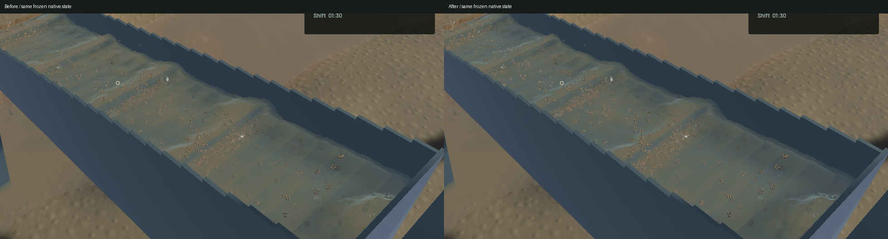
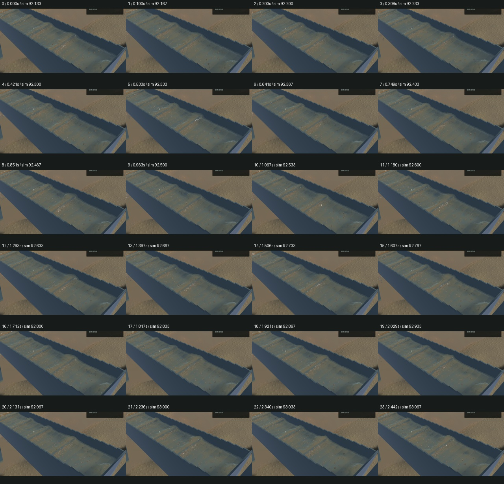
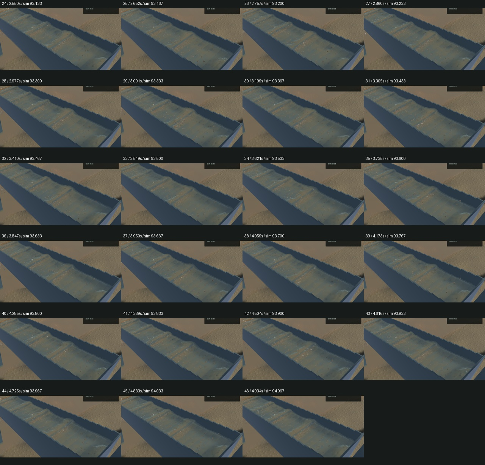

# Correct grazing-angle crest opacity

The channel compositor refracted the background but attenuated it along the longer, unbent eye ray. It now uses the refracted path through a local parallel homogeneous column for both absorption and the background lookup. Geometric normals determine optical thickness; capillary reflection detail cannot create new extinction patches. This follows [Snell refraction](https://www.pbr-book.org/4ed/Reflection_Models/Specular_Reflection_and_Transmission). The approximation does not trace a bent ray through the actual stratified 3D sediment field or reconstruct a nonparallel floor.

The native change is modest: crest shoulders look less opaque, with less muddy cap shading. Broad hydraulic standing waves and real suspended plumes remain. No interface smoothing, waves, water, sediment or riffle physics are changed. River RGB, channel normal and sediment debug views are byte-identical in the matched frozen controls; the detached outlet crop at (750, 290)-(1030, 750) is also byte-identical. All selected physical clocks, particle tracks, render-centre samples, flow, machine and material fields are identical in all five frozen pairs. The full outlet view changes where channel water is visible.

A real-GPU oracle independently traces transmitted vectors through 64 homogeneous slabs, 0.5-12.5 mm deep and 0-89 degrees incident angle. Path relative error and RGB transmission absolute error stay below 2e-6. At the most grazing angle, the unrefracted-ray negative control is 37.895 times the transmitted path length. This synthetic worst angle is not a native scene measurement. All 18 GPU optics, five visible-column, one complete-chain and 69 ordinary app checks pass, as do strict scoped Clippy, formatting, whitespace and signed packaging. Two optional app profiles remain unrun; the unchanged game dependency constructor warning remains.

The [native wall-timed motion preview](2026-10-27-crest-refraction.mp4) retains all 47 captured frames over 4.934 wall seconds / 1.933 physical seconds. All 46 presentation and worker intervals advance, with zero recorded buffer underruns. Every temporal crop was reviewed, alongside the full frozen views. Whole-video playback and manual controls were not rechecked. The preserved older binary records three startup presentation holds; these are retained in the receipt. Moving before/after clips start at different physical times and are not matched trajectory comparisons.

| Sequential 20-second windows | Before | After |
|---|---:|---:|
| Render FPS | 59.71 | 57.24 |
| p95 frame time | 23.43 ms | 28.05 ms |
| Physical simulation / wall time | 0.3582x | 0.3765x |
| Bulk and dry-mass budgets | Pass | Pass |
| Physical real-time gate | Fail | Fail |

These short windows do not establish a throughput gain. Rendering is slower in the candidate window; physical simulation advances faster. Both retain the same physical model and fail real-time throughput. No extra render targets or passes are allocated; the compositor adds a bounded Snell path calculation.

The verified signed app is installed at `/Users/simonheikkila/Documents/12-Coding/the-sluice-moose/target/bundles/First Bend.app`. The previous signed app is retained under the artifact directory. Original dirty files and the user stash are unchanged. Heavy jobs ran sequentially; scoped cleanup reports zero task-owned game/compiler/encoder/browser/Node jobs, and no new panic or WindowServer report appeared. Source hashes, exact controls, timings, failures and limitations are in the [receipt](2026-10-27-crest-refraction.json). Broader water art, refracted heterogeneous optics and the full playable-game goal remain open.
