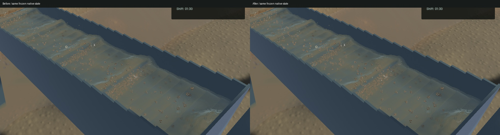
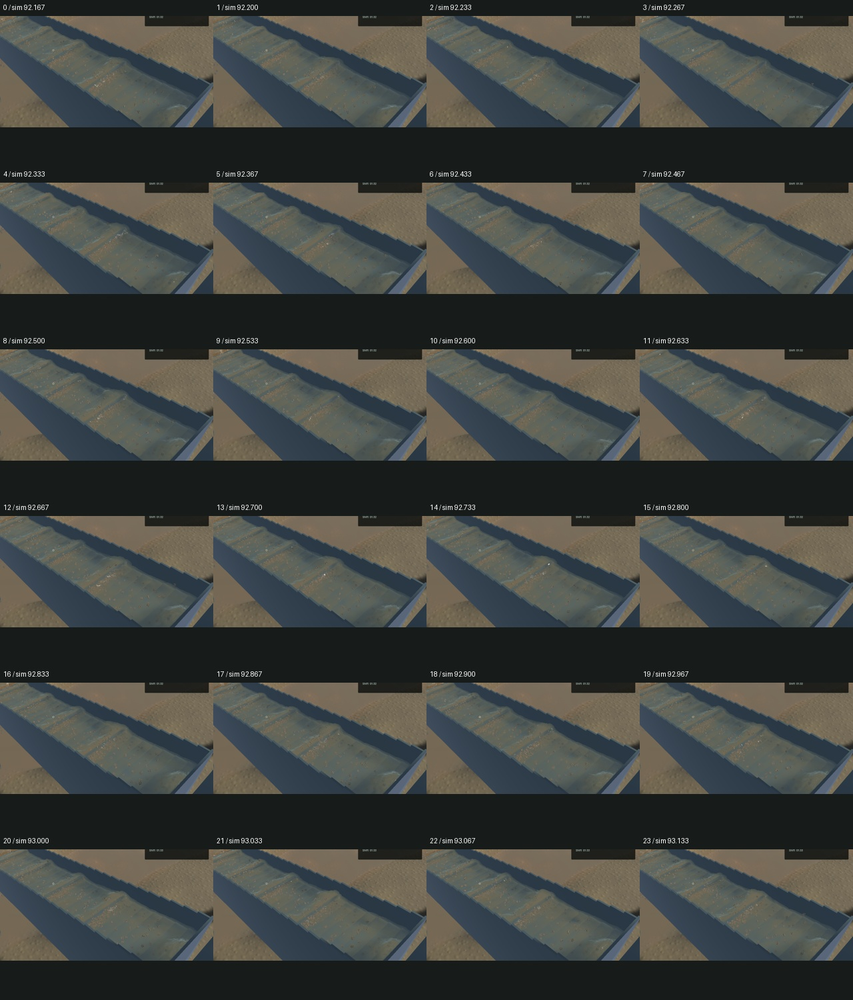
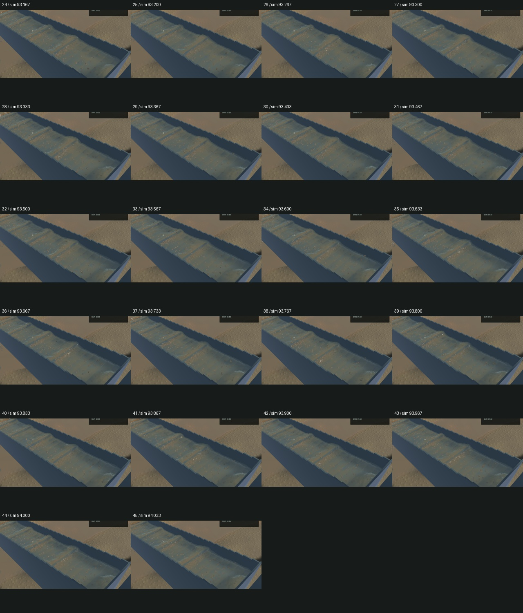

# Tighter crest highlights and correct foreground refraction

Connected-water shading overestimated the normal variation inside a pixel and changed it with screen orientation. Pixel-box integration now uses both derivative directions. Independent GPU quadrature across 16 roll angles and 4 scales measures 0.02443% maximum relative error, including quadrature discretization; the former extra roughness was 3.00–4.41 times this pixel variance. This is an antialiasing approximation, not a calibrated GGX material model. The existing minimum water roughness remains.

Refraction also validated each shifted scene tap against the original pixel's camera depth. On a receding crest that admits foreground brown objects. Channel taps now test the geometric water tangent plane, with the normal captured before optical ripple detail. The independent tilted-plane GPU control rejects all 32 foreground samples and retains all 32 submerged samples; the old guard admits 28 foreground samples. The river retains its original guard, and the accepted detached outlet retains its original rendering.

The visible improvement is local: tighter glints and less dragged foreground colour around grains and crest shoulders. Broad hydraulic standing waves, true suspended plumes and grain stippling remain visible; the broader water-art issue stays open. All 740 other starting Rust/WGSL sources match the stage manifest. No simulation grid, timestep, particle, force, physical surface support, material ledger, optical moment, render target or pass changes.

All 21 explicit GPU optics, five visible-column, one complete-chain and 69 ordinary application checks pass, together with strict scoped all-target Clippy, formatting, whitespace and signed packaging. Two optional app profiles remain unrun. Full-workspace or operator-control verification is not claimed. The unchanged game dependency emits its existing unused-constructor warning.

Five frozen native view pairs retain identical selected physical clocks, steps, tracks, render samples, machine, flow and material fields. Normal, sediment-debug and river RGB are byte-identical. The accepted 280 × 460 falling-outlet crop is also byte-identical; the complete outlet camera changes where it includes channel water. Final sluice RGB changes at 24,613 pixels. Geometry and sediment debug identity separate this shading correction from a change in water dynamics or suspension.

The [native motion preview](2026-10-27-crest-sheet.mp4) uses all 46 captured source frames in 308 display frames at 60 FPS, with quantized source-frame holds. The encoded clip is 5.133 seconds including its final hold. Repeated display frames are not additional simulation. The source spans 4.940 wall seconds / 1.867 physical seconds, with 45 presentation advances, 45 worker advances and zero buffer underruns. Review covers every temporal crop and the full frozen views. Whole-video playback and manual controls were not rechecked; the moving before/after windows cover different physical intervals.

| Sequential 20-second windows | Render FPS | p95 frame time | Physical / wall time |
|---|---:|---:|---:|
| Before, first |59.99|20.26ms|0.38992×|
| After, first |55.25|28.50ms|0.38144×|
| After, warmed repeat |59.99|20.14ms|0.39658×|
| Before, warmed repeat |59.99|20.48ms|0.39139×|

The first candidate window is retained, not discarded. The reversed warm pair shows similar rendering throughput; these short windows do not establish a speedup. Every window passes its bulk/dry-mass budgets and fails the physical-real-time gate. Physics remains about 0.39× real time.

The qualified signed app is installed at `/Users/simonheikkila/Documents/12-Coding/the-sluice-moose/target/bundles/First Bend.app`. Its preceding signed bundle is preserved in the artifact directory. Original dirty files and the user stash remain intact. Heavy jobs ran sequentially, all owned native/compiler/encoder jobs exited, required scoped cleanup ran, and no new panic or WindowServer report appeared. One shared Node process was left untouched. Automatic approval rejected tracker-wide `bd sync` because it could export unrelated shared issues; the handoff instead preserves every unrelated JSONL row and exports only this task's issue. Source, input, binary and media fingerprints are recorded in the [receipt](2026-10-27-crest-sheet.json).
