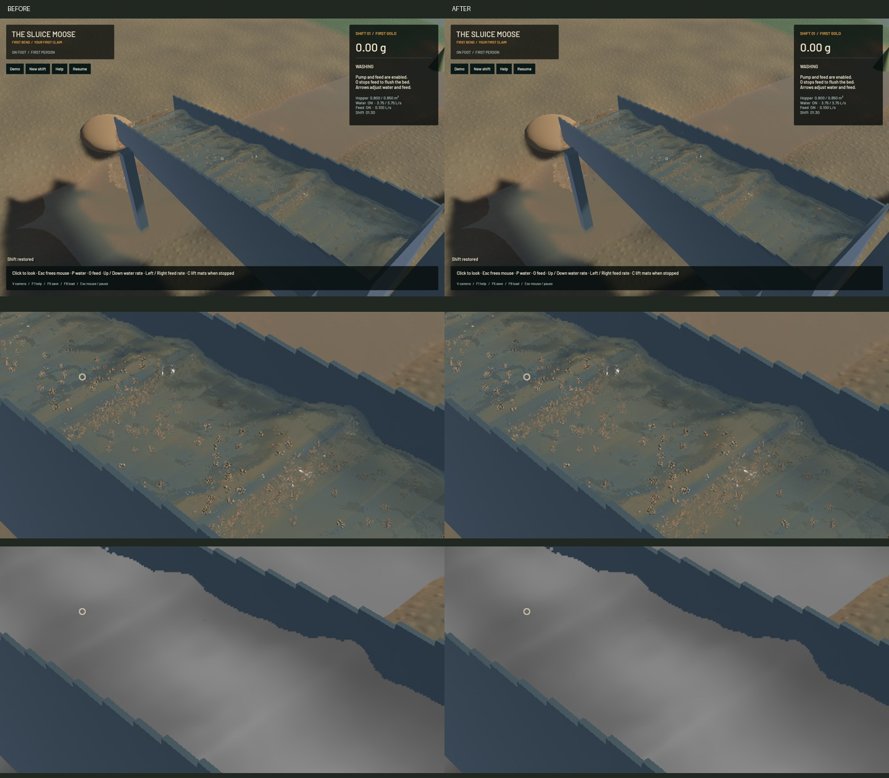
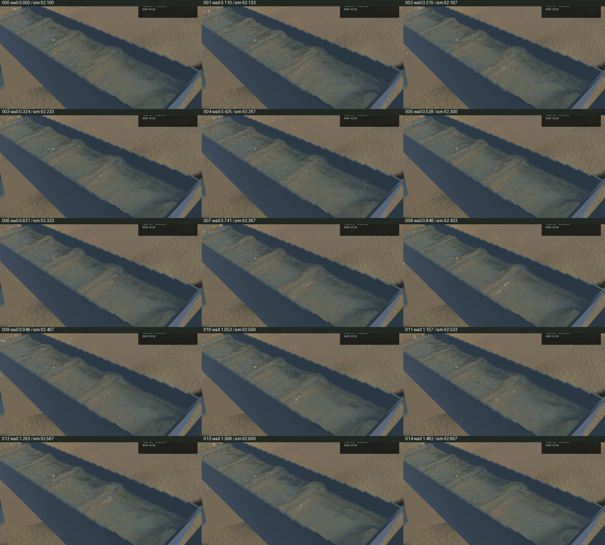
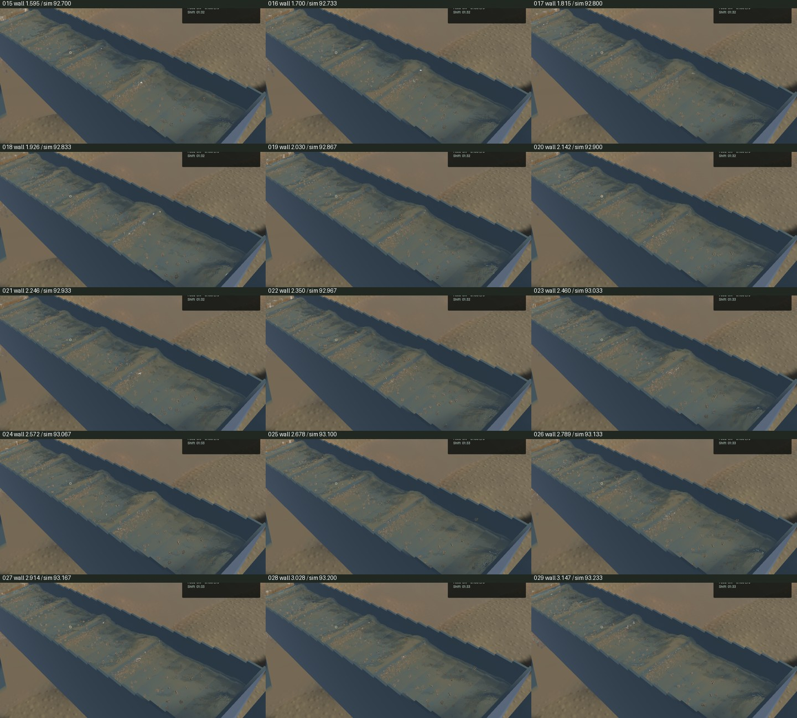
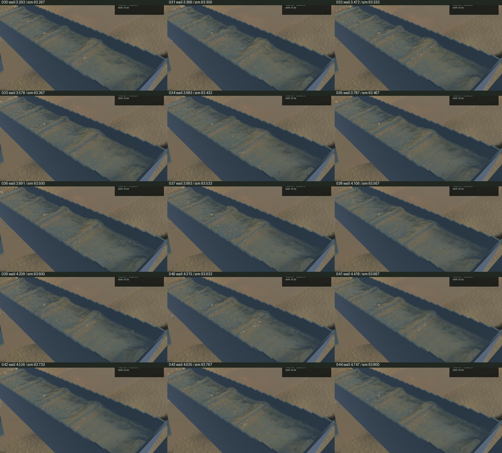
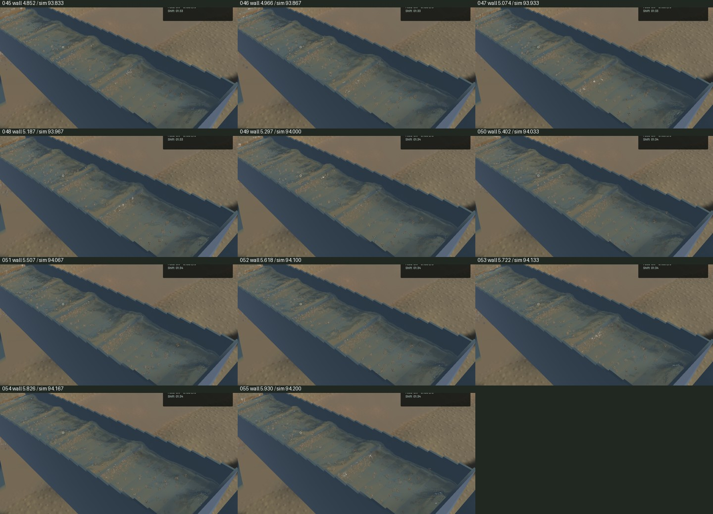

# Crest detail and airborne-sand correction

Two concrete rendering defects are corrected. A supported cubic water sheet previously inherited the coherence of averaged particle gradients. Those gradients can cancel around a curved crest even when its continuous geometry is resolved, suppressing transported surface detail and leaving a smooth cap. An accepted sheet now raises its own detail confidence. Missing coverage and rejected layer boundaries keep their existing fallback. The correction changes optical normal detail; large physical riffle waves and water geometry remain intact. Native improvement is localized, not a complete water-art redesign.

Channel optics also treated every moving Sand parcel as suspended while hiding its opaque proxies. Moving Sand without nearby water now remains visible as grains and cannot seed channel turbidity. Classification uses the physical adapter's existing 27-cell water-presence query, shared without changing its arithmetic. The saved input has 117,544 water particles and 4,308 grains: 22 moving Sand parcels lack that surrounding water, including 19 fines below 200 micrometres. Their represented solid volume is 1.4879473457088975e-5 m³. This is a coarse phase indicator, not exact submergence. Legacy outlet extinction is sampled before masked reconstruction and remains unchanged. Proxy reservations, other-grain seeds, material stocks and the established channel optical footprint are retained.

All 192 selected checks pass: 76 simulation-library, eight slurry, four physical-presence, 76 application, 21 real-GPU optics, five visible-column, one complete-chain and one reflection test. Two optional application profiles remain ignored. The new GPU curved-sheet control checks coherent, cancelling and zero normal sums against an independent f64 tangent, preserves carrier/column/flow, reproduces measurable suppression with the actual former expression, and checks rejected sparse/layer fallbacks. Strict scoped Clippy, formatting, whitespace, signed packaging and installed native smoke pass. The unchanged game dependency emits its existing unused-constructor warning. Initial initializer, over-broad lint and old-confidence expectation failures are retained and explained in the receipt; no lint suppression or relaxed geometry/optical limit was added.

The ordinary-water continuation is exactly equal across the complete saved state after canonicalizing only JSON key order and the three unordered contact-history maps. Every other array and float value remains significant. Both runs end with 116,139 water particles and 4,430 grains at 92.60000482946634 physical seconds; canonical SHA-256 is `e6934203145f8f31f1ddb61d6fc1ccff5b0ad6a5a32caa25723c0bd7a827256d`. The shared predicate extraction therefore produces no observed change in this full physical continuation. No simulation grid, timestep, contact force or riffle model changes.

Six frozen native pairs retain identical selected physical clocks, steps, tracks, surface samples, machinery, flow and material fields. Visible-column RGB and river RGB are exact. Channel normal-detail RGB changes at 67,181 pixels and sediment diagnostic RGB at 109,065 pixels; final sluice RGB changes at 83,413 pixels. The accepted 280 × 460 falling-outlet crop is byte-identical. Its complete camera changes where channel water is visible. Water-only debug and outlet captures exclude deliberately restored opaque airborne grains. The installed signed app reproduces the candidate's frozen RGB and physical fields exactly.

| Sequential 20-second native window | Render FPS | p95 frame | Physical / wall | Mean surface build |
| --- | ---: | ---: | ---: | ---: |
| Installed baseline | 57.38 | 27.99 ms | 0.37324× | 109.00 ms |
| Qualified candidate | 57.36 | 28.23 ms | 0.37479× | 112.20 ms |

Both windows pass bulk and dry-mass budgets and fail physical real time. The candidate's bulk residual is 3.9677576069152565e-07 m³ and dry-mass residual 0.0007140255765989423 kg. Surface reconstruction costs about 2.94 percent more in this short benchmark; render throughput is similar. No speedup or physical-real-time claim is made.

All 56 candidate temporal crops and the frozen final/diagnostic/outlet views were inspected. The source spans 5.930325 wall seconds / 2.100000 physical seconds, with 55 advancing worker and presentation intervals and zero recorded presentation-buffer underruns. The baseline has 55 frames, 50 worker advances and 54 presentation advances; all its presented intervals advance. Moving before/after clips cover different physical windows, so they are not matched-trajectory comparisons. The [native preview](2026-10-27-crest-suspension.mp4) retains all 56 source frames in 368 display frames at 60 FPS over 6.133333 seconds using source-frame holds. Repeated display frames are not new simulation. Whole-video playback and manual operator controls were not rechecked.

The signed app is installed at `/Users/simonheikkila/Documents/12-Coding/the-sluice-moose/target/bundles/First Bend.app`; its preceding signed bundle is preserved under the artifact directory. All nine original dirty paths and the existing stash are intact. Heavy work ran sequentially with one owned build/test/native/encode job at a time. Required scoped cleanup ran, all owned heavy jobs exited, one shared Node process was left untouched, and no new panic or WindowServer report appeared. The tracker handoff updates only parent menace-d6y and appends the two closed defects plus open proxy-sampling follow-up menace-2ry, preserving all 248 unrelated starting JSONL rows literally. No global tracker export or sync was invoked.

Broader transport qualification remains in progress under menace-d6y: the optical footprint still needs solid/wet connectivity and vertical-support qualification, and physical fine-parcel mixing needs dilute-pulse, refinement, residence and washout controls across flow rates and riffles. Wet/dry visibility timing and full-population opaque sampling also remain open. The benchmark's legacy slurry projection diagnostic is not a measurement of the new masked channel field. These fixes remove specific false turbidity and detail-suppression sources; they do not establish calibrated slurry mixing or finish the playable-game goal. Full evidence, source and binary hashes are in the [receipt](2026-10-27-crest-suspension.json).
