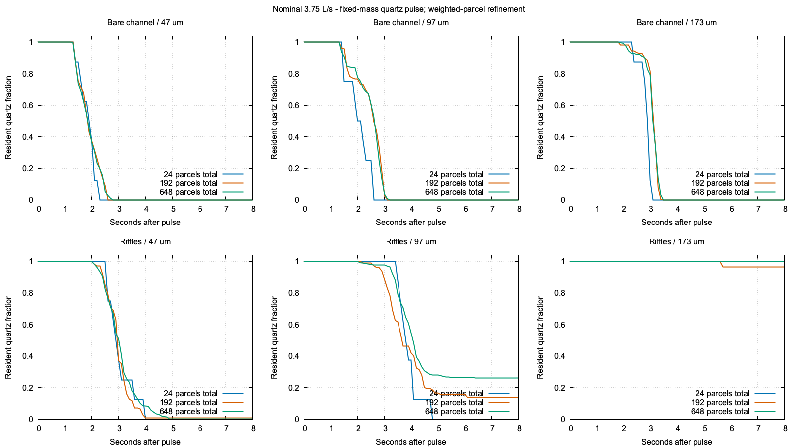
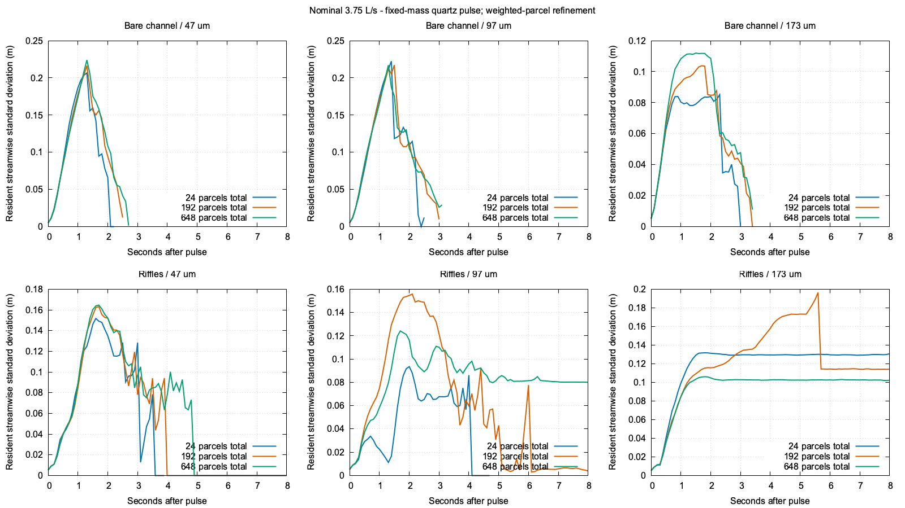

# Dilute fine-pulse transport qualification

Fine sediment transport is now measured independently at the actual solver-removal step. Conservation passes across all 18 final trials, but transport is still resolution-sensitive: with nominal flow and riffles, the 97 micrometre cohort exits by eight seconds at 100%, 86.1585% and 73.9572% for 24, 192 and 648 total parcels. The final pair differs by 12.2012 percentage points. This stage supplies a reproducible measurement and finds an unresolved accuracy limit; it does not calibrate slurry mixing or prescribe a new rendering footprint.

The [crest and airborne-sand fixes](2026-10-27-crest-suspension.md) remain installed. This stage adds an opt-in diagnostic and laboratory example. The game retains its ordinary water/riffle/terrain dynamics, and conservative phase exchange remains opt-in.

## Experiment and custody

Six conditions combine bare/riffled geometry with prescribed clean external water at 1.25, 3.75 and 7.5 L/s. Each has a fresh eight-second warmup and save. Every parcel refinement loads that same condition's warm save, executes the same two restart ticks, and injects a finite 0.03 mL solid quartz pulse (79.5 mg). The three diameter classes, 47/97/173 micrometres, each carry one third of its solid volume and mass. These are equal-mass classes, not an equal-number PSD.

Positive Cartesian Gauss-Legendre cubature at orders 2/4/6 gives 24/192/648 total parcels, or 8/64/216 per class. Within each class the solid mass, COM and full analytic covariance remain fixed up to reported f32 position roundoff. Three fixed source rotations avoid coincident cross-class nodes. Rotation occurs before the fixed anisotropic scale. [NIST DLMF §3.5(v)](https://dlmf.nist.gov/3.5#v) describes the quadrature family; quadrature identities are not transport-accuracy evidence. Actual source moments, supports, represented population, radii and overlaps are retained in every report.

The pulse centre is (0.32, 0.258, 0.20) m in solver coordinates, with initial velocity (0.35, 0, 0) m/s. Its enclosing support clears the upstream floor step; all 18 actual cached-SDF preflights report zero initial surface penetration. The harness refuses unsupported seed geometry rather than repairing positions. Source kind and exact-zero active material, including sub-empty-tolerance pending inlet/feed stock, are checked before and after restart. It never replaces newly emitted background material.

The laboratory explicitly credits clean external water to the existing ledger and feeds the original nozzle/admission/outflow/FLIP/APIC/DEM/terrain stages. It keeps operator feed off and supplies no prescribed particle trajectory. Delivered rates are 1.24999992, 3.74999998 and 7.49999997 L/s, identical across refinements within each condition. These warmups pass accounting/completion; that does not establish steady hydraulics. This is an isolated boundary experiment, not a replay of the native river intake.

The bounded observer records the complete grain immediately before the existing removal, with exact boundary-face bits. It changes no removal decision or tailings transfer. Disabled capture does not classify, clone or allocate. Enabled capture retains at most 4,096 records per public step and reports overflow, invalid input and whole-step failure explicitly. A failure after removal preserves its known events and cannot become a completed-custody pass. A reusable snapshot retains bounded storage. Empty, paused and non-fluid steps remain distinguishable from a completed removal stage.

Every public step checks the independently measured resident cohort plus observed exits against initial per-class input, and observed exits against the actual pooled-tailings increment. Both retain the original one-ppm pulse-relative limit. Maximum relative errors are 1.654e-15 and 2.206e-15. Maximum whole-scene water residual is 2.25956882e-07 m³ during the final pulse windows; local sluice water residual is zero. Whole and local water gates run independently and retain worst intermediate errors; nonfinite values cannot recover a pass. Failed/setup runs retain nonpass receipts, final state, first error and any known exits without overwriting earlier evidence.

## What leaves the channel

All 4,223 actual removal endpoints are beyond the physical 1.5 m lip. Their minimum centre X is 1.51217985 m; minimum complete contact-envelope X is 1.51184001 m. There are no recorded pre-lip removals in this matrix. This endpoint evidence does not prove that earlier trajectories never penetrated geometry.

The solver domain extends to X = 1.62 m. There are 4,090 lower-Y removals, 128 combined lower-Y/+X removals and only five pure +X removals. Grains mostly fall below the buffer before reaching its far end. Pure +X therefore undercounts physical discharge; lower-Y alone also cannot establish it without checking position. The CSV reports all-face, pure +X, postlip and pre-lip endpoint fractions separately. Final histograms contain no resident pulse material beyond the lip.

Reported exit time and restricted resident integral include buffer travel until deletion; neither is a first lip-crossing time. The conditional mean includes only observed exits. The finite-horizon identity between the resident integral, observed exit times and surviving fraction closes within 7.28e-14 seconds. Survivors are censored, not recovered gold or permanent capture.

| Channel and flow | Cohort (µm) | Exit by 8 s: 24 / 192 / 648 total parcels | Final pair difference |
| --- | ---: | --- | ---: |
| bare_nominal | 97 | 100.000% / 100.000% / 100.000% | 0.000 pp |
| riffles_low | 97 | 100.000% / 87.416% / 83.816% | 3.600 pp |
| riffles_nominal | 47 | 100.000% / 99.014% / 99.828% | 0.815 pp |
| riffles_nominal | 97 | 100.000% / 86.158% / 73.957% | 12.201 pp |
| riffles_nominal | 173 | 0.000% / 3.467% / 0.000% | 3.467 pp |
| riffles_high | 97 | 100.000% / 95.021% / 94.719% | 0.301 pp |

## Retention and spread

The bare channel flushes all three classes within this horizon at every tested flow/refinement. Riffles retain substantial larger-class mass, but the changing 97 micrometre result prevents a convergence claim. There is no prescribed recovery curve.

Legend counts are total parcels across the three classes. Spread panels use their own Y ranges. Empty cohorts have missing COM/covariance, not an invented zero. This is spread conditional on remaining material: selective exit can reduce it, so the curves are not turbulent diffusivity measurements.

Fixed first two moments do not fix source higher moments, supports or excluded contact geometry. Actual contact radii are approximately 0.792 mm at the coarsest rule, 0.276–0.517 mm at the middle and 0.136–0.371 mm at the finest. Initial overlapping contact pairs are 4/6/14. Every parcel contact envelope remains coarser than its physical grain, and different class rotations further limit cross-size-only attribution. These controls expose weighted-parcel sensitivity at fixed one-centimetre water grid and timestep; they do not identify a unique cause. Wet-moving remains the existing 27-cell presence predicate, not exact immersion or proven suspension.

The next gate, menace-d6y.1, separates release/source effects, contact envelopes, local drag/phase budgets, grid/time refinement and longer/repeated residence before changing transport or optical footprint. Parent menace-d6y remains in progress. Optical wet/solid connectivity, vertical support, native phase-visibility timing and the imposed presentation blur remain separate open work. Gold, loaded beds, mat fibres, cohesive mud, shaker decks and empirical recovery are not calibrated here.

## Verification and reproduction

All 42 unique selected controls pass: 28 physics-library tests (including six new observer controls), 12 final example tests, the actual original mining/pump/live-restore GPU pipeline, and the actual worker failure/saveability GPU control. Unselected GPU matrices were not rerun. Strict scoped Clippy, formatting, whitespace and the example build pass. An initial excessive-precision lint failure was fixed without suppressing the lint or changing the represented f64 node. Source-guard hardening was followed by fresh final warmups and all 18 final pulses; earlier runs remain separate artifacts.

The ordinary game continuation exercises 344 actual removal records over 132 ticks and 264 fluid solver steps. Its complete canonical state equals the qualified capture-disabled continuation exactly: 116,139 water particles, 4,430 grains and clock 92.60000482946634. SHA-256 is e6934203145f8f31f1ddb61d6fc1ccff5b0ad6a5a32caa25723c0bd7a827256d. Only JSON key order and three unordered contact-history maps are canonicalized; all other arrays and floats remain significant. Positive clock/solver progress is required, so a paused no-op cannot pass.

~~~bash
cargo +nightly build -p mining-physics --example slurry_transport --profile playable --locked --jobs 1
# Use fresh output directories. Each command is a separate bounded serial run.
target/playable/examples/slurry_transport warm riffles_nominal /tmp/pulse-warm 8
target/playable/examples/slurry_transport pulse /tmp/pulse-warm /tmp/pulse-q2 2 8
target/playable/examples/slurry_transport pulse /tmp/pulse-warm /tmp/pulse-q4 4 8
target/playable/examples/slurry_transport pulse /tmp/pulse-warm /tmp/pulse-q6 6 8
~~~

Use the actual configured Cargo target path if shared. Other cases are bare_low, bare_nominal, bare_high, riffles_low and riffles_high. The example also supports the declared conservative option for separate validation; it does not activate it in gameplay. A loadable grown fixture can be checked with the equivalence subcommand; canonical comparison remains a separate required assertion.

The [summary CSV](2026-10-27-fine-pulse.csv) has all 54 final class/configuration rows, complete final COM/covariance and phase partitions. The [time-series CSV](2026-10-27-fine-pulse.timeseries.csv) retains 4,374 class observations. The [reproduction bundle](2026-10-27-fine-pulse.reports.zip) contains byte-identical warm/pulse/equivalence reports, selected verification logs, qualified sources, plot data and portable gnuplot scripts. Saved-state hashes and the full 747-file Rust/WGSL manifest are in the [receipt](2026-10-27-fine-pulse.json); complete saves and bounded process logs remain in the recorded artifact root. The manifest now also covers an unchanged tracked legacy root diagnostic omitted from the earlier scope.

The signed installed app stays at SHA-256 944547abaab444460a7c5382967284164e0da18b44adc0cbcf19be0baa309df0; the previous crest/suspension native visual checks and FPS/physical-rate benchmark remain its evidence. No new native animation or speed claim is made here. All heavy work ran serially, no new panic or WindowServer report appeared, all nine original dirty files and the stash are preserved, and required scoped cleanup reports zero remaining browser/test/Node processes. Tracker handoff closes menace-60r, keeps menace-d6y active and opens menace-d6y.1. It updates only those three owned rows, preserving all 251 unrelated starting rows literally. No global tracker sync/export was invoked; the scoped CLI's auto-export warning did not change this worktree's starting JSONL.
