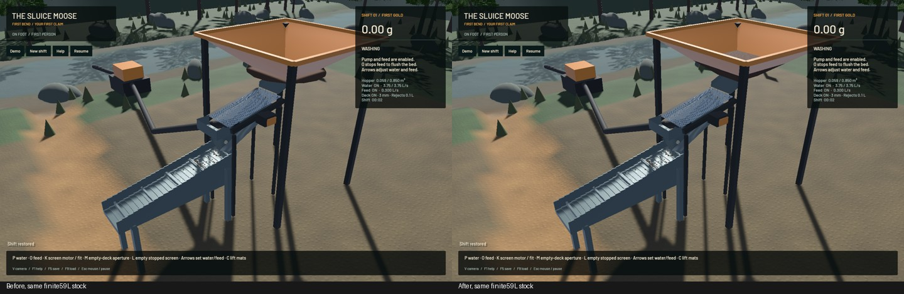
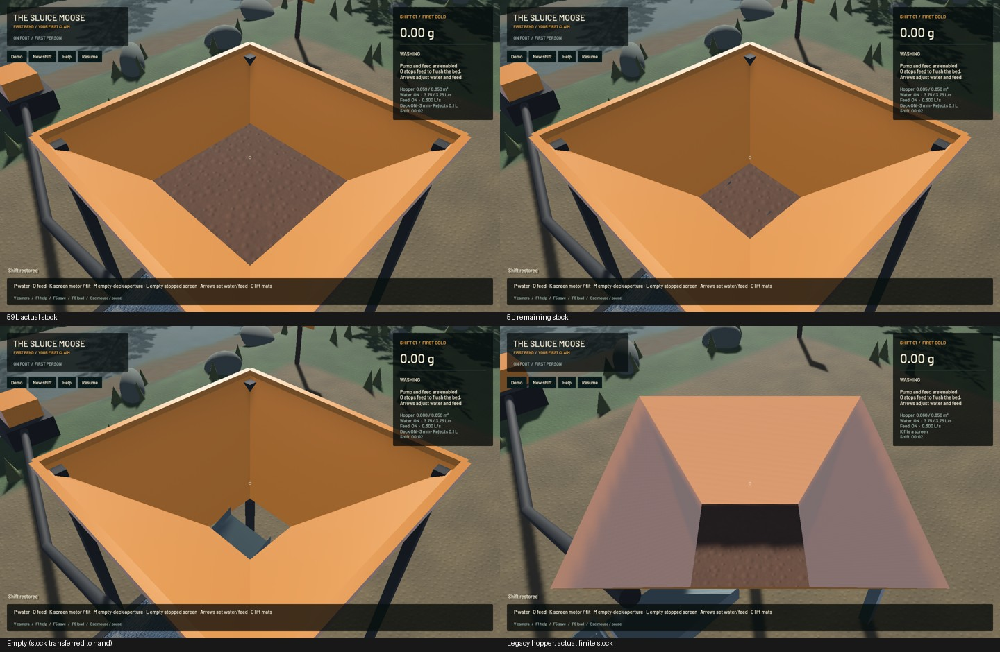

# Visible finite hopper stock

The hopper now displays its saved stock as a textured tapered volume. The former thin ellipsoid was largely hidden at the bottom. The new surface follows actual handling volume (including independent gold solids), fills the shared modern bowl or legacy diamond bowl, vanishes when empty and lowers as feeding removes stock. Existing filtered soil detail and moisture colour/roughness apply. A tiny 36–42-vertex mesh updates only when stock/circuit changes; paused unchanged stock causes no rebuild.

The current modern bowl encloses 0.5188 m³ below the rim, while the inherited handling limit is 0.85 m³. Remaining display stock forms a square pyramid above the rim rather than disappearing. This is an inventory display, not dense granular flow, heap collisions, repose calibration or a clay/clogging model. Those remain required.

**82 app tests pass**, including two new independent geometry controls across both bowls, 1 mL / 5 L / 59 L / rim / full stock and empty state. Signed tetrahedral volume differs by less than 0.2 mL after float mesh conversion in the tested cases. Strict app Clippy, formatting and signed packaging pass. Two existing opt-in diagnostics remain ignored; no full physics/workspace suite is claimed. Initial compile/lint failures and their fixes are retained in the evidence.

Reviewed actual native captures cover the unchanged 59L initial save, 5 L remaining, empty, legacy and live feeding. Low/empty fixtures conservatively transfer the same existing stock to the hand owner; they are diagnostic initial conditions, not feed-throughput tests. 39 native samples pass budget/runtime gates. The same frozen plant preserves flow, tracked water, surface samples, machine, tailings, independent gold and screen state exactly; visible hopper pixels change. The running clip uses real wall capture times and records actual decreasing hopper stock. No manual control replay is claimed in this rendering stage.

The native 20-second sample records **54.20FPS / 0.39659 physical seconds per wall second**. Material/water budgets pass; physical real time still fails. A follow-up adjacent reference/candidate pair gives 0.46974x / 0.47115x physical and 58.57 / 57.50 FPS; the first lower candidate rate is not reproduced. These short windows establish no speedup. Installation remains held and the previous signed app is untouched. All simulation and WGSL source fingerprints match the preceding checkpoint.

[Actual live feeding clip](2026-10-27-hopper-stock-motion.mp4) · [Receipt](2026-10-27-hopper-stock.json) · [Evidence](2026-10-27-hopper-stock-reports.zip)

One task-owned heavy job ran at a time, queued for global capacity. No new panic/WindowServer reports appeared. Scoped cleanup ran. The original nine dirty files, stash and installed app are exact. Only two owned tracker rows change; 260 unrelated rows remain literal. Beads 1.0.4 has no sync command; scoped rows land with the explicit verified commit.

Dense/wet hopper and deck physics, clay bridging/blinding, persistent elastic screen response, physically interacting stock, configurable shaker/trommel plants, calibration, haulage, ponds/recirculation, wet access/dewatering, bogging, slumps/deep cuts, surveys, tailings/berm/flood/bridge failures and every unfinished [operation-plan requirement](../../plans/2026-10-22-realistic-operation.md) remain active.
