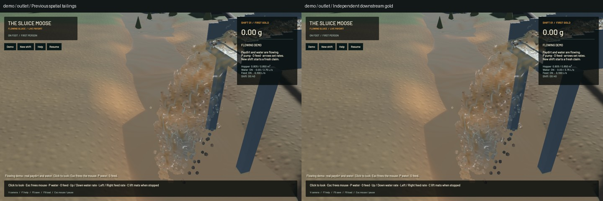
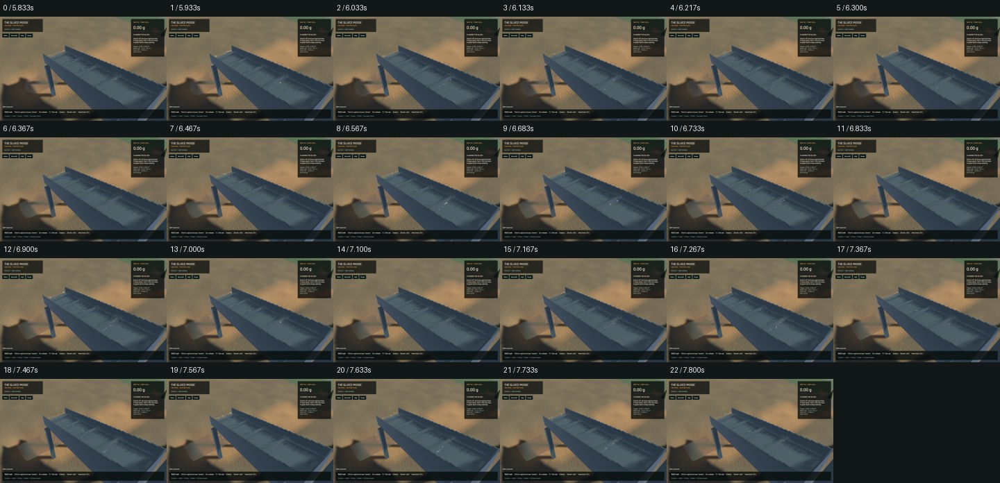
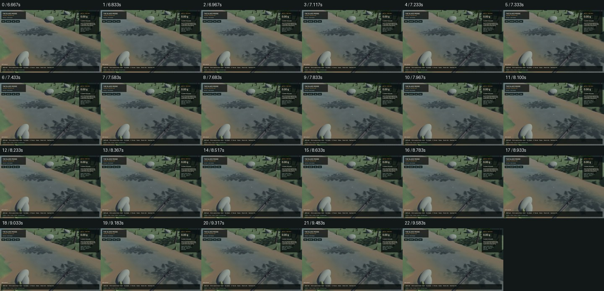

# Independent downstream gold checkpoint

Pure gold leaving the actual sluice now continues into a saved world owner. It settles in environmental water, contacts the terrain triangles, can be buried/uncovered, collected by finite cuts or mobile pump intake, and exported across the claim boundary. It does not acquire fictitious paydirt. This advances the Gold Rush operation; it does not complete realistic gold hydraulics or the full mine.

## Implemented behavior

The original in-sluice FLIP/APIC, DEM, riffle equations, terrain grid and water timestep policy are unchanged. Full outgoing Grain state is retained. The downstream model uses physical diameter rather than a weighted parcel's large collision envelope. Existing particles advance once; first-contact admission advances only the new particle through its remaining fixed time. Bed impact is localized before supported motion. Sediment burial retains the particle's actual position instead of raising it onto the new surface.

Active gold is Site inventory; finite boundary exports are counted once. Excavation/intake receipts are diagnostics rather than extra stock. Failed admission retains donors or the pre-step owner. The 65,536-particle storage limit and bounded numerical work are resource guards, never physical clogging. Modern version-13 saves retain this owner while preserving the inner mechanism version. Laboratory v12/older loads retain their existing policy; modern app loading enables the new owner. Historic pooled gold keeps its old owner because its former position/grading cannot be reconstructed.

The [model description](../physics/independent-gold.md) states the limitations: dilute one-way point parcels, depth-averaged horizontal flow, prototype terminal relaxation/friction, no resolved turbulence/lift, flakes, collisions or drag reaction on water. Bulk tool/haul/dump/intake/feed still discard individual grading and reconstruct nominal or sampled sizes. That is tracked in `menace-sfu.1.2`. These models are not empirically calibrated gold recovery.

Review also corrected pure-gold hopper occupancy, pending feed shutdown overfill, save-state flags and sub-tolerance material receipt. No hand bucket volume limit was reintroduced.

## Verification

**149 final focused checks pass:** 63 CPU, six worker, 77 application and three actual Metal regressions. Two optional app profiles remain ignored. Selected strict Clippy, changed-package formatting, signed packaging and installed smoke pass. This is not a full workspace-suite pass; the earlier bounded broad-soil attempts remain incomplete. The dependency `game` still emits its existing dead-code warning during Cargo commands.

CPU controls cover analytic free/wet motion, size/weight independence, contact/refinement, static and moving bed response, burial/uncovering including repeated 10-nm deposits, finite excavation/intake/exports, donor-safe refusal, tiny stock, pure-gold handling and exact save continuation. The flat collinear contact trial at 60/120/480/960 Hz agrees to 5.33e-15 m. This establishes the specified constant-field point model, not real gold-flake behavior.

The new real-Metal fixture debits finite geological gold and injects four separated 50/100/200/500-µm weighted parcels just beyond the buffered sluice lip. All **4 actual gold exits** match complete world state and survive airborne/world save/load. They admit 0.0135539450850381 g; final gold residual is -8.185e-12 g, bulk -7.623e-10 m³ and water 2.262e-07 m³ over 360 post-pulse ticks. This is a buffered-lip handoff control, not an inlet-through-riffles recovery assay. The 600-tick mineral test still matches 383 actual exits and the original excavation/pump/camera/live-restore GPU control also passes.

## Native inspection and throughput

Reviewed 136 native samples covering the default flowing demo, finite GPU fixture, outlet, sluice and river, plus two installed smoke frames. Every capture passes its inventory checks. All six frozen scene/view comparisons preserve flow, water tracks, surface samples and machine state. The old app receives independent gold in its old tailings pool because it cannot read v13; fixture site data is identical except the gold owner and sluice destination inventory. This pairs endpoint ownership, not identical whole runtime policies. Installed physical fields and RGB match the qualified candidate exactly.

| Paired finite fixture, 20 s after 5 s warmup | Previous spatial app | Independent-gold app |
|---|---:|---:|
| Render FPS | 57.44 | 57.28 |
| Physical seconds / wall second | 0.66479 | 0.62387 |
| Real-time acceptance | Fail | Fail |

Both runs preserve material, gold and water budgets. A single pair is not a speedup claim, and this workload differs from the preceding dense-demo/mineral fixture. Keep FPS separate from physical time.

The screenshots still show rough sluice/crest optics, conspicuous mineral proxies and a flat muddy river sheet. This stage does not improve those visuals. Native world gold is retained at physical size and can be subpixel; no artificial gold enlargement or visual motion replaces the model. No new manual controls, machinery placement or complete processing-shift replay is claimed.

## Remaining operation and evidence

`menace-sfu.1.1`, tailings parent `menace-sfu.1` and shift milestone `menace-sfu` remain in progress. Gold size/shape history, phase coupling, empirical operating assays and mineral runout/stacking need work. Next plant integration is `menace-sfu.2`: persisted modules and a first real finite hopper/screen transfer. Both trommel and shaker, upgrades, clearing/haulage, actual washout/loading/clogging, ponds/recirculation, cleanup and saved continuation remain required. Wet access/slumps, bogging, deep-cut collapse, uncertain surveys, wet-feed bridging/blinding, berm breaches, tailings instability, malfunctions and flood/bridge damage remain required future systems under `menace-9z3` and the [canonical operation plan](../../plans/2026-10-22-realistic-operation.md).

The [receipt](2026-10-27-independent-gold.json) records exact sources, gates, GPU/native/benchmark reports, install/backup identity and limits. The [compressed evidence](2026-10-27-independent-gold-reports.zip) includes final sources, input saves, frame records/contact sheets, logs and failed historical attempts. Run focused tests serially with Cargo `--jobs 1` and `--test-threads=1`; the new `mining-physics --test world_gold -- --ignored` needs a real Metal/Vulkan adapter. Set `SLUICE_WORLD_GOLD_OUTPUT` to a nonexistent directory for fixtures. Preserve original water/riffle fidelity and report actual physical throughput.

All original nine dirty files and stash remain exact; the previous signed app is backed up in the receipt. No new panic/WindowServer report appears. Required scoped cleanup has run; its exact process summary is in the receipt. Only four owned issue rows change, with 257 unrelated rows literal. Landing/push is recorded separately in the stage artifact, and the full goal remains active.
