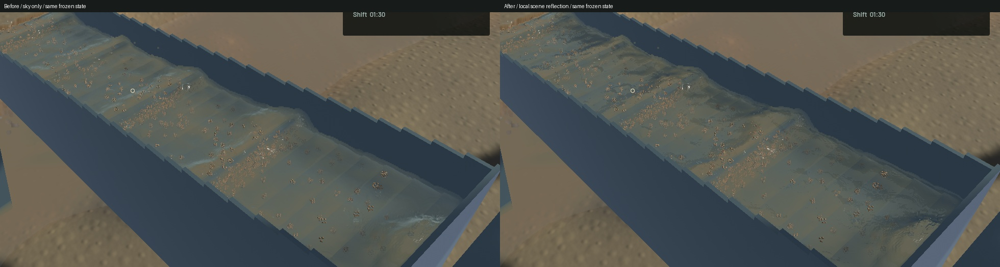
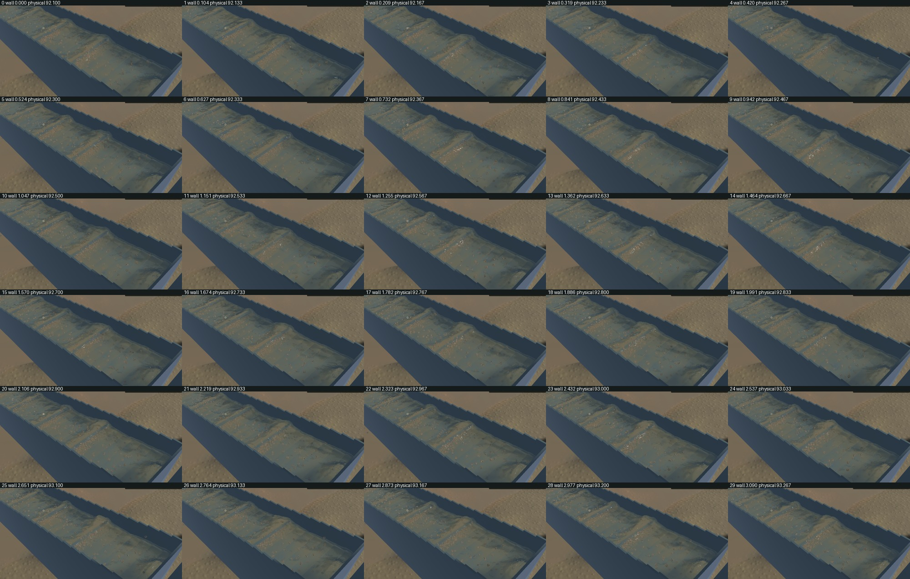
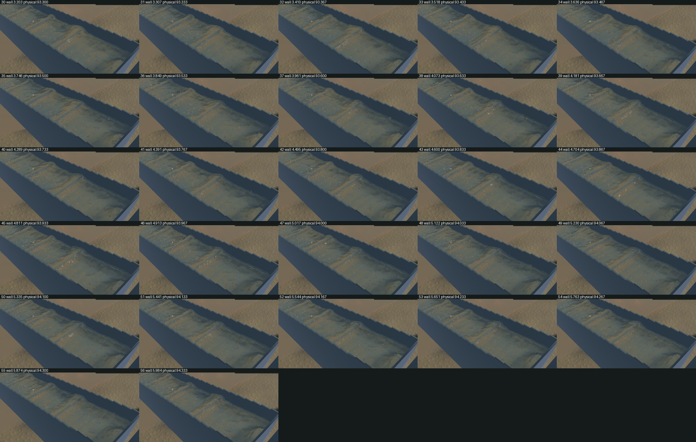

# Local water reflections and reliable capture references

Standing-wave shoulders previously reflected an azimuth-independent two-colour sky. They could look like flat grey slabs despite a joined, curved interface. Connected sluice water now reflects nearby opaque scene geometry using existing colour/depth targets, with the sky retained when the scene cannot supply a valid hit. This breaks up the broad grey shoulders without flattening the riffle waves.

The view-space ray is bounded to 0.8 m with sixteen coarse samples and five crossing refinements. A crossing must match observed depth and lie above the geometric water tangent plane. Bilinear colour taps retain the same validity checks. Screen edges and the end of the local ray fade to the sky; invalid/behind-camera origins and submerged geometry cannot supply a reflection. This is an approximate single-depth screen-space reflection using already-tonemapped scene colour, not a complete ray-traced environment. Off-screen and hidden objects remain unobserved.

The filter changes final channel lighting only. There is no new render target or pass, no authoritative particle or surface displacement, and no water/riffle/terrain/sediment/contact solver change. All 738 other starting Rust/WGSL sources remain byte-identical. The accepted detached outlet path remains intact.

## Native image and motion checks

Six frozen before/after view pairs retain identical selected physical clocks, solver steps, tracks, surface samples, machine, flow and material fields. Sluice normal, visible-column and sediment-debug RGB are byte-identical. Main sluice RGB changes at 40,577 pixels; the complete outlet camera changes at 11,732 pixels where channel water is visible. Its accepted 280 × 460 detached falling-water crop is byte-identical. The river view has 23 scattered one-level RGB changes; exact river-image identity is not claimed.

All 57 temporal crops and the full frozen views were inspected. The motion capture spans 5.984 wall seconds / 2.233 physical seconds with 56 advancing intervals and zero presentation-buffer underruns. Local reflections move with the water surface. Broad suspended plumes, grain stippling and wider environment/gameplay improvements remain open; the large physical riffle waves are retained.

The [wall-timed native preview](2026-10-27-local-reflections.mp4) includes all 57 captured sources in 366 display frames at 60 FPS, with the latest known source held until the next capture and a final hold. Its 6.1-second duration does not represent 366 simulated frames. Whole-video playback and manual controls were not rechecked. Moving before/after captures cover different physical intervals, so no identical moving-state comparison is claimed.

## Rendering performance and physics rate

| Sequential 20-second native window | Render FPS | p95 frame time | Physical / wall | Bulk and dry-mass budgets |
| --- | ---: | ---: | ---: | --- |
| Installed baseline | 56.92 | 28.60 ms | 0.37145× | Pass |
| Reflection candidate | 57.36 | 28.00 ms | 0.37658× | Pass |
| Final packaged source | 57.48 | 27.75 ms | 0.37478× | Pass |

These short local windows show similar rendering throughput; no FPS speedup is established. **All three fail the physical-real-time gate.** The final package's bulk residual is 3.977506253249885e-7 m³ and dry-mass residual 0.0007159844972193241 kg. Physics remains roughly 0.375× real time, independently of draw FPS.

The clip and six comparison pairs use the initial candidate. Subsequent strict-lint cleanup groups two ECS read parameters and changes test initializers, leaving the final shader intact. The final signed package reproduces the candidate's frozen RGB byte-for-byte, preserves its selected physical fields, and has its own native benchmark and missing-load check.

## Capture accounting correction

The first native capture exposed a misleading ledger: its reference came from `Session::new()` before the requested asynchronous load finished. That compared 807,509.0929744536 kg in the temporary new shift against approximately 807,421.62236 kg in the loaded scene. Independent saved-stock reconstruction showed the apparent 87.47 kg loss was a mixed-scene comparison, not evidence of a physical loss.

Motion capture now waits for the requested restore acknowledgement, selects its first published restored baseline before renderer warmup and records its reference simulation time. The baseline stays fixed. The first restored publication can already include one or two worker ticks; it is not claimed as an exact raw-input boundary. In the moving candidate capture, reference time is 90.4333380497992 s, bulk change 2.1554899376496905e-7 m³ and dry-mass change 0.0003880083095282316 kg. Frozen restored baselines are exact.

Opt-in motion captures now participate in automated failure handling. A worker/load/submission failure produces an error exit and a nonpass receipt rather than recording a replacement scene or waiting indefinitely for surface readiness. The actual final-package missing-save test exits in about 0.56 seconds with `passed:false`, zero frames, no reference baseline and the explicit load error. Scripted operator-control checks retain their dedicated input exception.

## Verification and remaining work

All **75 ordinary application tests**, including six new capture/readiness/error tests, pass; two optional saved-scene profiling tests remain unrun. All **21 existing explicit GPU optics tests** pass, and the new production-reflection GPU test passes **17 analytic cases** across wall, bed, sky, screen/camera and finite-range scenes. Its expected intersections are computed independently in f64 rather than by duplicating the marcher. Strict scoped application/all-target and reflection-test Clippy, formatting, whitespace and signed packaging pass. The unchanged dependency retains its existing unused-constructor warning.

The initial one-frame frozen fixture correctly failed the recorder's two-sample requirement and is retained; corrected pairs use two samples. Four new lint findings were fixed without suppression before final suite/lint/package checks. Other physical suites and full operator replay were not rerun; no new live digging-force adoption, calibration or full-game completion is claimed.

`menace-83z` and `menace-6l1` are closed. Follow-up `menace-d6y` remains open: the existing slurry presentation explicitly imposes approximately 12 cm downstream / 6 cm cross-channel footprints, which need qualification against actual suspension transport rather than cosmetic shortening. Physical real time, realistic digging work/energy/refinement gates and the broader game objective remain active.

The checked signed app is installed at `/Users/simonheikkila/Documents/12-Coding/the-sluice-moose/target/bundles/First Bend.app`; its preceding bundle is preserved. Original user files and stash remain intact. Heavy jobs ran sequentially; all owned native/compiler/encoder jobs exited, scoped cleanup ran and no new panic/WindowServer report appeared. Zero test-browser sessions remain; one shared Node process was left untouched.

Automatic review previously rejected tracker-wide sync for unrelated-state risk. This stage appends only its three scoped issue rows and preserves all 246 starting rows literally. The [receipt](2026-10-27-local-reflections.json) pins source, input, binary and check fingerprints; [individual benchmark rows](2026-10-27-local-reflections.csv) retain the failed real-time results. Full captures and logs remain under the local `crest-transport-20261027` artifact directory.
