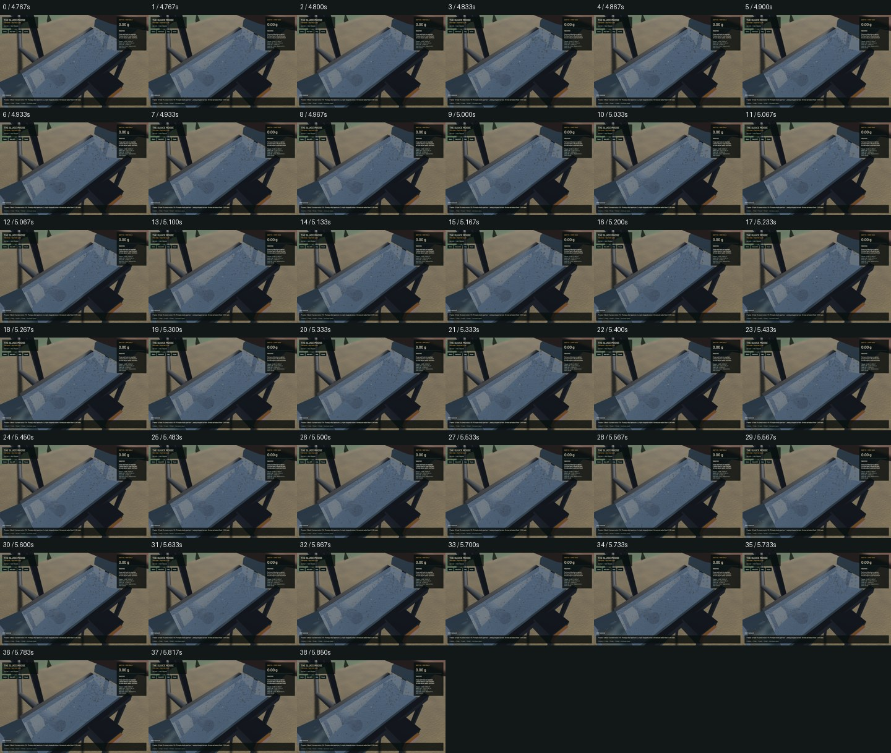
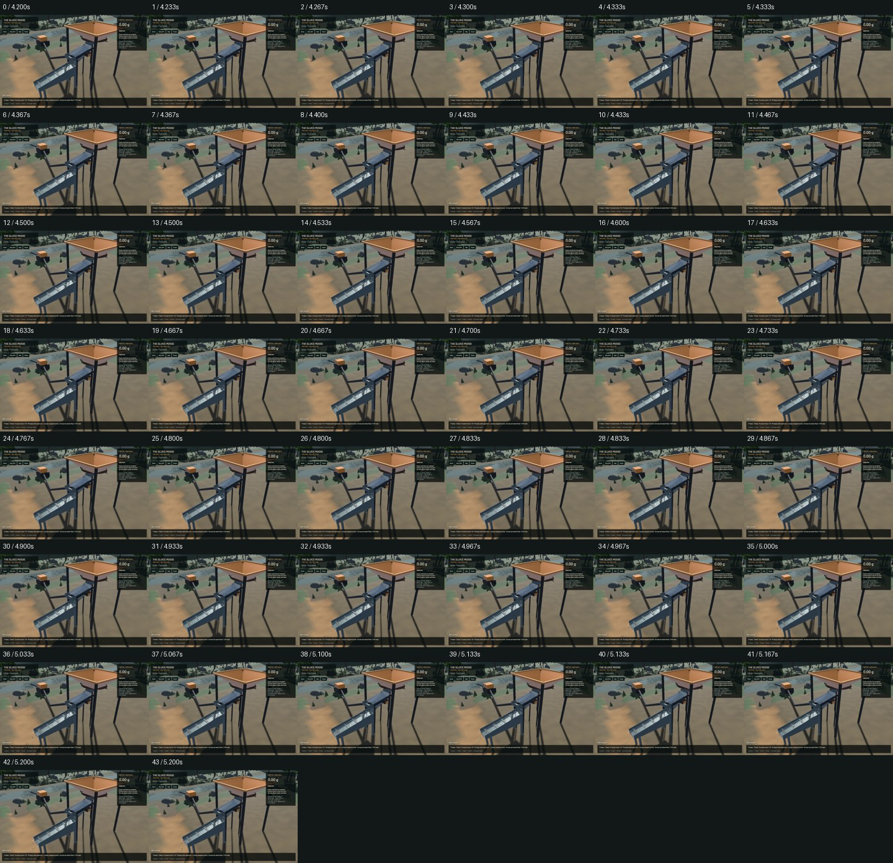

# First connected screen candidate — installation held

The finite hopper now feeds a saved moving wire screen, receiving gutter, original wet sluice and reject bin. The candidate demo includes this circuit. **This build is not installed:** the physical-time benchmark is too slow. The previous signed app stays in place. The complete Gold Rush operation remains active.

Near the hopper, on foot: **K** fits/stops/restarts the screen; **L** transfers all stopped screen stock and held water into the temporary unlimited hand; **M** cycles 3/6/12 mm apertures when stopped and entirely empty. Maintenance works while paused. F5/F9 retain finite stock, settings, phase and connections. Moving the connected sluice requires stopping and emptying the screen.

Real grain diameter interacts with moving wire capsules, gravity, friction, spin and the gutter. Oversize must contact the actual bin floor. Undersize enters the original sluice with complete position, velocity, orientation, spin and affine state; attached moisture becomes accounted feed water. Donors remain owned on refusal. Strict version14 saves retain the plant; old envelopes cannot silently hide its stock. Original water, riffle and terrain equations and numerical settings remain unchanged.

The [model and limits](../physics/plant-screen.md) describe the dilute dry screen. There is no dense bed, cohesion, clay bridging, blinding, spray/film solver, calibrated throughput/recovery, interchangeable trommel or general module placement. Simultaneous impacts explicitly use plastic response; isolated impacts retain configured rebound. Persistent elastic preload/rebound is required under `menace-sfu.2.1`. Numerical refusals are never called physical clogs. The logged GPU `collected_rejects` is the whole manual screen/bin cleanout, not a bin-only assay.

**198 focused checks pass:** 94 CPU integration, 14 contact/geometry, 6 worker, 80 app and 4 actual Metal checks. Selected strict Clippy, formatting and signed packaging pass. This is not a full-workspace suite. The 480-tick real-pay Metal route verifies 1170 complete handoffs, live plant save/restore, actual underflow and caught oversize. Gold residual -7.731e-12g; bulk 7.563e-09m³; water 1.988e-07m³.

## Performance and native review

The first native screen implementation measured about0.16x physical time while rendering around58FPS. CPU sampling found repeated contact roots and tiny matrix allocations. Stack elimination, residual-only line search, certified projected-map proposals, zero-projection early exits, immutable drive caching and conservative triangle rejection retain the existing contact tolerances, exact-phase CCD and physical step sizes. The first optimization measured0.34x on the same initial screen save, with all water/material budgets passing; evolving populations and workstation activity prevent treating these windows as controlled per-step speedup ratios.

| Final 20-second finite fixture | Previous circuit | Screen candidate |
|---|---:|---:|
| Render FPS | 57.29 | 51.92 |
| Physical seconds / wall second | 0.64722 | 0.47145 |
| Real-time acceptance | False | False |

The old fixture returns screen stock to its hopper, so these are different circuits, not a matched algorithm-only comparison. Both physical-time results are reported separately from FPS. The final screen remains below real time and is held from installation. `sluice-realtime` and `menace-sfu.2` remain in progress.

Reviewed 164 final-candidate native samples across screen, plant, sluice, outlet and river, including requested30Hz screen/plant sampling. Actual capture cadence is retained in the frame records and video. The native synthetic-keyboard replay passes pause, stop, whole cleanout, aperture change, save, reload and restart checks, with seven screenshots. This does not qualify manual driving. Three fresh frozen comparisons preserve flow, tracked water, surface samples and machine state; the earlier demo comparisons remain historical evidence. Close screen wires visibly alias and weighted grain proxies remain sparse. The finite hopper stock lacks a visible fill surface. Sluice crests/mineral proxies and river shoreline/optics remain provisional; no water-rendering improvement is claimed in this stage. The short low-flow fixture outlet view alone does not establish a natural developed discharge; the demo outlet and frame records are also retained.

[Actual native video](2026-10-27-plant-screen-screen.mp4) · [Frozen water comparison](2026-10-27-plant-screen-water.jpg) · [Receipt](2026-10-27-plant-screen.json) · [Evidence and failed historical attempts](2026-10-27-plant-screen-reports.zip)

Only one task-owned heavy job ran at a time; jobs queued when global capacity was full. No new panic/WindowServer reports appeared. Scoped cleanup ran. The nine original dirty files, stash and installed signed app remain exact. Only four owned tracker rows change/add;258 unrelated rows remain literal. Beads1.0.4 has no sync command; scoped rows are committed with the verified code instead of a tracker-wide export.

The [operation plan](../../plans/2026-10-22-realistic-operation.md) still requires wet/dense processing and clogs, trommel/shaker options and failures, configuration/upgrades, transport, constructed pads/ponds/berms/recirculation, calibrated washout/recovery, finite surveyed geology, wet access/dewatering, bogging, slumps/deep-cut collapse, tailings instability and flood/bridge failures. This candidate does not complete the goal.
