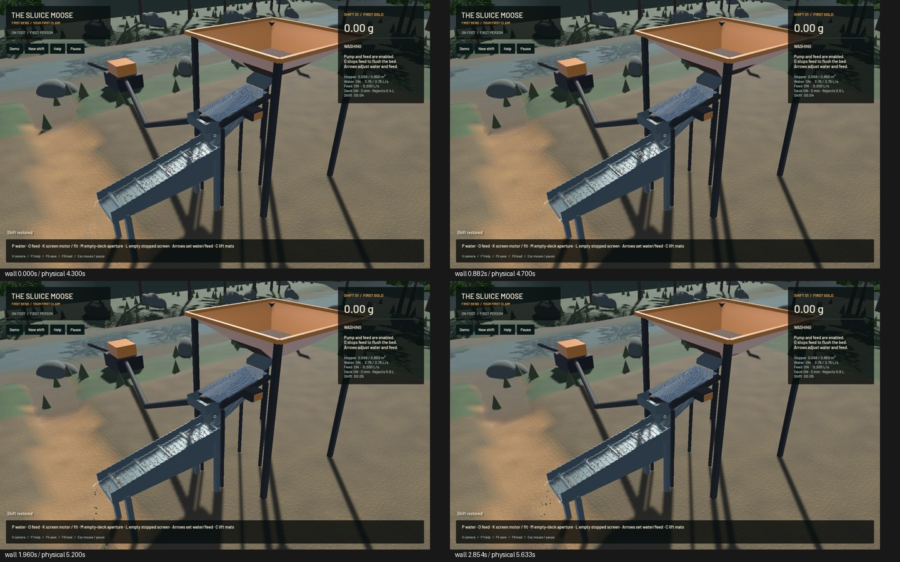

# Runtime staging and upload reuse

The solver reuses six fully refreshed host staging vectors and builds the identical resting-grain stencil once per fluid update. A duplicate P2G parameter upload is removed; both callers already prepare those exact parameters before dispatch. This reduces allocation/upload churn while preserving particle order and arithmetic. Cached capacity lives until the local solver resets and is never a saved physical owner.

All WGSL, render, mining-sim and sim3d sources match the preceding checkpoint. Original particle population, 1 cm grid, substeps, 80 pressure sweeps, riffles, contacts, terrain flow and tolerances remain unchanged. The existing probe now reports Session CPU time separately from hydraulics. The baseline measured about 9.88 ms / 21.05 ms per fixed tick; headless timing excludes rendering.

**10 actual Metal checks pass:** constant/affine transfer, sparse carrier support, conservative-phase oracle, wet feed, storage reallocation, both large-shift restores, original/conservative live pipelines and the finite screen/wet-sluice route. Selected strict Clippy, formatting and signed packaging pass. This is an affected-surface check, not a full-workspace suite.

Three complete 150-tick saved-state comparisons are exact after sorting only unique exported contact-history map keys; every other scalar, particle, cell and owned stock remains unnormalized. Two 120-tick samples per variant in A/B/B/A order give mean preparation 0.8303 ms before and 0.7803 ms after (about 6% less observed preparation time). GPU/shared-workload timing varies; this does not prove a whole-game gain.

| Native 20-second window, same input | Previous | Candidate |
|---|---:|---:|
| Render FPS |57.43|57.39|
| Physical seconds/wall second |0.48798|0.48997|
| Runtime failure |None|None|

Budgets pass and physical real time still fails. Frozen native flow, water tracks/surface samples, plant, hopper, machine and tailings match; all 1,296,000 RGB pixels match. Actual plant motion is inspected in the local build. Installation remains held and the previous signed app is exact. One motion capture was denied before launch when global capacity filled; a later single queued launch completed. No denied/pending check counts as passed.

A 64-thread G2P layout experiment also preserved complete states, but timings drifted across unrelated GPU stages and did not establish its benefit. Both host/shader changes were rejected and restored exactly. The original 128-thread layout stays. GLM reviewed only source verified publicly downloadable without authentication at the pushed baseline. Its allocation/upload suggestions were checked; the cell-type-reset removal suggestion was rejected because the fluid pass writes that buffer. Two bounded patch-generation requests reached deadlines with no response, so root implemented the focused changes. No unpublished source was sent to GLM.

[Receipt with checks, timings, exact-state hashes and public-source provenance](2026-10-27-runtime-uploads.json). Detailed local evidence is retained under `/Users/simonheikkila/.codex/visualizations/2026/10/18/01a14ce3-309f-7782-9a7c-ccd0efaf3227/gpu-runtime-20261027`. Reproduce the probe with the `fixtures/modern.save.json` entry in the preceding hopper-stock evidence ZIP: `cargo +nightly run -p mining-physics --example flow_probe --profile playable --locked --jobs 1 -- INPUT 120 OUTPUT 30`. GPU timestamps use `SLUICE_PROFILE_GPU_TIMESTAMPS=1`.

Only one task-owned heavy job ran at a time. Scoped cleanup ran; no new panic/WindowServer report appeared. Nine original dirty files, stash and installed app are preserved. Only `sluice-realtime` changes in the tracker; 261 unrelated rows remain literal. Beads 1.0.4 has no sync command; the scoped row lands with the verified code.

The complete [realistic mining operation](../../plans/2026-10-22-realistic-operation.md) stays active: real-time fidelity, dense/wet hopper and screen behavior, elastic response and calibration, grading/haulage, configurable shaker/trommel plants, repairs/upgrades, surveyed finite pay, wet access/dewatering/bogging/slumps/deep cuts, constructed pads/ponds/recirculation, tailings/berm instability and flood/bridge failures remain required. This checkpoint does not close those requirements.
