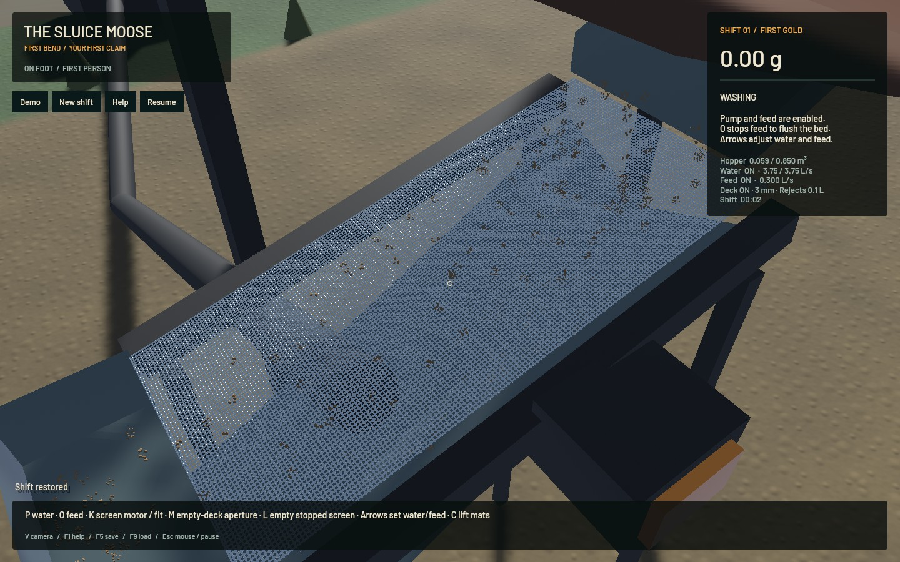

# Exact screen CPU optimization — installation remains held

Shared exact drive endpoints and recursive midpoints remove repeated trigonometry from the wire contact search. Evaluated values are reused only at identical floating-point times; the original phase arithmetic order, continuous contact search, intervals, skin, friction, restitution and work limits remain. Original water, riffle and terrain solvers/settings are untouched.

**47 affected checks pass:** 15 contact/geometry, 31 screen/feed/plant integration and 1 actual Metal route. Selected strict Clippy, formatting and signed packaging pass. The new 2048-case contact control compares hit time, normal, surface velocity, index, refusal and query work exactly with the uncached method. A bounded `screen_replay` diagnostic restores finite saved screen stock and adds no feed. All 360 complete states over 120 ticks each in warm, loaded and stopped cases match byte-for-byte, including every particle, output, inventory and work counter. Initial/final states also match. This is not a full-workspace suite.

The 480-tick actual Metal route retains 1170 full-state handoffs and live plant restore. Both full saved fixtures match the previous candidate after sorting only unique keyed contact-history rows exported from HashMaps; no particle, cell or scalar values are normalized. Gold residual−7.73e−12g, bulk7.56e−9m³, water1.99e−7m³.

| Finite stock, median CPU seconds /120 ticks | Reference | Candidate | Reduction |
|---|---:|---:|---:|
| Warm |0.36318|0.33872|6.73%|
| Loaded |0.76072|0.70112|7.83%|
| Stopped |0.51770|0.48044|7.20%|

A/B/B/A order gives six samples per variant and case. All raw timings/outliers are retained. Timers exclude cloning and JSON/disk. This isolates screen step cost; it does not measure whole-game speed or dense/wet processing.

| Native 20-second window, same initial save | Render FPS | Physical seconds / wall second |
|---|---:|---:|
| Reference A |57.17|0.46162|
| Candidate B |54.54|0.47663|
| Candidate B |56.71|0.44275|
| Reference A |56.50|0.44636|

All four runs retain material/water budgets and have no runtime failure. **There is no consistent native whole-game gain and real time still fails.** These short windows do not qualify the required 60-second acceptance. The previous signed independent-gold app remains installed; this screen candidate is held.

Frozen restored native physical fields and all 1,296,000 RGB pixels match the previous screen candidate. The new motion recording contains 39 actual frames over 1.997 wall seconds and 1.017 physical seconds; its video uses recorded wall timing. The developed outlet recording contains 17 frames over 2.838 wall seconds and 1.167 physical seconds. Capture overhead affects cadence. Synthetic Bevy keyboard events pass 10 maintenance/save/restart checks with 7 screenshots; OS focus, key delivery and manual driving are not exercised.

Visual inspection confirms moving but sparse grain proxies, strong fine-wire aliasing and provisional outlet/river optics. No rendering improvement is claimed. Finite hopper inventory still needs a visible surface. Dense slurry, persistent elastic screen response, wet clay/clogging/blinding, empirical calibration, flexible wash-plant modules and all other operation/failure requirements remain open in the [operation plan](../../plans/2026-10-22-realistic-operation.md).

[Actual wall-time motion](2026-10-27-screen-throughput-screen.mp4) · [Receipt](2026-10-27-screen-throughput.json) · [Evidence/reproduction inputs](2026-10-27-screen-throughput-reports.zip)

One task-owned heavy job ran at a time and queued for global capacity. No new panic/WindowServer reports appeared. Scoped cleanup ran; unrelated processes were preserved. The nine original dirty files, stash and installed app remain exact. Only two tracker rows change, 260 unrelated literal rows remain. Beads 1.0.4 has no sync command; scoped rows land with the verified commit. Raw large traces and redundant endpoint saves remain local with hashes; the archive contains finite input states, metrics, scripts, logs and native evidence to reproduce them.
