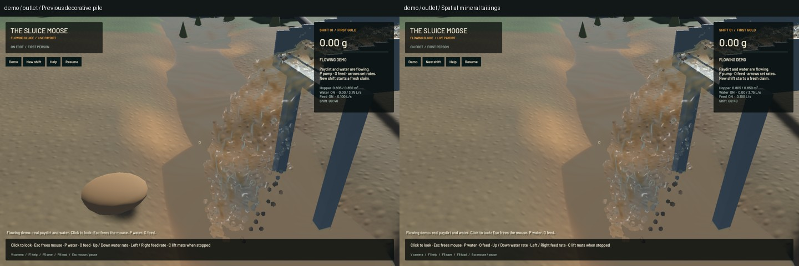
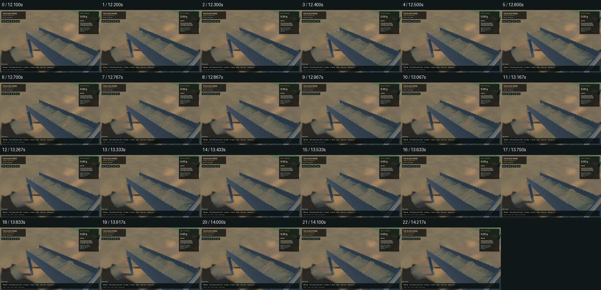
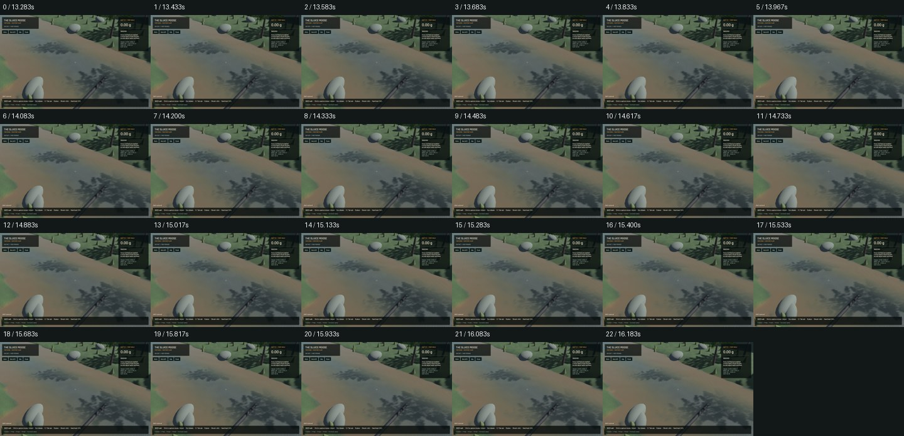

# Spatial mineral tailings and the remaining full operation

Actual outgoing sluice grains now retain their complete world-space state and gravity flight. Gold-free packets enter the real terrain bed or water suspension at first contact. The old decorative pile is removed from new/demo operations. This is a usable mineral-discharge integration step; it does not complete tailings mechanics, independent downstream gold, plant modules, wet failures or the full playable shift.

## Ownership and compatibility

The reflected downstream/up/right grid basis transforms polar velocity and affine state with B, angular velocity with det(B)B, and proper grain rotation with BRBᵀ. Diameter, represented stock and pore water remain intact. Removal reserves the complete outgoing batch and validates every world packet before removing donors. A finite 65,536-packet numerical storage guard retains the full batch on refusal and allows saving; it is not a physical hopper or clogging law.

Flight resolves the first crossing of bilinear ground/water, split at grid boundaries. A quadratic root finds interior impacts even when both endpoints are clear. Boundary exits are explicit exports. Dry impacts use a four-node local receiving footprint and positive bed remainders; wet impacts enter existing class suspension. Raising the bed preserves free water, mobile inventory and horizontal water momentum. Cumulative release/receipt diagnostics are never counted again as inventory.

**Gold needs its own downstream model.** Review caught that existing terrain gold is class-3 paydirt provenance, whereas these mineral tailings use classes 0–2. Putting independent gold there could strand it. Gold-bearing packets therefore retain their complete first-contact state in saved `contact_pending` custody, counted once and omitted from simulated-motion rendering. They do not continue settling, advect, become recovered gold or support re-excavation. Pending contacts share the numerical storage bound. No fictitious mineral carrier is added. Follow-up `menace-sfu.1.1` must integrate water/contact, independent bed ownership, excavation, intake/export and cleanup before the tailings parent can close.

The version-12 envelope retains the validated inner mechanical version 6–11 plus flight/contact ownership. New/demo shifts enable it. A playable worker already in spatial mode migrates an older loaded shift before replacing current state; invalid migration retains the current shift. Direct laboratory `Session::new` and legacy loads preserve their existing policy. Historical pooled minerals are reconstructed once at the former visible pile location, preserving water and leaving historical gold in its original owner. Old particle trajectories and grading were discarded and cannot be reconstructed. This is explicit historical reconstruction, not observed old deposition.

## Verification

Ten focused tailings CPU checks, six worker checks, 77 application checks and two unique real-Metal regressions pass (95 final focused checks). Two optional application profiles remain ignored. Controls cover reflected motion, analytic/refined flight at 30/60/240 Hz, interior ridge contact, wet/dry handoff, sub-ULP bed/water custody, numerical admission refusal, first-contact gold retention, exact saved continuation, inner mechanical guards, legacy policy and migration refusal. Selected strict Clippy, changed-package formatting, signed packaging and installed smoke pass. The dependency `game` still emits its existing dead-code warning during Cargo commands; this is not a warning-free whole-workspace gate.

The actual 600-tick GPU run records **383 complete exit callbacks**, matches every admitted world packet field, restores live flight and continues 1,200 sluice solver steps. It receives 0.000518017992983198 m³ of mineral stock, with bulk residual 4.720106971944915e-9 m³, dry-mass residual 8.391914889216423e-6 kg, gold residual -6.366462912410498e-12 g and water residual 2.738987046058128e-7 m³. This short trial discharges soil; it does not establish downstream gold or gravel kinetics. The existing original excavation/pump/camera/live-restore GPU regression also passes.

An additional 28 soil-water, subgrid-bed, track and water controls passed earlier in the stage. Two broader serial CPU attempts hit their unchanged 300-second supervision deadlines. Twelve completed binaries pass 181 checks; activation, bank scoop/hold/discharge and two tumbling cases complete. The delayed-input soil case and remaining broad-suite work are incomplete. **The full CPU suite is not passed.** No crash report accompanied either deadline; no retry loop or resource-limit relaxation was used.

## Native inspection and throughput

Reviewed five motion contact sheets and six paired frozen scene/view comparisons: 139 native samples across the original demo, a finite GPU-qualified shift, outlet, sluice and river. Each capture passes its inventory checks. The 918 matched sampled flight transitions agree with ballistic continuation to 9.369526553479908e-6 m position and 5.584023892168943e-7 m/s velocity. Those checks establish flight, not post-impact drag/contact dynamics. Two installed smoke frames match qualified candidate physical fields and RGB exactly.

All six frozen comparisons preserve water tracks, flow metrics, surface samples and machine state exactly. The three qualified-fixture views and demo river RGB are exact. Demo outlet/sluice pixels change where the fake pile and reconstructed terrain differ. The paired qualified saves retain identical site/sluice state except destination inventory: the old app receives active flight stock in its old pool because it cannot read version 12. Their whole endpoint policies are therefore not identical.

| Paired finite-shift benchmark | Previous app | Spatial mineral tailings |
|---|---:|---:|
| Render FPS | 57.42 | 56.84 |
| Physical seconds / wall second | 0.58980 | 0.59648 |
| Real-time acceptance | Fail | Fail |

Both 20-second measured runs (after five-second warmup) pass material, dry-mass, gold and water budgets. Sluice water residual is zero in the candidate. One pair does not establish a speedup. The older dense-demo benchmark from the carrier stage is a different workload and is not this comparison. Existing water appearance remains provisional; brown sheets/crest optics and terrain edges are not fixed by this stage. No new manual driving, placement or complete mining/processing replay is claimed.

## Remaining physical and gameplay work

Jet/air drag, solid/water impact momentum coupling, shape contact/runout, repose, compaction, size-resolved downstream grains, re-entrainment and independent gold remain unqualified. The terrain receiver uses its existing coarse material classes after first impact. This is not a validated tailings-pile stability, blocked-outlet, wet-soil or pond-failure model.

The canonical operation plan now includes the user's additional requirements: wet slumps and inaccessible pay, bogging/recovery, deep-cut collapse, uncertain surveys of varying finite deposits, wet-feed hopper/chute bridging or plugging and screen blinding, berm breach/overtopping, unstable/obstructive tailings, plant malfunctions and floods washing out bridges. Moisture response must depend on material and geometry, with actual drainage/clearing/repair and saved stocks; these models are not implemented by this checkpoint. They are tracked in `menace-9z3`. Persisted plant modules/first screen are `menace-sfu.2`. Parents `menace-sfu.1`, `menace-sfu` and the full operation epic remain in progress.

The full [operation acceptance plan](../../plans/2026-10-22-realistic-operation.md) still requires stripping, separate spoil/pay stocks, haulage, both screen types, physical modifications/upgrades, sluice loading/clogging and gold washout, constructed ponds/recirculation, cleanup and continuation. No unfinished stage is closed here.

## Reproduce and evidence

Use one heavy job at a time with Cargo `--jobs 1` and tests `--test-threads=1`. Run `cargo +nightly test -p mining-sim --test tailings --profile playable --locked --jobs 1 -- --test-threads=1`, the `mining-physics` library `worker::tests`, and the ignored `spatial_tailings` integration test with an actual Metal/Vulkan adapter. Set `SLUICE_TAILINGS_OUTPUT` to a nonexistent directory to emit matched modern/legacy endpoint fixtures. Replay that modern save with the app's ordinary `--load`, `--capture-motion` and `--capture-view` options; use `--freeze` for fixed physical-state comparisons. Do not substitute rendered FPS for physical throughput.

The [receipt](2026-10-27-spatial-tailings.json) records all source fingerprints, gates, benchmark reports, native comparisons, install/backup identity and limitations. The [compressed evidence](2026-10-27-spatial-tailings-reports.zip) includes qualified input saves, final changed sources, native records, checks, historical failed attempts and capture sheets. The previous complete signed bundle is retained in the receipt's backup location. Required cleanup reports no browser/test/Playwright processes and four unrelated Node processes left untouched. Original nine dirty files and stash remain exact; no new panic/WindowServer diagnostic appears. Only six owned tracker rows change; 254 unrelated raw lines remain literal. Commit/push identity is recorded separately in the stage artifact landing receipt.
