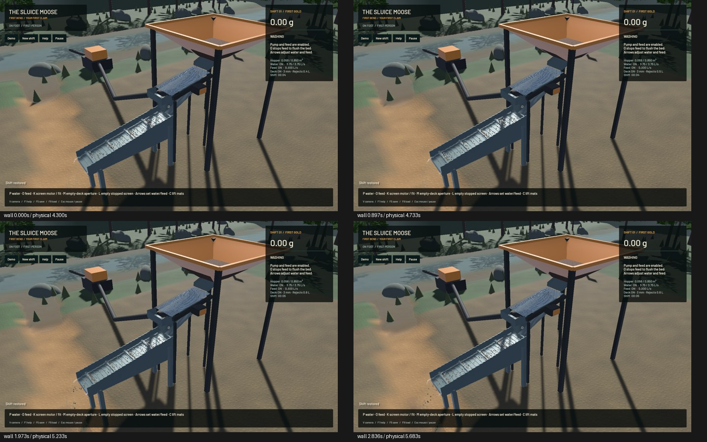

# Direct particle upload staging

Full and contact-range uploads now fill wgpu's mapped staging directly, removing five temporary padded CPU vectors and their extra copies per nonempty upload. Parcel volume, XYZ, velocity and all affine columns retain the same bytes and offsets. Independent short input lengths, density upload, particle limits, original submission order and empty-input behavior are preserved. The original vector/write path remains the fallback if direct staging is unavailable. Staging views drop before the next upload/submit; byte copies assume no staging alignment. GPU staging allocation itself remains.

All WGSL, render, mining-sim and sim3d sources match `e82d2e1`. Water particles, 1 cm grid, substeps, 80 pressure sweeps, riffles, contacts, terrain flow and tolerances stay unchanged. Readback still uses the existing joined mapping, required per-substep grain dependency and polling.

**14 actual Metal checks pass**, including two new raw transport tests, constant/affine transfer, joined full/suffix readback, mixed phase conservation, wet feed, storage growth/restores and the finite screen/wet-sluice route. The raw tests cover empty/short/growing inputs, limits, untouched prefixes/tails, volume defaults, affine columns, signed zero and NaN payload bytes without dispatching physical shaders on those nonphysical sentinels. Strict selected adapter Clippy and formatting pass; 98 existing game warnings remain visible with zero primary diagnostics on changed lines. Only the three changed game functions are checked for formatting. Signed packaging passes. This is affected-surface verification, not a full-workspace suite.

Three complete 150-tick saved-state comparisons are exact after ordering only unique exported contact-history keys. No particle/cell order or scalar is normalized. Short A/B/B/A 120-tick probes report median fluid/readback 14.485ms before and 14.088ms after. They show a modest observed reduction under shared-load variability, not a robust whole-game improvement. The owned CPU sample includes startup and is not used for steady-state percentages.

| Native 20-second window, same save | Previous | Candidate |
|---|---:|---:|
| Render FPS |57.03|57.27|
| Physical seconds/wall second |0.49317|0.49634|
| Runtime failure |None|None|

Both physical real-time gates fail. Installation remains held; the previous signed app is exact. Frozen native physical fields and every RGB pixel match. Actual plant motion is inspected; this does not establish empirical hydraulic/screen calibration or a new visual-quality improvement.

GLM 5.3 completed a focused review of source verified publicly downloadable without authentication at the baseline; tools were denied. Its blocking-channel wait suggestion was rejected: wgpu23 callbacks need submission/device/instance polling, which this worker explicitly performs. A plane-major readback suggestion remains unadopted without measured benefit. One bounded direct-upload patch request reached 120 seconds with no output, so root implemented and tested this helper. No unpublished source was sent. Installed wgpu23 API source supports direct staging's drop/submit contract and the callback-pumping requirement.

[Receipt](2026-10-28-direct-upload.json). Full local saves, logs, public-source provenance and images remain under `/Users/simonheikkila/.codex/visualizations/2026/10/18/01a14ce3-309f-7782-9a7c-ccd0efaf3227/gpu-readback-20261028`. Reproduce affected GPU checks with `cargo +nightly test -p mining-physics --test particle_upload --test fluid_momentum --test transfer_consistency --test carrier_support --test phase_gpu --test wet_material --test storage_growth --profile playable --locked --jobs 1 -- --ignored --test-threads=1 --nocapture`. For full probes, use `fixtures/modern.save.json` in the preceding hopper-stock evidence ZIP with `flow_probe INPUT 120 OUTPUT 30`.

Only one task-owned heavy process ran at once; no new panic/WindowServer report appeared. Scoped cleanup ran and leaves unrelated processes alone. Original nine dirty files, stash and installed app are preserved. Only `sluice-realtime` changes; 261 unrelated tracker rows remain literal. Beads 1.0.4 has no sync command; the scoped row lands with the checked code.

The complete [realistic operation](../../plans/2026-10-22-realistic-operation.md) stays active: dense/wet hopper and screen behavior, elasticity/calibration, grading/haulage, configurable wash plants, repairs/upgrades, surveyed finite pay, wet access/dewatering/bogging/slumps/deep cuts, pads/ponds/recirculation and tailings/berm/flood/bridge failures remain required. Next measure CPU Session/plant/world costs alongside remaining GPU work; physical fidelity remains mandatory.
