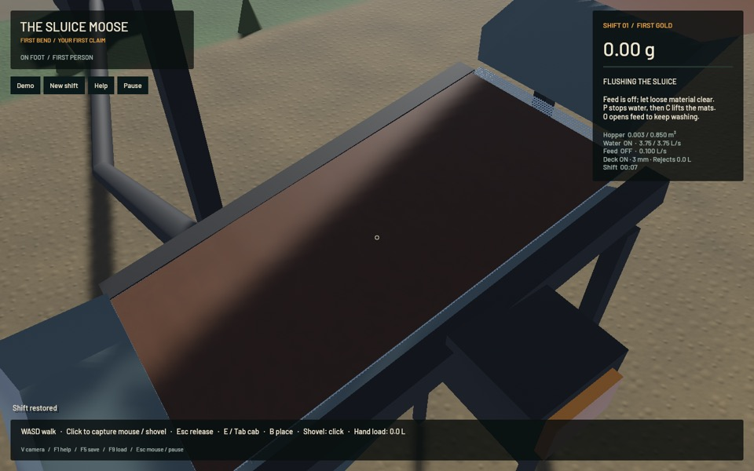
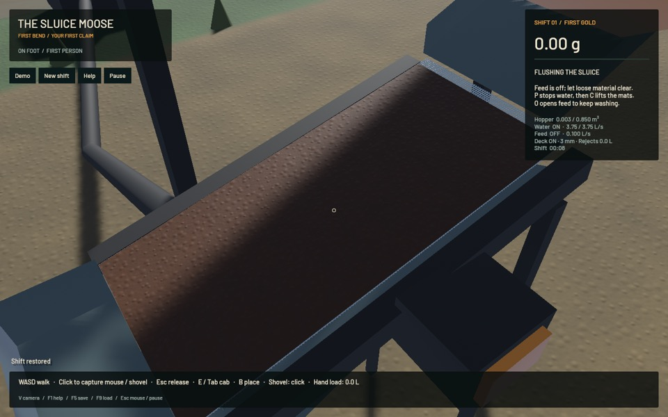

# Finite screen-bed loading and presentation — 28 October 2026

The opt-in bulk shaker now uses the same conservative, smooth finite-stock field for loading and visible bed depth. Wet load can redistribute and leave the deck. Its basal adhesion scales with the estimated contact layer rather than treating every internal grain as glued to the deck. The default remains the detailed wire screen; original wet-sluice/riffle and terrain solvers are unchanged.

The full realistic placer mine goal is **active and incomplete**. This is an integrated experimental stage, not calibrated screening, high-quality final graphics or real-time gameplay. The current native loaded window reaches **57.26 FPS / 0.464364× physical time**; the real-time gate **FAILS**.

## Physical representation and saved continuation

Resident finite parcels remain the sole owners of mineral volume, gold and pore water. A positive C1 smoothstep partition deposits that stock into the existing 16×4 cells; all basis functions integrate to the same cell area, including edges. Surface depth integrates to the actual represented handling volume, including gold once. Field coordinates follow the deck tangent so normal vibration does not spuriously change cells.

The pressure operator uses matching deposition/gather weights and a skew-symmetric central stencil with zero-pressure exterior. Its symmetric mass/volume term gives zero self-force and equal/opposite forces for mixed-density pairs. These checks do not prove angular momentum, exact energy, dense contact, packing or empirical material accuracy. Newly landed parcels enter the next field deposition before receiving field pressure.

The revised transport law uses wet inertial mass and a contact fraction d/(d+h) for basal adhesion. A thick sheet therefore has an area-limited basal force instead of an artificial force proportional to all bonded layers. Intrinsic adhesion still affects the assumed bonding/blinding/passage law. The assumed 25 Pa soil yield and this contact fraction require calibration; no cohesive fracture, explicit compaction, spray-water solver or resolved bulk actuator-work audit is claimed.

Saved detailed circuits remain model 1. Missing projection in an older bulk save selects model 2 and retains its original arithmetic/law. New opt-in bulk circuits explicitly use model 3. Plant validation rejects inconsistent declarations rather than silently changing physics. Three 90-tick dry/wet/coarse standalone bulk continuations match the pre-change full physical states exactly, excluding only the newly explicit legacy configuration tag. Hashes are in the [JSON receipt](2026-10-28-screen-bed.json).

## Presentation and native inspection

A closed mean envelope replaces supported on-deck point glyphs. Its local mesh volume independently matches field stock (about 0.001024 m³ in the renderer control, 7,480 triangles), while airborne and product markers remain visible. The bed and wire deck interpolate the same recorded physical drive clock. Paused/cleaned/restored states invalidate the appropriate field and geometry; rendering never owns more material.

Actual material composition and moisture set colour and roughness. Wet absorption is applied once in linear light. Existing filtered soil albedo/normal textures are shared at quarter-metre repeat; valid tangent frames add millimetre-scale lighting detail without adding geometry, physical volume, collision or image assets. This remains a mean surface: individual mixed gravel shapes, packed/clay fracture and mature plant art are unqualified.

| Before surface detail | After surface detail |
| --- | --- |
|  |  |

These are actual native captures from the same wet fixture, with live simulation advancing; they are appearance observations, not matched-clock pixel comparisons. First/middle/last frames and the running whole-plant view were inspected. The final sequence has 43 frames, 1.500 seconds of physical progress, no pause/failure and ready water snapshots throughout. Bed stock falls from 0.400 L to 0.364 L as finite stock moves off the deck. Native gold error is -1.09e-11 g; whole-water error 2.21e-07 m³.

The capture cannot independently prove high-frequency animation fidelity: 14 latest-state drive gaps exceed half the 12 Hz period, and latest telemetry differs from the interpolated presented clock. A small local VFR clip retains measured wall timing. It is a macro preview, not validation of 12 Hz movement. Raw PNGs and generated saves are removed/archived after inspection.

## Checks and actual plant circuit

- **154 domain CPU checks:** 100 library, 13 bulk-screen, 10 intake, 11 plant, 11 screen and 9 screen-feed checks.
- **99 app checks**, including independent mesh volume, tangent/normal validity, recorded oscillator frame, finite interpolation, supported-marker uniqueness, cleanout, controls, save/motion validation and existing render tests. Two unrelated profiling tests remain ignored and are not counted as passes.
- **Three actual Metal circuit checks:** default detailed and opt-in bulk feed/gutter/original-wet-sluice routes plus actual dug wet overburden, river-water withdrawal, saved live plant and operator stopped cleanout.
- **256 distinct passing checks total**, scoped strict Clippy (`--no-deps`), formatting of the 11 changed Rust files and a final native build. Previously observed workspace-format/dependency lint failures remain outside this scope and are not reported passed.

The eight-second dry circuit transfers 1,013 complete grain states into the original wet sluice in model 3 versus 1,170 in detailed model 1. Bulk gravel underflow is -30.451866% relative to detailed; screen-passed gold differs +0.118912%. These are **screen outputs, not sluice gold recovery**, and the detailed model is itself an uncalibrated dilute reference. Similar gold output does not validate the substantial gravel discrepancy.

The wet circuit digs 0.002997000032 m³ of actual overburden, withdraws 0.000672907569 m³ of actual river water and passes finite stock through the real hopper/plant. It retains 0.000386 m³ on-deck at save, restores the active plant exactly and verifies actual stopped cleanout. Bulk, gold and water errors stay within the existing circuit budgets. No fictitious incoming dirt/water, recovery multiplier or hidden cleanup deletion is used.

## Loaded native performance and limits

One separate 60-second native window with `--bulk-screen` gives 57.26 FPS, 28.37 ms p95 rendered frame, 27.867 physical seconds / 60.010 wall seconds = **0.464364×**. Worker busy fraction is 0.9940, mean worker packet 71.10 ms; mean water-surface build is 101.15 ms. Runtime failure is null; pause is false; water surface and material budgets pass. The overall `passed` flag and process exit 1 correctly record the failed real-time gate.

This window is not a fresh paired comparison with the previous detailed/legacy bulk windows; it supports no causal percentage speedup claim. Original FLIP/APIC, CPU DEM, terrain flow/erosion/transport/collapse, marker volume, water resolution and riffle fidelity are retained. No installed app or default-setting change is made.

Next qualify per-size/mixed/packed/wet bulk transport and grading, then finite full-width active-bed/cohort ownership, shear/impact/undercut/cleanout wake, displacement/porosity and lane/head/periodic-water feedback. Continue excavation and actual machines/logistics, building pads, survey-dependent deposits, wet-ground access/slump/bogging/collapse, plant modification/maintenance, settling ponds/berm breaches, tailings obstruction, floods/bridge failure and complete saved operator gameplay. Parent issues remain in progress.
